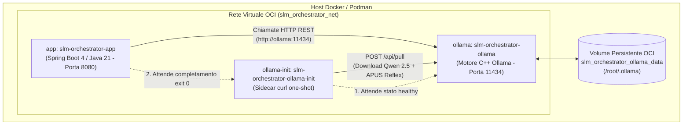

# Guida alla Dockerizzazione di SLM Orchestrator

La presente guida spiega nel dettaglio come utilizzare l'infrastruttura di containerizzazione di **SLM Orchestrator**, come interagiscono i servizi tra loro, cosa accade durante il ciclo di vita dei container e quale configurazione scegliere in base all'hardware a disposizione.

---

## 1. Architettura dei Container e Componenti

L'infrastruttura containerizzata gestisce sia il backend applicativo (Spring Boot 4 / Java 21) sia i modelli linguistici locali (SLM/LLM) in modalità **100% offline**, senza dipendenze cloud e senza secret.

L'architettura è composta da **3 servizi**, **1 rete virtuale isolata** e **1 volume persistente**:



### I Servizi nel Dettaglio

| Servizio | Immagine | Ruolo e Responsabilità |
| :--- | :--- | :--- |
| **`ollama`** | `ollama/ollama:latest` | Motore di inferenza locale. Esegue i tensori dei modelli GGUF (generativi e decisionali), mappa i pesi in memoria RAM/VRAM ed espone le API REST sulla porta interna `11434`. |
| **`ollama-init`** | `curlimages/curl:latest` | **Sidecar one-shot**. Si avvia non appena `ollama` diventa *healthy*, richiede il download (`/api/pull`) dei modelli necessari e termina immediatamente (`exit 0`). |
| **`app`** | `slm-orchestrator:latest` (da [`Dockerfile`](file:///home/del/Projects/slm-orchestrator/Dockerfile)) | Backend Spring Boot dell'orchestratore. Espone l'API REST `POST /api/orchestrator/process` sulla porta `8080`, convalida gli input, applica le guardie simboliche ed esegue le pipeline YAML. |

---

## 2. Perché ci sono 2 File Compose e Quale Usare?

Nel repository sono presenti due file di configurazione Compose:
1. [`compose.yaml`](file:///home/del/Projects/slm-orchestrator/compose.yaml)
2. [`compose.gpu.yaml`](file:///home/del/Projects/slm-orchestrator/compose.gpu.yaml)

### Perché non un solo file?
Docker Compose non consente di rendere opzionale la richiesta di una GPU fisica: se la sezione `deploy.resources.reservations.devices` con driver GPU viene inserita nel file principale, qualsiasi utente privo di scheda grafica NVIDIA o del software *NVIDIA Container Toolkit* vedrà fallire l'avvio con l'errore:
```text
Error response from daemon: could not select device driver with capabilities: [[gpu]]
```
Separando la configurazione tramite il pattern **Compose Overlay / Override**, il sistema garantisce portabilità universale.

### Tabella Decisionale: Quale Usare?

| Hardware & Sistema Operativo a Disposizione | File da Usare | Comando di Avvio |
| :--- | :--- | :--- |
| **PC/Server standard senza GPU NVIDIA**<br>*(CPU Intel/AMD, Linux, Windows WSL2, VM Cloud standard)* | [`compose.yaml`](file:///home/del/Projects/slm-orchestrator/compose.yaml) (Solo CPU) | `docker compose up -d` |
| **Mac con Apple Silicon**<br>*(M1, M2, M3, M4)* | [`compose.yaml`](file:///home/del/Projects/slm-orchestrator/compose.yaml) (CPU/Metal emulation) | `docker compose up -d` |
| **PC/Server con GPU NVIDIA dedicata**<br>*(GeForce RTX, Quadro, Tesla + NVIDIA Container Toolkit installato)* | [`compose.yaml`](file:///home/del/Projects/slm-orchestrator/compose.yaml) + [`compose.gpu.yaml`](file:///home/del/Projects/slm-orchestrator/compose.gpu.yaml) | `docker compose -f compose.yaml -f compose.gpu.yaml up -d` |

---

## 3. Cosa Succede Dietro le Quinte (Ciclo di Vita Step-by-Step)

Quando si esegue il comando di avvio, Docker orchestra l'avvio in sequenza coordinata:

### Fase 1: Creazione Rete e Volume
1. Viene creata la rete virtuale isolata `slm_orchestrator_net` (driver bridge).
2. Viene allocato il volume OCI nominato `slm_orchestrator_ollama_data`.  
   *(Questo volume è indipendente dall'host: non risente di restrizioni UID/GID o vincoli SELinux tipici dei bind-mounts da cartella locale).*

### Fase 2: Avvio e Healthcheck del Motore Ollama
1. Il container `slm-orchestrator-ollama` viene avviato e monta il volume in `/root/.ollama`.
2. Si attiva il meccanismo di **Healthcheck**: ogni 10 secondi esegue `ollama list || exit 1`.
3. Non appena il socket HTTP locale risponde su porta 11434, lo stato del container transita a `healthy`.

### Fase 3: Provisioning Idempotente dei Modelli (`ollama-init`)
1. Il sidecar `slm-orchestrator-ollama-init` si avvia perché `ollama` è `healthy`.
2. Esegue in sequenza due chiamate REST non-streaming verso Ollama:
   - **Modello Generativo**: `qwen2.5:3b-instruct-q8_0` (usato per l'estrazione dati aperti da JSON Schema).
   - **Modello Decisionale**: `hf.co/apus-ailab/APUS-Reflex-4B-GGUF:Q4_K_M` (usato per il routing e la selezione ruoli a 1 token).
3. **Comportamento Idempotente**:
   - *Al primo avvio*: scarica i layer GGUF e li memorizza nel volume persistente.
   - *Agli avvii successivi*: Ollama verifica i checksum SHA-256 già presenti nel volume e risponde istantaneamente in circa **20 ms**, senza scaricare nulla dalla rete.
4. Una volta confermata la disponibilità di entrambi i modelli, il container `ollama-init` termina con codice `0` (`service_completed_successfully`).

### Fase 4: Avvio dell'Applicazione Spring Boot (`app`)
1. Il container `slm-orchestrator-app` si avvia (poiché `ollama-init` ha completato con successo).
2. Viene eseguita l'immagine generata dal [`Dockerfile`](file:///home/del/Projects/slm-orchestrator/Dockerfile):
   - Multi-stage build su base Alpine Linux (`eclipse-temurin:21-jre-alpine`).
   - Esecuzione non privilegiata sotto utente `appuser:appgroup` (sicurezza rootless).
   - Flag JVM ottimizzati per container: `-XX:+UseContainerSupport -XX:MaxRAMPercentage=75.0`.
3. All'avvio, `OllamaServerInitializer` esegue un controllo di integrità a timeout breve (2s) verificando che i modelli siano pronti.
4. L'orchestratore compila le pipeline dichiarative YAML e apre la porta `8080` per ricevere le richieste dei client.

---

## 4. Guida ai Comandi

### 4.1. Avvio Standard (CPU)

Adatto alla maggior parte dei computer e degli ambienti di sviluppo:

```bash
docker compose up -d
```

*(Per visualizzare i log del download iniziale dei modelli e dell'avvio)*:
```bash
docker compose logs -f
```

---

### 4.2. Avvio con Accelerazione GPU NVIDIA

Se la macchina ospita una scheda grafica NVIDIA con i driver e l'NVIDIA Container Toolkit configurati:

```bash
docker compose -f compose.yaml -f compose.gpu.yaml up -d
```

> [!TIP]
> **Scorciatoia Automatica**: Se vuoi che Docker Compose usi sempre la GPU senza dover digitare `-f compose.gpu.yaml` ogni volta, basta creare un link simbolico o copiare il file in `compose.override.yaml`:
> ```bash
> cp compose.gpu.yaml compose.override.yaml
> docker compose up -d
> ```
> Docker Compose caricherà automaticamente `compose.override.yaml` insieme al file base.

---

### 4.3. Verifica dello Stato dei Servizi

Per verificare che tutti i container siano operativi e sani:

```bash
docker compose ps
```

Output atteso:
```text
NAME                           IMAGE                         COMMAND                  SERVICE       STATUS
slm-orchestrator-app           slm-orchestrator:latest       "sh -c 'exec java $J…"   app           running (healthy / port 8080)
slm-orchestrator-ollama        ollama/ollama:latest          "/bin/ollama serve"      ollama        running (healthy / port 11434)
slm-orchestrator-ollama-init   curlimages/curl:latest        "sh -c 'echo \"Pull …"   ollama-init   exited (0)
```
*(Nota: è del tutto normale che `ollama-init` risulti in stato `exited (0)`: ha completato il suo compito di provisioning).*

---

### 4.4. Test di una Chiamata all'Orchestratore

Una volta avviato, l'endpoint REST è raggiungibile su `http://localhost:8080/api/orchestrator/process`.

Esempio con `curl`:

```bash
curl -X POST http://localhost:8080/api/orchestrator/process \
  -H "Content-Type: application/json" \
  -d '{
    "payload": "Fattura n. 102/2026 del 12/03/2026. Fornitore: Acme S.r.l., P.IVA 01234567890. Imponibile: 1000.00 EUR, IVA 22%: 220.00 EUR. Totale: 1220.00 EUR. IBAN: IT60X0542811101000000123456."
  }'
```

Risposta attesa (HTTP 200 OK):
```json
{
  "status": "OK",
  "label": "FATTURA",
  "routerUsed": "APUS Reflex (hf.co/apus-ailab/APUS-Reflex-4B-GGUF:Q4_K_M)",
  "result": { ... },
  "executionTimeMs": 142
}
```

---

### 4.5. Monitoraggio dei Log

- Log dell'applicazione Spring Boot:
  ```bash
  docker compose logs -f app
  ```
- Log del motore di inferenza Ollama:
  ```bash
  docker compose logs -f ollama
  ```
- Log dell'inizializzatore (per vedere lo stato di avanzamento del pull dei modelli):
  ```bash
  docker compose logs ollama-init
  ```

---

### 4.6. Arresto e Pulizia

- **Arresto standard (mantenendo i modelli scaricati nel volume)**:
  ```bash
  docker compose down
  ```
- **Arresto con eliminazione del volume dei modelli (reset completo)**:
  ```bash
  docker compose down -v
  ```

---

## 5. Risoluzione dei Problemi Comuni (Troubleshooting)

### A. Errore: `port is already allocated (11434)`
- **Causa**: Sul computer host è già in esecuzione un'istanza locale di Ollama installata a livello di sistema operativo (es. `systemctl status ollama` o Ollama Desktop).
- **Soluzione**: Fermare l'istanza di sistema prima di avviare il cluster Docker:
  ```bash
  sudo systemctl stop ollama
  # oppure terminare l'applicazione desktop di Ollama
  ```
  In alternativa, se si preferisce usare l'Ollama già installato sull'host invece del container, è sufficiente avviare solo il container `app` impostando:
  ```bash
  OLLAMA_BASE_URL=http://host.docker.internal:11434 docker compose up app
  ```

### B. Errore GPU: `could not select device driver with capabilities: [[gpu]]`
- **Causa**: È stato lanciato il file `compose.gpu.yaml` su un sistema privo di GPU NVIDIA o senza il toolkit `nvidia-container-toolkit`.
- **Soluzione**: Avviare il cluster in modalità CPU standard senza il file GPU:
  ```bash
  docker compose up -d
  ```

### C. Primo Avvio Lento
- **Causa**: Durante il primo avvio assoluto, il sidecar `ollama-init` deve scaricare i pesi GGUF dalla rete (circa 2.5 GB per Qwen 2.5 e 2.8 GB per APUS Reflex). La durata dipende esclusivamente dalla velocità della connessione internet.
- **Verifica**: È possibile monitorare l'avanzamento con `docker compose logs -f ollama-init`. Agli avvii successivi, il processo richiederà meno di un secondo.
