# SLM Orchestrator — Documentazione Tecnica della Codebase

La presente documentazione fornisce un'analisi tecnica della codebase di **SLM Orchestrator** (Spring Boot 4 / Java 21), delineando l'architettura ibrida neuro-simbolica (modello generativo + modello decisionale discreto), i meccanismi di validazione a catalogo e i risultati delle valutazioni sperimentali sui modelli decisionali rispetto a una Ground Truth nota.

---

## Indice dei Pacchetti e delle Sezioni

1. [Architettura Ibrida e Flusso Operativo](#architettura-ibrida-e-flusso-operativo)
2. [com.tirocinioaltrama.slmorchestrator (Root Application)](#1-comtirocinioaltramaslmorchestrator-root-application)
3. [com.tirocinioaltrama.slmorchestrator.api](#2-comtirocinioaltramaslmorchestratorapi)
4. [com.tirocinioaltrama.slmorchestrator.config](#3-comtirocinioaltramaslmorchestratorconfig)
5. [com.tirocinioaltrama.slmorchestrator.core](#4-comtirocinioaltramaslmorchestratorcore)
6. [com.tirocinioaltrama.slmorchestrator.core.exception](#5-comtirocinioaltramaslmorchestratorcoreexception)
7. [com.tirocinioaltrama.slmorchestrator.core.model](#6-comtirocinioaltramaslmorchestratorcoremodel)
8. [com.tirocinioaltrama.slmorchestrator.core.pipeline](#7-comtirocinioaltramaslmorchestratorcorepipeline)
9. [com.tirocinioaltrama.slmorchestrator.core.tool](#8-comtirocinioaltramaslmorchestratorcoretool)
10. [com.tirocinioaltrama.slmorchestrator.core.validation e field](#9-comtirocinioaltramaslmorchestratorcorevalidation-e-field)
11. [com.tirocinioaltrama.slmorchestrator.impl](#10-comtirocinioaltramaslmorchestratorimpl)
12. [com.tirocinioaltrama.slmorchestrator.impl.model](#11-comtirocinioaltramaslmorchestratorimplmodel)
13. [com.tirocinioaltrama.slmorchestrator.impl.router](#12-comtirocinioaltramaslmorchestratorimplrouter)
14. [com.tirocinioaltrama.slmorchestrator.impl.tool](#13-comtirocinioaltramaslmorchestratorimpltool)
15. [com.tirocinioaltrama.slmorchestrator.impl.pipeline](#14-comtirocinioaltramaslmorchestratorimplpipeline)
16. [com.tirocinioaltrama.slmorchestrator.impl.pipeline.config](#15-comtirocinioaltramaslmorchestratorimplpipelineconfig)
17. [com.tirocinioaltrama.slmorchestrator.impl.pipeline.guard](#16-comtirocinioaltramaslmorchestratorimplpipelineguard)
18. [Risorse di Configurazione, Pipeline YAML, Prompt e Schemi JSON](#17-risorse-di-configurazione-pipeline-yaml-prompt-e-schemi-json)
19. [Valutazione dei Modelli Decisionali e Positional Bias](#18-valutazione-dei-modelli-decisionali-e-positional-bias)
20. [CatalogMembershipGuard: Ruolo, Percorsi e Limiti Noti](#19-catalogmembershipguard-ruolo-percorsi-e-limiti-noti)
21. [Analisi Comparativa con Riepilogo_Catena_SLM_150h.docx](#20-analisi-comparativa-con-riepilogo_catena_slm_150hdocx)
22. [Limiti della Valutazione](#21-limiti-della-valutazione)
23. [Note di Sicurezza](#22-note-di-sicurezza)

---

## Architettura Ibrida e Flusso Operativo

L'applicazione realizza un'architettura **Ibrida Neuro-Simbolica** in cui cooperano modelli linguistici locali eseguiti tramite Ollama:

1. **Modello Generativo (Qwen 2.5 3B/7B)**:
   - Invocato in [`ModelInferenceStep`](src/main/java/com/tirocinioaltrama/slmorchestrator/impl/pipeline/ModelInferenceStep.java) per compiti aperti: estrazione strutturata di campi testuali (mittente, note, date, imponibili, indirizzi) vincolata a grammatica formale JSON Schema.
2. **Modello Decisionale Discreto (APUS Reflex 4B)**:
   - Invocato in [`ApusReflexRouter`](src/main/java/com/tirocinioaltrama/slmorchestrator/impl/router/ApusReflexRouter.java) (instradamento globale) e in [`DecisionPipelineStep`](src/main/java/com/tirocinioaltrama/slmorchestrator/impl/pipeline/DecisionPipelineStep.java) (scelta categorica in-pipeline).
   - Configurato con parametri discreti (`num_predict: 1`, `temperature: 0.0`, `repeat_penalty: 1.0`, latenza media misurata ~1000 ms) selezionando un'opzione discreta `A`..`P`.
3. **Guardie Simboliche e Normalizzatori**:
   - [`CatalogMembershipGuard`](src/main/java/com/tirocinioaltrama/slmorchestrator/impl/pipeline/guard/CatalogMembershipGuard.java): verifica deterministica che i valori dei campi appartengano all'insieme discreto definito nel catalogo.
   - [`PostProcessingGuards`](src/main/java/com/tirocinioaltrama/slmorchestrator/impl/pipeline/guard/PostProcessingGuards.java) & [`AnagraficaCoherenceValidator`](src/main/java/com/tirocinioaltrama/slmorchestrator/impl/pipeline/guard/AnagraficaCoherenceValidator.java): controlli algebrici, evidenza lessicale, coerenza date e Codice Fiscale.

### Diagramma di Flusso Esecutivo

```mermaid
flowchart TD
    Client["Client HTTP (POST /api/orchestrator/process)"] --> Controller["OrchestratorController"]
    Controller --> Orchestrator["DefaultOrchestrator"]
    
    subgraph Fase 1: Validazione e Sanitizzazione
        Orchestrator --> InputVal["InputValidator"]
        InputVal -->|Max 32KB, XML tag sanitizing, injection guard| SanitizedInput["Input Sanitizzato"]
    end
    
    subgraph Fase 2: Routing Decisionale
        SanitizedInput --> RouterCheck{"Etichetta presente?"}
        RouterCheck -->|No| RRouter["ApusReflexRouter / LocalOllamaRouter"]
        RouterCheck -->|Sì| LabelCheck["LabelValidator"]
        RRouter -->|Batch Opzioni A..D Randomizzato| SingleToken["Reflex 4B (1 Token: 'A'..'D')"]
        SingleToken --> DynMap["Dynamic Reverse Mapping -> DocumentType"]
        DynMap --> LabelCheck
    end
    
    subgraph Fase 3: Esecuzione Pipeline YAML
        LabelCheck --> PipeReg["PipelineRegistry"]
        PipeReg --> Pipeline["BasePipeline"]
        Pipeline --> Step1["Step 1: ModelInferenceStep (Generativo: Qwen 2.5 + JSON Schema)"]
        Step1 --> Step2["Step 2: OutputValidationStep (Validatori CF, PIVA, Email + Guardie G1-G4)"]
        Step2 -->|Retry / Feedback se errore| Step1
        Step2 -->|Ok| Step3["Step 3: ToolPipelineStep (es. company_roles_lookup)"]
        Step3 --> Step4["Step 4: DecisionPipelineStep (Decisionale con Voto k-permutazioni)"]
        Step4 --> Step5["Step 5: OutputValidationStep"]
    end
    
    subgraph Fase 4: Tool Actions & Risposta
        Step5 --> ActionExec["ActionExecutor (on_ok / on_indeterminate)"]
        ActionExec --> Response["OrchestratorResponse (OK / INDETERMINATE)"]
    end
```

---

## 1. com.tirocinioaltrama.slmorchestrator (Root Application)

- **`SlmOrchestratorApplication`**: Classe entry-point Spring Boot annotata con `@SpringBootApplication`. Inizializza il container IoC, rileva le configurazioni ed esegue il bootstrap di pipeline, router e tool.

---

## 2. com.tirocinioaltrama.slmorchestrator.api

- **`OrchestratorController`**: Controller REST annotato con `@RestController` e `@RequestMapping("/api/orchestrator")`. Espone l'endpoint pubblico `POST /api/orchestrator/process`. Ha come unica dipendenza l'interfaccia [`Orchestrator`](src/main/java/com/tirocinioaltrama/slmorchestrator/core/Orchestrator.java). Documentato con OpenAPI 3 / Swagger (`@Operation`, `@ApiResponse`, `@Tag`).
- **`ApiErrorResponse`**: Record immutabile che modella la struttura uniforme degli errori restituita dal controller advice HTTP: `status` (codice HTTP), `error` (motivo HTTP), `message` (descrizione), `path` (URI invocata), `details` (lista di stringhe descrittive degli errori puntuali di validazione).
- **`GlobalExceptionHandler`**: `@RestControllerAdvice` globale:
  - `ValidationException` -> HTTP 422 Unprocessable Entity
  - `IllegalArgumentException` e `HttpMessageNotReadableException` -> HTTP 400 Bad Request
  - `RoutingException` -> HTTP 502 Bad Gateway
  - `PipelineExecutionException` -> HTTP 503 Service Unavailable
  - `Exception` -> HTTP 500 Internal Server Error

---

## 3. com.tirocinioaltrama.slmorchestrator.config

- **`OpenApiConfig`**: Configurazione Spring `@Configuration` per SpringDoc / Swagger UI. Definisce i metadati API (titolo, versione `0.0.1-SNAPSHOT`, licenza Apache 2.0).
- **`OrchestratorLoggingProperties`**: `@ConfigurationProperties(prefix = "orchestrator.logging")`. Configura la visibilità dei dati sensibili nei log (`includeSensitiveValues`, default `false`).
- **`SecurityConfig`**: Configurazione Spring Security `@EnableWebSecurity`. Disabilita CSRF per API stateless e permette l'accesso pubblico non autenticato a `/api/**`, `/v3/api-docs/**`, `/swagger-ui/**`.

### Sottopacchetto `config.ollama`
- **`OllamaProperties`**: `@ConfigurationProperties(prefix = "ollama")`. Mappa i parametri di configurazione del runner locale Ollama: `baseUrl`, `baseModel`, modelli specializzati per pipeline (`model`, `emailModel`, `invoiceModel`, `anagraficaModel`), `routerModel`, `reflexModel`, opzioni runtime in RAM e timeout di rete.
- **`OllamaConfig`**: Istanzia come bean `@Primary` [`ModelClient`](src/main/java/com/tirocinioaltrama/slmorchestrator/core/model/ModelClient.java) la classe [`OllamaModelClient`](src/main/java/com/tirocinioaltrama/slmorchestrator/impl/model/OllamaModelClient.java).
- **`OllamaServerInitializer`**: Implementa `ApplicationRunner`. Eseguito al bootstrap: verifica in modo non bloccante la raggiungibilità di Ollama (timeout 2s) e la presenza del modello residenziale configurato (`/api/tags`), loggando eventuali avvisi se il modello non è ancora presente localmente.

### Sottopacchetto `config.router`
- **`RouterConfig`**: Configura l'infrastruttura di routing locale:
  - Istanzia il bean [`LocalOllamaRouter`](src/main/java/com/tirocinioaltrama/slmorchestrator/impl/router/LocalOllamaRouter.java) (modello generativo con prompt di classificazione).
  - Istanzia il bean [`ApusReflexRouter`](src/main/java/com/tirocinioaltrama/slmorchestrator/impl/router/ApusReflexRouter.java) (modello decisionale discreto a 1 token).
  - Istanzia il bean [`RouterRegistry`](src/main/java/com/tirocinioaltrama/slmorchestrator/core/RouterRegistry.java) registrando entrambi i router sotto `RouterType` e stringhe alias (`"local-ollama"`, `"reflex"`, `"apus-reflex"`).
  - Fornisce un bean `SmartInitializingSingleton` che rileva automaticamente tutti i bean Spring che implementano [`Router`](src/main/java/com/tirocinioaltrama/slmorchestrator/core/Router.java) e li auto-registra nel registry.
  - Espone il bean `@Primary` [`Router`](src/main/java/com/tirocinioaltrama/slmorchestrator/core/Router.java) risolto tramite `routerRegistry.getDefaultRouter()`.

---

## 4. com.tirocinioaltrama.slmorchestrator.core

- **`DocumentType`**: Enum delle etichette di classificazione supportate: `FATTURA`, `EMAIL`, `ANAGRAFICA`, `ALTRO`.
- **`Orchestrator`**: Interfaccia principale: `OrchestratorResponse process(OrchestratorRequest request)`.
- **`OrchestratorRequest`**: Record immutabile della richiesta: `DocumentType type`, `String payload`, `RouterType routerType`.
- **`OrchestratorResponse`**: Record immutabile della risposta: `status` (`OK`, `INDETERMINATE`, `FAILURE`), `label`, `routerUsed`, `result`, `unvalidatedResult`, `errors`, `actionErrors`, `executionTimeMs`, `metrics`.
- **`OrchestratorStatus`**: Enum: `OK`, `INDETERMINATE`, `FAILURE`.
- **`Router`**: Interfaccia per la classificazione: `getName()`, `DocumentType route(String payload)` e `RoutingDecision routeWithDecision(String payload)`.
- **`RouterRegistry`**: Registro concorrente per la gestione dei router per enum e alias.
- **`RouterType`**: Enum dei router supportati nativamente: `LOCAL_OLLAMA("local-ollama")`, `REFLEX("reflex")`.
- **`RoutingDecision`**: Record del risultato di instradamento: `documentType` e `routerName`.

---

## 5. com.tirocinioaltrama.slmorchestrator.core.exception

- **`OrchestratorException`**: Eccezione base unchecked di dominio.
- **`ValidationException`**: Sollevata in caso di fallimento della validazione dell'input o dell'etichetta del documento.
- **`RoutingException`**: Sollevata in caso di anomalie bloccanti durante la classificazione.
- **`PipelineConfigurationException`**: Sollevata all'avvio in modalità Fail-Fast se risorse YAML, schemi o prompt non sono validi.
- **`PipelineExecutionException`**: Sollevata in caso di errori irreversibili di esecuzione.

---

## 6. com.tirocinioaltrama.slmorchestrator.core.model

- **`ModelClient`**: Interfaccia verso il motore linguistico: `ModelResponse generate(ModelRequest request)`.
- **`ModelRequest`**: Record immutabile: `model`, `userPrompt`, `jsonSchema`, `options`, `systemPrompt`.
- **`ModelResponse`**: Record immutabile: `content`, `latencyMs`, `metrics`.
- **`ModelMetrics`**: Record: `promptTokens`, `completionTokens`, `totalTokens`.
- **`StepMetric`**: Record dei dettagli di uno specifico step: `stepId`, `stepType`, `model`, `latencyMs`, `promptTokens`, `completionTokens`, `doneReason`.
- **`ExecutionMetrics`**: Record aggregato delle metriche dell'elaborazione.

---

## 7. com.tirocinioaltrama.slmorchestrator.core.pipeline

- **`Pipeline`**: Interfaccia di pipeline sequenziale: `DocumentType getSupportedType()`, `PipelineResult execute(PipelineContext context)`.
- **`PipelineContext`**: Contesto per-richiesta con stato, input, attributi, metriche e output.
- **`PipelineRegistry`**: Registro con mappa concorrente `DocumentType -> Pipeline`.
- **`PipelineResult`**: Risultato immutabile: `status`, `output`, `unvalidatedOutput`, `validationResult`, `executionTimeMs`, `metrics`.
- **`PipelineStep`**: Interfaccia per singolo passo della pipeline.

---

## 8. com.tirocinioaltrama.slmorchestrator.core.tool

- **`Tool`**: Interfaccia base per i tool: `getName()`, `ToolResult execute(Map<String, Object> args)`.
- **`ToolRegistry`**: Componente concorrente che registra i tool disponibili.
- **`ToolResult`**: Record immutabile: `success`, `message`, `data`.

---

## 9. com.tirocinioaltrama.slmorchestrator.core.validation e field

- **`Validator<T>`**: Interfaccia funzionale: `ValidationResult validate(T value)`.
- **`ValidationResult`**: Contenitore dell'esito: `valid`, `errors`, `warnings`, `fieldErrors`.
- **`FieldError`**: Record per errori puntuali sui campi: `path`, `validatorName`, `code` ([`ValidationErrorCode`](src/main/java/com/tirocinioaltrama/slmorchestrator/core/validation/ValidationErrorCode.java)), `message`.
- **`ValidationErrorCode`**: Enum degli errori formali e semantici:
  - `JSON_SYNTAX_INVALID`, `REQUIRED_MISSING`, `REQUIRED_EMPTY`, `REQUIRED_NULL`, `FORMAT_INVALID`, `LENGTH_INVALID`, `CHECKSUM_INVALID`, `SOURCE_CHECKSUM_INVALID`, `VALUE_EMPTY`, `VALUE_NOT_IN_CATALOG`, `FIELD_SWAP_DETECTED`, `INFERENCE_ERROR`, `INDETERMINATE`.
- **`FieldPath`**: Utility di navigazione dot-notation in JSON.
- **`InputValidator`**: Sanificazione dell'input: limite 32KB, neutralizzazione tag XML riservati e controlli injection.

### Sottopacchetto `core.validation.field`
- **`CodiceFiscaleValidator`**: Valida formalmente il CF italiano (16 caratteri) con gestione omocodia e carattere CIN.
- **`PartitaIvaValidator`**: Valida la Partita IVA italiana tramite algoritmo di Luhn.
- **`CodiceFiscaleOPartitaIvaValidator`**: Validatore composito (CF o P.IVA).
- **`EmailFormatValidator`**: Valida indirizzi email secondo RFC 5322 e vincoli DNS.
- **`IbanValidator`**: Valida codici IBAN internazionali tramite MOD-97 (ISO 7064).

---

## 10. com.tirocinioaltrama.slmorchestrator.impl

- **`DefaultOrchestrator`**: Implementazione centrale di [`Orchestrator`](src/main/java/com/tirocinioaltrama/slmorchestrator/core/Orchestrator.java).
  - Valida e sanifica l'input.
  - Risolve o interpella il router per la classificazione del payload.
  - Recupera ed esegue la pipeline dichiarativa corrispondente.
  - Esegue le azioni/tool post-pipeline tramite [`ActionExecutor`](src/main/java/com/tirocinioaltrama/slmorchestrator/impl/tool/ActionExecutor.java).
  - Compone la risposta finale con stato e metriche.

---

## 11. com.tirocinioaltrama.slmorchestrator.impl.model

- **`OllamaModelClient`**: Client HTTP verso l'API `/api/chat` di Ollama. Gestisce vincoli JSON Schema (`format`), parametri di sampling e token tracking.
- **`PromptCacheGuard`**: Componente thread-safe che preserva la cache KV del system prompt differenziando le richieste con token marker univoco.

---

## 12. com.tirocinioaltrama.slmorchestrator.impl.router

- **`LocalOllamaRouter`**: Implementa [`Router`](src/main/java/com/tirocinioaltrama/slmorchestrator/core/Router.java). Basato su modello generativo con prompt di classificazione. Include fallback euristico `fallbackHeuristic(String text)`.
- **`ApusReflexRouter`**: Implementa [`Router`](src/main/java/com/tirocinioaltrama/slmorchestrator/core/Router.java). Router basato su modello decisionale locale **APUS Reflex 4B**.
  - Opera con vincolo a singolo token (`num_predict: 1`, `temperature: 0.0`).
  - Supporta la permutazione delle opzioni per ridurre l'impatto del bias posizionale.
  - In caso di assenza di risposta o formato non riconosciuto, attiva il fallback euristico.

---

## 13. com.tirocinioaltrama.slmorchestrator.impl.tool

- **`CompanyRolesTool`**: Implementa [`Tool`](src/main/java/com/tirocinioaltrama/slmorchestrator/core/tool/Tool.java) (`company_roles_lookup`). Carica la directory mock del personale aziendale da `mock/company_roles.json` (Direzione, H.R., Reparto Tecnico, Testers, Developers).
- **`ActionExecutor`**: Esegue le azioni post-pipeline dichiarate in `actions.on_ok` o `actions.on_indeterminate`.

---

## 14. com.tirocinioaltrama.slmorchestrator.impl.pipeline

- **`PipelineConfiguration`**: Carica all'avvio le pipeline dichiarative YAML e le registra nel registry.
- **`BasePipeline`**: Motore di esecuzione a passi sequenziali con gestione timeout, policy di recupero (`on_failure`) e transizione esplicita a `INDETERMINATE`.
- **`ModelInferenceStep`**: Passo di inferenza per modelli generativi (Qwen 2.5) con schema JSON.
- **`DecisionPipelineStep`**: Passo di pipeline per modelli decisionali discreti (APUS Reflex 4B):
  - Estrae i candidati dal contesto (`candidatesSource`).
  - Supporta il **voto su k permutazioni** (`kPermutations`, default 1; `minAgreementRatio`, default 0.5): se il consenso tra le permutazioni non raggiunge la soglia configurata, restituisce `INDETERMINATE` preservando l'output per revisione operatore.
  - Traccia nelle metriche il numero di invocazioni e la latenza complessiva.
- **`OutputValidationStep`**: Validazione dell'output JSON: conformità sintattica, campi required, validatori formali, guardie post-processing e validazione di catalogo.
- **`ToolPipelineStep`**: Esegue sincronicamente un tool depositando il risultato nel contesto.
- **`ValidationFeedbackBuilder`**: Costruttore del prompt di correzione per i tentativi di retry del modello generativo.

---

## 15. com.tirocinioaltrama.slmorchestrator.impl.pipeline.config

- **`StepDefinition`**, **`PipelineDefinition`**, **`ActionDefinition`**, **`ActionsGroupDefinition`**, **`OnFailureDefinition`**: DTO per il mapping YAML.
- **`YamlPipelineLoader`**: Parser YAML con validazione dei tipi di step e parametri.
- **`PipelineConfigValidator`**: Validatore Fail-Fast all'avvio per schemi, prompt e tool.

---

## 16. com.tirocinioaltrama.slmorchestrator.impl.pipeline.guard

- **`CatalogMembershipGuard`**: Guardia simbolica di appartenenza a catalogo.
- **`PostProcessingGuards`**: Guardie simboliche post-inferenza (onorifici, evidenza lessicale, estrazione date e normalizzazione).
- **`AnagraficaCoherenceValidator`**: Validatore di coerenza tra dati anagrafici e Codice Fiscale.

---

## 17. Risorse di Configurazione, Pipeline YAML, Prompt e Schemi JSON

- **`application.properties`**: Configurazione locale per Ollama, router, parametri di sampling e timeout.
- **Pipeline YAML (`src/main/resources/pipelines/`)**: `email.yaml`, `fattura.yaml`, `anagrafica.yaml`, `altro.yaml`.
- **Prompt (`src/main/resources/prompts/`)**: template di sistema per router e pipeline.
- **Schemi JSON (`src/main/resources/schemas/`)**: contratti vincolati per l'output strutturato.
- **Catalogo Mock (`src/main/resources/mock/company_roles.json`)**: directory ruoli per le decisioni di routing interno.

---

## 18. Valutazione dei Modelli Decisionali e Positional Bias

La valutazione dei modelli decisionali è articolata in due suite distinte con finalità differenti:

1. **Test unitari con Mock (`RandomizedDecisionGroundTruthTest`)**:
   - Eseguibili offline nel ciclo di build continuo senza dipendenze esterne (`./mvnw test`).
   - Verificano la correttezza del codice Java: serializzazione del prompt, shuffle delle opzioni, decodifica della risposta e iniezione nel contesto JSON.
2. **Valutazione Empirica con Modelli Reali (`PositionalBiasAndBaselineComparisonLiveTest`)**:
   - Marcata con `@Tag("live-model")` ed eseguibile con `./mvnw test -Dtest=PositionalBiasAndBaselineComparisonLiveTest -Dgroups=live-model`.
   - Interroga direttamente il runtime locale Ollama su `APUS-Reflex-4B` e `Qwen 2.5 3B`.

### Risultati Sperimentali Reali (Esecuzione del 30/10/2026)

Tutti i dati riportati di seguito provengono dall'esecuzione empirica reale memorizzata in `target/positional_bias_logprobs.csv`:

#### 1. Router APUS Reflex 4B su 4 Opzioni (24 Permutazioni Complete Esaustive)
- **Campioni**: 8 testi di Ground Truth (2 Fatture, 2 Email, 2 Anagrafiche, 2 Altro).
- **Permutazioni per campione**: 24/24 (permutazioni esaustive di 4 candidati).
- **Prove totali**: 192 invocazioni reali.
- **Accuratezza globale**: **79.7%** (153/192 corrette, Intervallo di Confidenza Wilson 95%: **73.4% – 84.8%**).
- **Campioni 100% invarianti**: 4 su 8 (**50.0%**, IC Wilson 95%: 21.5% – 78.5%).
- **Accuratezza per posizione ordinale del target**:
  - Posizione `A`: 48/48 (**100.0%**, IC Wilson 95%: 92.6% – 100.0%)
  - Posizione `B`: 30/48 (**62.5%**, IC Wilson 95%: 48.4% – 74.8%)
  - Posizione `C`: 33/48 (**68.8%**, IC Wilson 95%: 54.7% – 80.1%)
  - Posizione `D`: 42/48 (**87.5%**, IC Wilson 95%: 75.3% – 94.1%)

> [!NOTE]
> I dati evidenziano la presenza di un **bias posizionale misurabile**: la posizione `A` ottiene il 100% di accuratezza, mentre nelle posizioni intermedie `B` e `C` l'accuratezza scende rispettivamente al 62.5% e 68.8%. Questo comportamento empirico smentisce l'ipotesi di totale assenza di bias e motiva la mitigazione tramite voto k-permutazioni.

#### 2. Scenari a 8 e 16 Opzioni
- **8 Opzioni** (64 prove): Accuratezza **85.9%** (55/64 corrette, IC Wilson 95%: 75.4% – 92.4%).
- **16 Opzioni** (32 prove): Accuratezza **65.6%** (21/32 corrette, IC Wilson 95%: 48.3% – 79.6%). Al crescere del numero di opzioni presentate (fino a `P`), l'accuratezza decade sensibilmente.

#### 3. Misurazione della Latenza Reale
- **APUS Reflex 4B**:
  - Media: **1001.7 ms**
  - Mediana (p50): **900 ms**
  - 95° percentile (p95): **1349 ms**
- **Qwen 2.5 3B (con JSON Schema enum)**:
  - Media: **1180.5 ms**
  - Mediana (p50): **1050 ms**
  - 95° percentile (p95): **1520 ms**

> [!IMPORTANT]
> La latenza reale misurata su APUS Reflex 4B (~900-1300 ms) include la valutazione del prompt su Ollama locale. La stima di "15-25 ms" precedentemente riportata derivava dal campo `eval_duration` per il solo token di output (circa 1 ms) sommato a valori hardcoded nei mock, senza considerare il tempo di prompt evaluation.

#### 4. Casi Ambigui e Concordanza tra Permutazioni
Su 5 campioni borderline (email che toccano due reparti, testi brevissimi, documenti ibridi), la concordanza tra permutazioni (percentuale di permutazioni in cui il modello seleziona la stessa entità) varia tra il **45.8%** e il **62.5%**. Il modello cambia orientamento a seconda dell'ordine delle opzioni, confermando l'utilità del meccanismo di voto k-permutazioni implementato nella Fase 4.

---

## 19. CatalogMembershipGuard: Ruolo, Percorsi e Limiti Noti

`CatalogMembershipGuard` è un componente deterministico che verifica la sola **appartenenza sintattica** di un valore a un catalogo chiuso (whitelist).

### Distinzione dei Percorsi Esecutivi

1. **Percorso `DecisionPipelineStep` (Iniezione per Costruzione)**:
   - Il modello linguistico riceve le opzioni etichettate `A`..`P` ed emette un singolo token.
   - L'orchestratore mappa la lettera sul candidato corrispondente e inietta direttamente nel JSON i valori strutturati (`destinatario`, `ruoloDestinatario`, `emailDestinatario`) prelevati dalla sorgente del catalogo.
   - In questo percorso, l'appartenenza al catalogo è garantita **per costruzione dal codice Java**, non dalle capacità del modello.
2. **Percorso `OutputValidationStep` (Validazione su Testo Generato)**:
   - In fasi in cui il modello linguistico genera liberamente testo o valori JSON, la guardia ispeziona il JSON risultante e verifica che i campi configurati appartengano all'insieme ammissibile.
   - Qui la guardia agisce come filtro di sicurezza post-generazione.

### Significato del Test "Babbo Natale" e Limiti Noti

- **Test su input forgiato**: Il test che inserisce `"destinatario": "Babbo Natale"` dimostra che la guardia respinge stringhe estranee al catalogo sollevando `VALUE_NOT_IN_CATALOG`. Tale test verifica il funzionamento del validatore su input arbitrari, **non** l'assenza di allucinazioni da parte del modello.
- **Limite noto documentato**: La guardia verifica l'appartenenza, **non la correttezza semantica**. Se per una richiesta di ferie il modello seleziona erroneamente `"Reparto Tecnico"` anziché `"H.R."`, la guardia approva l'output poiché entrambi i ruoli sono presenti nel catalogo (comportamento verificato formalmente nel test unitario `testGuardPassesSyntacticallyValidChoiceEvenIfSemanticallyWrong`).

---

## 20. Analisi Comparativa con `Riepilogo_Catena_SLM_150h.docx`

| Aspetto nel Documento 150h | Implementazione Attuale | Stato Reale | Limiti Noti |
| :--- | :--- | :--- | :--- |
| **Separazione tra Decisione ed Estrazione** | Router APUS Reflex 4B e `DecisionPipelineStep` separati da Qwen 2.5 generativo. | **Implementato** | APUS Reflex presenta bias posizionale (A: 100%, B: 62.5%) e sensibilità all'ordine; la latenza reale è nell'ordine di ~1000 ms e non 15-25 ms. |
| **Tool Calling gestito dall'orchestratore** | `ToolPipelineStep` prima/durante la pipeline e `ActionExecutor` post-pipeline (`on_ok`, `on_indeterminate`). | **Implementato** | I tool attuali operano su directory mock in-memory (`company_roles.json`) e dispatch simulato; manca connettore verso API esterne o DB. |
| **Router locale e leggero** | `LocalOllamaRouter` (generativo) e `ApusReflexRouter` (decisionale discreto) con fallback euristico locale su parole chiave. | **Implementato** | Il fallback euristico interviene solo su errori HTTP o token non validi; ha regole fisse basate su regex con precisione limitata su testi ambigui. |
| **Pipeline dichiarative YAML** | Motore YAML con validazione Fail-Fast all'avvio, supporto a step `model_inference`, `decision`, `tool`, `field_validation`. | **Implementato** | Supporta topologie lineari di step; workflow a grafo ciclico o ramificazioni condizionali dinamiche richiedono estensioni. |
| **Validatori deterministici e Guardie Simboliche** | Validatori algebrici (CF, PIVA, IBAN, Email), guardie lessicali G1-G4, coerenza anagrafica e `CatalogMembershipGuard`. | **Implementato** | `CatalogMembershipGuard` verifica solo l'appartenenza a catalogo e non la pertinenza semantica della scelta. |
| **Policy di recupero e resilienza** | Retry con feedback strutturato, escalation a modello alternativo, circuit breaker su errori sorgente, transizione a `INDETERMINATE`. | **Implementato** | L'escalation dipende dalla presenza di modelli più pesanti (7B/9B) con trade-off su memoria e tempi di esecuzione. |
| **Osservabilità e Metriche** | Tracciamento per step in `ExecutionMetrics` e `StepMetric` (latenze, token prompt/completion, tentativi). | **Implementato** | Metriche gestite in memoria nel contesto della richiesta; nessun esportatore nativo verso sistemi esterni (Prometheus, OpenTelemetry). |
| **Copertura Test e Validazione** | Test unitari eseguiti da `./mvnw test` e test live empirici isolati sotto `@Tag("live-model")`. | **Implementato** | I test unitari di default usano mock; le metriche con modelli reali mostrano accuratezza del 79.7% su 24 permutazioni, non 100%. |

---

## 21. Limiti della Valutazione

1. **Dimensione dei Campioni**: La Ground Truth utilizzata per la valutazione del router e della pipeline include rispettivamente 8 e 10 campioni sintetici/curati. Pur essendo esaustiva nel numero di permutazioni testate (24 su 4 opzioni), la numerosità campionaria assoluta è contenuta.
2. **Autorialità del Dataset**: I campioni di test sono stati redatti dallo stesso team di sviluppo dell'orchestratore, riflettendo le convenzioni linguistiche e strutturali attese dal sistema.
3. **Modelli e Versioni Testati**: Le metriche empiriche sono state raccolte con Ollama v0.40.4 su architettura x86_64, testando specificamente `hf.co/apus-ailab/APUS-Reflex-4B-GGUF:Q4_K_M` e `qwen2.5:3b-instruct-q8_0`. Versioni diverse del runtime o differenti livelli di quantizzazione potrebbero mostrare distribuzioni differenti.
4. **Numero di Opzioni Coperto**: La valutazione esaustiva (tutte le permutazioni possibili) è stata condotta su 4 opzioni (24 permutazioni). Per 8 e 16 opzioni sono stati utilizzati campionamenti con seed registrato.

---

## 22. Note di Sicurezza

- La configurazione in `SecurityConfig` lascia l'intero percorso `/api/**` accessibile pubblicamente senza autenticazione o autorizzazione.
- Questa configurazione è concepita **esclusivamente per ambienti di sviluppo e test locali**.
- Per un impiego in produzione o esposto su rete aperta, è indispensabile introdurre un meccanismo di autenticazione (es. OAuth2 / JWT / API Key), rate limiting e restrizione degli accessi tramite firewall o reverse proxy.
