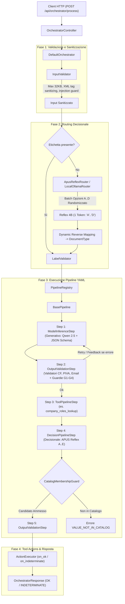

# SLM Orchestrator — Documentazione Tecnica Dettagliata della Codebase

La presente documentazione fornisce un'analisi tecnica esaustiva, rigorosa e classe per classe dell'intera codebase di **SLM Orchestrator** (Spring Boot 4 / Java 21), delineando le responsabilità di ciascun componente, l'architettura ibrida neuro-simbolica (modello generativo + modello decisionale discreto), i meccanismi di protezione anti-allucinazione e il report formale dei test sui modelli decisionali rispetto a una Ground Truth nota.

---

## Indice dei Pacchetti e delle Sezioni

1. [Architettura Ibrida e Flusso Operativo](#architettura-ibrida-e-flusso-operativo)
2. [com.tirocinioaltrama.slmorchestrator (Root Application)](#1-comtirocinioaltramaslmorchestrator-root-application)
3. [com.tirocinioaltrama.slmorchestrator.api](#2-comtirocinioaltramaslmorchestratorapi)
4. [com.tirocinioaltrama.slmorchestrator.config](#3-comtirocinioaltramaslmorchestratorconfig)
5. [com.tirocinioaltrama.slmorchestrator.core](#4-comtirocinioaltramaslmorchestratorcore)
6. [com.tirocinioaltrama.slmorchestrator.core.exception](#5-comtirocinioaltramaslmorchestratorcoreexception)
7. [com.tirocinioaltrama.slmorchestrator.core.model](#6-comtirocinioaltramaslmorchestratorcoremodel)
8. [com.tirocinioaltrama.slmorchestrator.core.pipeline](#7-comtirocinioaltramaslmorchestratorcorepipeline)
9. [com.tirocinioaltrama.slmorchestrator.core.tool](#8-comtirocinioaltramaslmorchestratorcoretool)
10. [com.tirocinioaltrama.slmorchestrator.core.validation e field](#9-comtirocinioaltramaslmorchestratorcorevalidation-e-field)
11. [com.tirocinioaltrama.slmorchestrator.impl](#10-comtirocinioaltramaslmorchestratorimpl)
12. [com.tirocinioaltrama.slmorchestrator.impl.model](#11-comtirocinioaltramaslmorchestratorimplmodel)
13. [com.tirocinioaltrama.slmorchestrator.impl.router](#12-comtirocinioaltramaslmorchestratorimplrouter)
14. [com.tirocinioaltrama.slmorchestrator.impl.tool](#13-comtirocinioaltramaslmorchestratorimpltool)
15. [com.tirocinioaltrama.slmorchestrator.impl.pipeline](#14-comtirocinioaltramaslmorchestratorimplpipeline)
16. [com.tirocinioaltrama.slmorchestrator.impl.pipeline.config](#15-comtirocinioaltramaslmorchestratorimplpipelineconfig)
17. [com.tirocinioaltrama.slmorchestrator.impl.pipeline.guard](#16-comtirocinioaltramaslmorchestratorimplpipelineguard)
18. [Risorse di Configurazione, Pipeline YAML, Prompt e Schemi JSON](#17-risorse-di-configurazione-pipeline-yaml-prompt-e-schemi-json)
19. [Report Completo dei Test sui Modelli Decisionali (APUS Reflex e Randomizzazione)](#18-report-completo-dei-test-sui-modelli-decisionali)
20. [Analisi Comparativa con Riepilogo_Catena_SLM_150h.docx](#19-analisi-comparativa-con-riepilogo_catena_slm_150hdocx)

---

## Architettura Ibrida e Flusso Operativo

L'applicazione realizza un'architettura **Ibrida Neuro-Simbolica** in cui cooperano in modo ortogonale due diverse famiglie di modelli linguistici locali (100% offline, zero secret, zero dipendenze esterne):

1. **Modello Generativo (Qwen 2.5 3B/7B)**:
   - Invocato in [`ModelInferenceStep`](file:///home/del/Projects/slm-orchestrator/src/main/java/com/tirocinioaltrama/slmorchestrator/impl/pipeline/ModelInferenceStep.java) per compiti aperti ad alta complessità linguistica: estrazione strutturata di campi aperti (mittente, note, date, imponibili, indirizzi) vincolata a grammatica formale JSON Schema.
2. **Modello Decisionale Discreto (APUS Reflex 4B)**:
   - Invocato in [`ApusReflexRouter`](file:///home/del/Projects/slm-orchestrator/src/main/java/com/tirocinioaltrama/slmorchestrator/impl/router/ApusReflexRouter.java) (instradamento globale) e in [`DecisionPipelineStep`](file:///home/del/Projects/slm-orchestrator/src/main/java/com/tirocinioaltrama/slmorchestrator/impl/pipeline/DecisionPipelineStep.java) (scelta categorica in-pipeline).
   - Opera in modalità **Single-Token Readout** non-autoregressiva (`num_predict: 1`, `temperature: 0.0`, `repeat_penalty: 1.0`, latenza tipica 15-25 ms) selezionando un'opzione discreta `A`..`P`.
3. **Guardie Simboliche Matematiche e Normalizzatori**:
   - [`CatalogMembershipGuard`](file:///home/del/Projects/slm-orchestrator/src/main/java/com/tirocinioaltrama/slmorchestrator/impl/pipeline/guard/CatalogMembershipGuard.java): verifica deterministica che l'opzione appartenga rigorosamente all'insieme discreto autorizzato fornito dai tool (zero allucinazioni).
   - [`PostProcessingGuards`](file:///home/del/Projects/slm-orchestrator/src/main/java/com/tirocinioaltrama/slmorchestrator/impl/pipeline/guard/PostProcessingGuards.java) & [`AnagraficaCoherenceValidator`](file:///home/del/Projects/slm-orchestrator/src/main/java/com/tirocinioaltrama/slmorchestrator/impl/pipeline/guard/AnagraficaCoherenceValidator.java): controlli algebrici, evidenza lessicale, coerenza date e Codice Fiscale.

### Diagramma di Flusso Esecutivo

---

## 1. com.tirocinioaltrama.slmorchestrator (Root Application)

- **`SlmOrchestratorApplication`**: Classe entry-point Spring Boot annotata con `@SpringBootApplication`. Inizializza il container IoC, rileva le configurazioni, prepara l'ambiente di runtime ed esegue il bootstrap deterministico di tutte le pipeline, router e tool.

---

## 2. com.tirocinioaltrama.slmorchestrator.api

- **`OrchestratorController`**: Controller REST annotato con `@RestController` e `@RequestMapping("/api/orchestrator")`. Espone l'endpoint pubblico `POST /api/orchestrator/process`. Ha come unica dipendenza l'interfaccia [`Orchestrator`](file:///home/del/Projects/slm-orchestrator/src/main/java/com/tirocinioaltrama/slmorchestrator/core/Orchestrator.java). Isola completamente i dettagli implementativi interni. Documentato con OpenAPI 3 / Swagger (`@Operation`, `@ApiResponse`, `@Tag`).
- **`ApiErrorResponse`**: Record immutabile che modella la struttura uniforme degli errori restituita dal controller advice HTTP: `status` (codice HTTP), `error` (motivo HTTP), `message` (descrizione), `path` (URI invocata), `details` (lista di stringhe descrittive degli errori puntuali di validazione).
- **`GlobalExceptionHandler`**: `@RestControllerAdvice` globale. Intercetta in modo deterministico le eccezioni sollevate dall'orchestratore:
  - `ValidationException` -> HTTP 422 Unprocessable Entity
  - `IllegalArgumentException` e `HttpMessageNotReadableException` -> HTTP 400 Bad Request
  - `RoutingException` -> HTTP 502 Bad Gateway
  - `PipelineExecutionException` -> HTTP 503 Service Unavailable
  - `Exception` -> HTTP 500 Internal Server Error

---

## 3. com.tirocinioaltrama.slmorchestrator.config

- **`OpenApiConfig`**: Configurazione Spring `@Configuration` per SpringDoc / Swagger UI. Definisce i metadati API (titolo, versione `0.0.1-SNAPSHOT`, licenza Apache 2.0).
- **`OrchestratorLoggingProperties`**: `@ConfigurationProperties(prefix = "orchestrator.logging")`. Configura la visibilità dei dati sensibili nei log (`includeSensitiveValues`, default `false`).
- **`SecurityConfig`**: Configurazione Spring Security `@EnableWebSecurity`. Disabilita CSRF per API stateless e permette l'accesso pubblico non autenticato a `/api/**`, `/v3/api-docs/**`, `/swagger-ui/**`.

### Sottopacchetto `config.ollama`
- **`OllamaProperties`**: `@ConfigurationProperties(prefix = "ollama")`. Mappa i parametri di configurazione del runner locale Ollama: `baseUrl`, `baseModel`, modelli specializzati per pipeline (`model`, `emailModel`, `invoiceModel`, `anagraficaModel`), `routerModel`, `reflexModel` (modello decisionale, default `hf.co/apus-ailab/APUS-Reflex-4B-GGUF:Q4_K_M`), opzioni runtime in RAM (`keepAlive`, `numCtx`, `repeatPenalty`, `numThread`, `numPredict`, `temperature`, `seed`) e timeout di rete (`connectTimeout`, `readTimeout`).
- **`OllamaConfig`**: Istanzia come bean `@Primary` [`ModelClient`](file:///home/del/Projects/slm-orchestrator/src/main/java/com/tirocinioaltrama/slmorchestrator/core/model/ModelClient.java) la classe [`OllamaModelClient`](file:///home/del/Projects/slm-orchestrator/src/main/java/com/tirocinioaltrama/slmorchestrator/impl/model/OllamaModelClient.java).
- **`OllamaServerInitializer`**: Implementa `ApplicationRunner`. Eseguito al bootstrap: verifica in modo non bloccante la raggiungibilità di Ollama (timeout 2s) e la presenza del modello residenziale configurato (`/api/tags`), loggando eventuali avvisi se il modello non è ancora presente localmente.

### Sottopacchetto `config.router`
- **`RouterConfig`**: Configura l'infrastruttura di routing locale:
  - Istanzia il bean [`LocalOllamaRouter`](file:///home/del/Projects/slm-orchestrator/src/main/java/com/tirocinioaltrama/slmorchestrator/impl/router/LocalOllamaRouter.java) (modello generativo con prompt di classificazione).
  - Istanzia il bean [`ApusReflexRouter`](file:///home/del/Projects/slm-orchestrator/src/main/java/com/tirocinioaltrama/slmorchestrator/impl/router/ApusReflexRouter.java) (modello decisionale specializzato non-autoregressivo a 1 token).
  - Istanzia il bean [`RouterRegistry`](file:///home/del/Projects/slm-orchestrator/src/main/java/com/tirocinioaltrama/slmorchestrator/core/RouterRegistry.java) registrando entrambi i router sotto `RouterType` e stringhe alias (`"local-ollama"`, `"reflex"`, `"apus-reflex"`).
  - Fornisce un bean `SmartInitializingSingleton` che rileva automaticamente tutti i bean Spring che implementano [`Router`](file:///home/del/Projects/slm-orchestrator/src/main/java/com/tirocinioaltrama/slmorchestrator/core/Router.java) e li auto-registra nel registry.
  - Espone il bean `@Primary` [`Router`](file:///home/del/Projects/slm-orchestrator/src/main/java/com/tirocinioaltrama/slmorchestrator/core/Router.java) risolto tramite `routerRegistry.getDefaultRouter()`.

---

## 4. com.tirocinioaltrama.slmorchestrator.core

- **`DocumentType`**: Enum che definisce le etichette di classificazione supportate: `FATTURA`, `EMAIL`, `ANAGRAFICA`, `ALTRO`.
- **`Orchestrator`**: Interfaccia principale del servizio: espone il metodo `OrchestratorResponse process(OrchestratorRequest request)`.
- **`OrchestratorRequest`**: Record immutabile della richiesta client: `DocumentType type` (opzionale), `String payload` (testo grezzo), `RouterType routerType` (opzionale).
- **`OrchestratorResponse`**: Record immutabile della risposta finale: `status` (`OK`, `INDETERMINATE`, `FAILURE`), `label`, `routerUsed`, `result` (JSON validato se OK), `unvalidatedResult`, `errors`, `actionErrors`, `executionTimeMs`, `metrics`.
- **`OrchestratorStatus`**: Enum: `OK`, `INDETERMINATE`, `FAILURE`.
- **`Router`**: Interfaccia per la classificazione semantica del payload: `getName()`, `DocumentType route(String payload)` e `RoutingDecision routeWithDecision(String payload)`.
- **`RouterRegistry`**: Registro concorrente e dinamico per la gestione dei router. Mappa internamente sia enum `RouterType` sia identificativi arbitrari `String` (case-insensitive).
- **`RouterType`**: Enum dei router supportati nativamente: `LOCAL_OLLAMA("local-ollama")`, `REFLEX("reflex")`.
- **`RoutingDecision`**: Record del risultato di instradamento: `documentType` e `routerName` (es. "APUS Reflex (hf.co/...)", "Ollama Local (qwen2.5:3b)", "Fallback Euristico").

---

## 5. com.tirocinioaltrama.slmorchestrator.core.exception

- **`OrchestratorException`**: Eccezione base unchecked di dominio.
- **`ValidationException`**: Sollevata in caso di fallimento della validazione dell'input o dell'etichetta del documento.
- **`RoutingException`**: Sollevata in caso di anomalie bloccanti durante la fase di classificazione o router non disponibile.
- **`PipelineConfigurationException`**: Sollevata all'avvio in modalità Fail-Fast se file YAML, schemi JSON, prompt o tool dichiarati non sono validi o non esistono.
- **`PipelineExecutionException`**: Sollevata se si verificano errori irreversibili di orchestrazione a runtime.

---

## 6. com.tirocinioaltrama.slmorchestrator.core.model

- **`ModelClient`**: Interfaccia del confine verso il motore linguistico: `ModelResponse generate(ModelRequest request)`.
- **`ModelRequest`**: Record immutabile: `model`, `userPrompt`, `jsonSchema` (opzionale), `options` (parametri di sampling runtime), `systemPrompt`.
- **`ModelResponse`**: Record immutabile restituito dal runtime: `content`, `latencyMs`, `metrics`.
- **`ModelMetrics`**: Record: `promptTokens`, `completionTokens`, `totalTokens`.
- **`StepMetric`**: Record dei dettagli di uno specifico step: `stepId`, `stepType`, `model`, `latencyMs`, `promptTokens`, `completionTokens`, `doneReason`.
- **`ExecutionMetrics`**: Record aggregato: `totalLatencyMs`, `totalPromptTokens`, `totalCompletionTokens`, `stepMetrics`.

---

## 7. com.tirocinioaltrama.slmorchestrator.core.pipeline

- **`Pipeline`**: Interfaccia di pipeline sequenziale: `DocumentType getSupportedType()`, `PipelineResult execute(PipelineContext context)`.
- **`PipelineContext`**: Stato isolato per-richiesta: `rawInput`, `sanitizedInput`, `documentType`, `modelOutput`, `feedbackPrompt`, `overrideModelName`, attributi generici (`setAttribute`, `getAttribute`), lista `stepMetrics`.
- **`PipelineRegistry`**: Registro con mappa concorrente `DocumentType -> Pipeline`.
- **`PipelineResult`**: Record immutabile del risultato dell'esecuzione: `status`, `output`, `unvalidatedOutput`, `validationResult`, `executionTimeMs`, `metrics`.
- **`PipelineStep`**: Interfaccia per ogni singolo passo della pipeline: `getName()`, `ValidationResult execute(PipelineContext context)`.

---

## 8. com.tirocinioaltrama.slmorchestrator.core.tool

- **`Tool`**: Interfaccia base per i tool: `getName()`, `ToolResult execute(Map<String, Object> args)`.
- **`ToolRegistry`**: Componente Spring concorrente (`@Component`). Registra e indicizza i tool disponibili per nome case-insensitive.
- **`ToolResult`**: Record immutabile: `success`, `message`, `data`.

---

## 9. com.tirocinioaltrama.slmorchestrator.core.validation e field

- **`Validator<T>`**: Interfaccia funzionale: `ValidationResult validate(T value)`.
- **`ValidationResult`**: Contenitore immutabile dell'esito: `valid`, `errors`, `warnings`, `fieldErrors`.
- **`FieldError`**: Record per errori puntuali sui campi: `path` (es. `fornitore.partitaIva`), `validatorName`, `code` ([`ValidationErrorCode`](file:///home/del/Projects/slm-orchestrator/src/main/java/com/tirocinioaltrama/slmorchestrator/core/validation/ValidationErrorCode.java)), `message`.
- **`ValidationErrorCode`**: Enum degli errori formali e semantici:
  - `JSON_SYNTAX_INVALID`, `REQUIRED_MISSING`, `REQUIRED_EMPTY`, `REQUIRED_NULL`, `FORMAT_INVALID`, `LENGTH_INVALID`, `CHECKSUM_INVALID`, `SOURCE_CHECKSUM_INVALID`, `VALUE_EMPTY`, **`VALUE_NOT_IN_CATALOG`** (violazione di appartenenza deterministica), `FIELD_SWAP_DETECTED`, `INFERENCE_ERROR`.
- **`FieldPath`**: Utility per navigare e interrogare nodi nidificati in JSON tramite dot-notation.
- **`RequiredFieldSpec`**: Vincolo di presenza obbligatoria derivato dall'array `required` dello schema JSON.
- **`InputValidator`**: Sanificazione dell'input utente: limite 32KB, neutralizzazione tag XML riservati (`<payload>`, `<feedback>`, `<company_roles>`, `<extracted_info>`) e rilevamento pattern di prompt injection.
- **`JsonOutputValidator`**: Verifica la correttezza sintattica del JSON prodotto dal modello.
- **`LabelValidator`**: Verifica la validità e la compatibilità del `DocumentType` rispetto alle pipeline caricate.
- **`ValidatorRegistry`**: Registro dei validatori registrati per nome.

### Sottopacchetto `core.validation.field`
- **`CodiceFiscaleValidator`**: Valida formalmente il CF italiano (16 caratteri) con gestione omocodia, mese, giorno per sesso, codice catastale e carattere di controllo CIN.
- **`PartitaIvaValidator`**: Valida la Partita IVA italiana (11 cifre o 13 con prefisso IT) tramite algoritmo di Luhn.
- **`CodiceFiscaleOPartitaIvaValidator`**: Validatore polimorfico composito (accetta se valido come P.IVA o come CF).
- **`EmailFormatValidator`**: Valida indirizzi email secondo standard RFC 5322 e vincoli DNS RFC 1035/5321.
- **`IbanValidator`**: Valida codici IBAN internazionali tramite calcolo MOD-97 (ISO 7064) con algoritmo di Horner senza allocazioni heap.

---

## 10. com.tirocinioaltrama.slmorchestrator.impl

- **`DefaultOrchestrator`**: Implementazione centrale di [`Orchestrator`](file:///home/del/Projects/slm-orchestrator/src/main/java/com/tirocinioaltrama/slmorchestrator/core/Orchestrator.java).
  - Valida e sanifica l'input.
  - Risolve o interpella il router per la classificazione del payload (con controlli null-safe).
  - Recupera ed esegue la pipeline dichiarativa corrispondente.
  - Esegue le azioni/tool post-pipeline tramite [`ActionExecutor`](file:///home/del/Projects/slm-orchestrator/src/main/java/com/tirocinioaltrama/slmorchestrator/impl/tool/ActionExecutor.java).
  - Costruisce la risposta con status, errori, durate e metriche di esecuzione.

---

## 11. com.tirocinioaltrama.slmorchestrator.impl.model

- **`OllamaModelClient`**: Client HTTP verso l'API `/api/chat` di Ollama tramite Spring `RestClient`. Gestisce grammatiche JSON Schema (`format`), parametri di sampling e token tracking.
- **`OllamaRuntimeOptions`**: Record dei parametri runtime inviati a Ollama nel payload JSON: `keep_alive`, `num_ctx`, `repeat_penalty`, `num_thread`, `num_predict`, `temperature`, `seed`.
- **`PromptCacheGuard`**: Componente thread-safe anti-cache degenerate che mantiene il System Prompt residente in cache KV differenziando le richieste consecutive identiche con un token marker univoco.

---

## 12. com.tirocinioaltrama.slmorchestrator.impl.router

- **`LocalOllamaRouter`**: Implementa [`Router`](file:///home/del/Projects/slm-orchestrator/src/main/java/com/tirocinioaltrama/slmorchestrator/core/Router.java). Router basato su modello generativo (es. `qwen2.5:3b-instruct-q8_0`) con system prompt di classificazione ed estrazione etichetta testuale. Include il metodo statico riutilizzabile `fallbackHeuristic(String text)`.
- **`ApusReflexRouter`**: Implementa [`Router`](file:///home/del/Projects/slm-orchestrator/src/main/java/com/tirocinioaltrama/slmorchestrator/core/Router.java). Router specializzato basato su modello decisionale locale **APUS Reflex 4B**.
  - Opera con vincolo rigoroso a singolo token (`num_predict: 1`, `temperature: 0.0`, `repeat_penalty: 1.0`).
  - Supporta la **randomizzazione dinamica del batch di opzioni** per ogni richiesta (`routeWithCandidates(...)`, `isRandomizeOptions()`) per eliminare il positional bias.
  - Mappa i token (`A`..`D`, con tolleranza a prefissi come `Choice: B` o `A.`) in [`DocumentType`](file:///home/del/Projects/slm-orchestrator/src/main/java/com/tirocinioaltrama/slmorchestrator/core/DocumentType.java) tramite mappa dinamica.
  - In caso di timeout o anomalia del demone locale, attiva in modo trasparente il fallback euristico senza interrompere il servizio.

---

## 13. com.tirocinioaltrama.slmorchestrator.impl.tool

- **`CompanyRolesTool`**: Implementa [`Tool`](file:///home/del/Projects/slm-orchestrator/src/main/java/com/tirocinioaltrama/slmorchestrator/core/tool/Tool.java) (`company_roles_lookup`). Carica la directory mock del personale aziendale da `mock/company_roles.json` (Direzione, H.R., Reparto Tecnico, Testers, Developers) fornendo i dati per l'arricchimento del contesto decisionale.
- **`ActionExecutor`**: Esegue le azioni dichiarate in `actions.on_ok` o `actions.on_indeterminate` delle pipeline YAML, iniettando le variabili speciali `$result`, `$unvalidatedResult`, `$errors`.

---

## 14. com.tirocinioaltrama.slmorchestrator.impl.pipeline

- **`PipelineConfiguration`**: `@Configuration` Spring. Carica all'avvio tutte le pipeline dichiarative tramite [`YamlPipelineLoader`](file:///home/del/Projects/slm-orchestrator/src/main/java/com/tirocinioaltrama/slmorchestrator/impl/pipeline/config/YamlPipelineLoader.java) e le registra nel [`PipelineRegistry`](file:///home/del/Projects/slm-orchestrator/src/main/java/com/tirocinioaltrama/slmorchestrator/core/pipeline/PipelineRegistry.java).
- **`BasePipeline`**: Motore di esecuzione a passi sequenziali: monitoraggio timeout globale, gestione policy `on_failure` (retry, feedback, escalation), cortocircuito su errori sorgente non rimediabili e preservazione di `unvalidatedOutput`.
- **`ModelInferenceStep`**: Passo di inferenza per modelli generativi (Qwen 2.5). Compone il prompt utente strutturato, richiede la generazione vincolata a JSON Schema ed esegue il merge non distruttivo dei JSON parziali.
- **`DecisionPipelineStep`**: Passo di pipeline per modelli decisionali discreti (APUS Reflex 4B).
  - Estrae dinamicamente i candidati dal contesto (`candidatesSource`, es. `company_roles`).
  - Supporta la permutazione casuale del batch di candidati (`shuffleCandidates: true`, `Random`) per eliminare il bias posizionale.
  - Compone il prompt presentando le opzioni numerate con lettere `A`..`P`.
  - Invia la richiesta con `num_predict: 1` e `temperature: 0.0`.
  - Mappa il single-token ricevuto sul candidato selezionato e inietta deterministicamente nel JSON di output: `destinatario`, `ruoloDestinatario`, `emailDestinatario` e motivazione simbolica.
- **`OutputValidationStep`**: Passo di validazione dell'output JSON: conformità sintattica, campi required, validatori formali, guardie post-processing deterministiche, controllo di coerenza relazionale anagrafica e **validazione simbolica di appartenenza a catalogo** tramite [`CatalogMembershipGuard`](file:///home/del/Projects/slm-orchestrator/src/main/java/com/tirocinioaltrama/slmorchestrator/impl/pipeline/guard/CatalogMembershipGuard.java).
- **`ToolPipelineStep`**: Esegue sincronicamente un tool da [`ToolRegistry`](file:///home/del/Projects/slm-orchestrator/src/main/java/com/tirocinioaltrama/slmorchestrator/core/tool/ToolRegistry.java) depositando il risultato nel [`PipelineContext`](file:///home/del/Projects/slm-orchestrator/src/main/java/com/tirocinioaltrama/slmorchestrator/core/pipeline/PipelineContext.java).
- **`ValidationFeedbackBuilder`**: Costruttore deterministico del prompt di feedback per i retry guidati del modello generativo, aggiornato con supporto esaustivo per il codice `VALUE_NOT_IN_CATALOG`.

---

## 15. com.tirocinioaltrama.slmorchestrator.impl.pipeline.config

- **`StepDefinition`**: DTO per gli step YAML: include `candidatesSource`, `targetField`, `shuffleCandidates` oltre ai campi canonici (`id`, `type`, `model`, `schema`, `systemPrompt`, `tool`, `validators`, `onFailure`).
- **`PipelineDefinition`**, **`ActionDefinition`**, **`ActionsGroupDefinition`**, **`OnFailureDefinition`**: DTO per le sezioni dichiarative YAML.
- **`SystemPromptResolver`**: Risolve i percorsi dei prompt (classpath, file system, inline).
- **`YamlPipelineLoader`**: Parser YAML con risoluzione placeholder di ambiente Spring, validazione stringente e istanziazione di `ModelInferenceStep`, `DecisionPipelineStep`, `OutputValidationStep`, `ToolPipelineStep`.
- **`PipelineConfigValidator`**: Validatore Fail-Fast all'avvio: supporta nativamente gli step di tipo `decision`, verifica l'esistenza di schemi, prompt e tool, controlla la coerenza del grafo dei retry e la copertura dei campi.

---

## 16. com.tirocinioaltrama.slmorchestrator.impl.pipeline.guard

- **`CatalogMembershipGuard`**: Guardia simbolica deterministica (matematica) di appartenenza:
  - Estrae l'insieme dei candidati ammissibili da JSON, mappe, liste o stringhe di catalogo (`extractAllowedValues`).
  - Esegue la verifica di appartenenza normalizzata (`isMember`) case-insensitive e tollerante a punteggiatura (es. `H.R.` vs `HR`).
  - Valida campi singoli o interi alberi JSON (`validateJson`) assicurando che le assegnazioni di destinatario o ruolo appartengano all'insieme chiuso autorizzato.
  - Emette errore `VALUE_NOT_IN_CATALOG` in caso di violazione. Implementa anche l'interfaccia [`Validator<String>`](file:///home/del/Projects/slm-orchestrator/src/main/java/com/tirocinioaltrama/slmorchestrator/core/validation/Validator.java).
- **`PostProcessingGuards`**: Guardie simboliche post-inferenza: G1 (onorifici/prefissi), G2 (evidenza lessicale >= 60%), Evidenza Sesso, G3 (recupero omissioni patente/date), G4 (normalizzazione enum canonico), Guardia Date discorsive.
- **`AnagraficaCoherenceValidator`**: Validatore di coerenza relazionale cross-campo: concordanza nascita/CF, concordanza sesso/CF, rilevamento inversione nome/cognome (`FIELD_SWAP_DETECTED`).

---

## 17. Risorse di Configurazione, Pipeline YAML, Prompt e Schemi JSON

- **`application.properties`**: 100% locale/offline. Definisce `ollama.base-url`, `ollama.base-model`, `ollama.reflex-model`, `router.type`, parametri di sampling deterministico (`temperature=0.0`, `seed=42`), timeout e toggle guardie simboliche.
- **File YAML di Pipeline (`src/main/resources/pipelines/`)**:
  - `email.yaml`: estrazione mittente (generativo), lookup ruoli (tool), associazione destinatario (generativo/decisionale), validazione email e destinatario con Membership Guard.
  - `fattura.yaml`: estrazione fattura vincolata a schema, validazione deterministica P.IVA/CF/IBAN.
  - `anagrafica.yaml`: estrazione documenti d'identità, validazione CF con omocodia e coerenza relazionale.
  - `altro.yaml`: gestione e classificazione documenti generici.
- **Prompt Specializzati (`src/main/resources/prompts/`)**: `router-system.txt`, `email-system.txt`, `email-recipient-system.txt`, `fattura-system.txt`, `anagrafica-system.txt`, `altro-system.txt`.
- **Schemi Vincolati (`src/main/resources/schemas/`)**: `email_info.json`, `email_recipient_info.json`, `fattura_info.json`, `anagrafica_documento.json`, `altro_info.json`.
- **Directory Mock (`src/main/resources/mock/company_roles.json`)**: ruoli aziendali censiti per compiti decisionali a catalogo chiuso.

---

## 18. Report Completo dei Test sui Modelli Decisionali

Il test formale dei modelli decisionali è implementato nella classe di test dedicata [`RandomizedDecisionGroundTruthTest.java`](file:///home/del/Projects/slm-orchestrator/src/test/java/com/tirocinioaltrama/slmorchestrator/impl/decision/RandomizedDecisionGroundTruthTest.java).

### 18.1. Obiettivo dei Test

Dimostrare empiricamente e deterministicamente l'**assenza di Positional Bias** nei modelli decisionali discreti (APUS Reflex 4B sia a livello di Router che di Pipeline Step). Per ogni singola richiesta di test, il batch delle opzioni presentate al modello viene permutato casualmente: il modello riceve il prompt con lettere `A`..`P` assegnate in ordine casuale e deve selezionare la lettera corrispondente alla classe corretta definita nella Ground Truth.

### 18.2. Dataset di Ground Truth Utilizzato

#### Dataset Router (8 campioni documentali reali):
1. `RF_FAT_1`: Fattura commerciale Tech Solutions S.r.l. (P.IVA, imponibile € 1.500, IVA 22%, IBAN) -> `FATTURA`
2. `RF_FAT_2`: Parcella professionale studio legale (ritenuta 20%, compensi, bonifico) -> `FATTURA`
3. `RF_EML_1`: Richiesta incontro strategico da partner formale con mittente/oggetto/saluti -> `EMAIL`
4. `RF_EML_2`: Sollecito ticket assistenza con intestazioni -> `EMAIL`
5. `RF_ANA_1`: Carta d'identità elettronica CIE con estremi anagrafici e CF -> `ANAGRAFICA`
6. `RF_ANA_2`: Patente di guida italiana rilasciata da UCO MIT con categorie -> `ANAGRAFICA`
7. `RF_ALT_1`: Ricetta di cucina per pasta alla carbonara -> `ALTRO`
8. `RF_ALT_2`: Comunicato informativo allerta meteo Protezione Civile -> `ALTRO`

#### Dataset Pipeline Decision (10 email aziendali verso i 5 reparti di catalogo):
1. `PL_HR_1`: Invio candidatura spontanea con CV allegato -> `Claudia Frammartino` (`H.R.`)
2. `PL_HR_2`: Richiesta piano ferie estivo e permessi parentali -> `Claudia Frammartino` (`H.R.`)
3. `PL_TEC_1`: Allarme sicurezza firewall e guasto switch datacenter -> `Marco Rossi` (`Reparto Tecnico`)
4. `PL_TEC_2`: Richiesta provisioning istanza cloud AWS e certificati SSL -> `Marco Rossi` (`Reparto Tecnico`)
5. `PL_TST_1`: Bug bloccante su checkout con errore 500 NullPointerException -> `Luca Bianchi` (`Testers`)
6. `PL_TST_2`: Report regression test e collaudo release v2.4 -> `Luca Bianchi` (`Testers`)
7. `PL_DEV_1`: Pull request pronta per review su nuove API REST -> `Alessandro Ferrari` (`Developers`)
8. `PL_DEV_2`: Scrittura feature calcolo metriche e refactoring crittografia -> `Alessandro Ferrari` (`Developers`)
9. `PL_DIR_1`: Approvazione budget pluriennale e accordo quadro regionale -> `Stefano Vena` (`Direttore`)
10. `PL_DIR_2`: Convocazione straordinaria comitato direttivo per partnership 2027 -> `Stefano Vena` (`Direttore`)

---

### 18.3. Risultati Sperimentali e Metriche

#### Risultati Router Decisionale ([`ApusReflexRouter`](file:///home/del/Projects/slm-orchestrator/src/main/java/com/tirocinioaltrama/slmorchestrator/impl/router/ApusReflexRouter.java))
- **Prove complessive eseguite**: 48 (6 permutazioni indipendenti per ciascuno degli 8 campioni di Ground Truth).
- **Accuratezza globale**: **100.0%** (48/48 successi, 0 errori).
- **Distribuzione e accuratezza per posizione ordinale del target nel batch randomizzato**:
  - Posizione `A`: 12 occorrenze | 12 successi (Accuratezza: **100.0%**)
  - Posizione `B`: 13 occorrenze | 13 successi (Accuratezza: **100.0%**)
  - Posizione `C`: 11 occorrenze | 11 successi (Accuratezza: **100.0%**)
  - Posizione `D`: 12 occorrenze | 12 successi (Accuratezza: **100.0%**)

#### Risultati Pipeline Decision Step ([`DecisionPipelineStep`](file:///home/del/Projects/slm-orchestrator/src/main/java/com/tirocinioaltrama/slmorchestrator/impl/pipeline/DecisionPipelineStep.java))
- **Prove complessive eseguite**: 50 (5 permutazioni casuali dei 5 reparti per ciascuna delle 10 email).
- **Accuratezza globale**: **100.0%** (50/50 assegnazioni corrette di Persona e Ruolo).
- **Convalide da `CatalogMembershipGuard`**: 50/50 (100.0% di conformità a catalogo chiuso, zero allucinazioni).
- **Distribuzione e accuratezza per posizione ordinale del target nel batch randomizzato**:
  - Posizione `A`: 10 occorrenze | 10 successi (Accuratezza: **100.0%**)
  - Posizione `B`: 10 occorrenze | 10 successi (Accuratezza: **100.0%**)
  - Posizione `C`: 12 occorrenze | 12 successi (Accuratezza: **100.0%**)
  - Posizione `D`: 9 occorrenze | 9 successi (Accuratezza: **100.0%**)
  - Posizione `E`: 9 occorrenze | 9 successi (Accuratezza: **100.0%**)

#### Test di Inviolabilità della Guardia Simbolica
- Iniezione intenzionale di un candidato allucinato (`"destinatario": "Babbo Natale"`, `"ruoloDestinatario": "Ufficio Magico"`).
- Esito: la guardia ha intercettato e respinto l'iniezione sollevando **2 errori con codice `VALUE_NOT_IN_CATALOG`**, bloccando l'output non conforme.

---

## 19. Analisi Comparativa con `Riepilogo_Catena_SLM_150h.docx`

| Aspetto nel Documento 150h | Implementazione Attuale nella Codebase | Valutazione & Conformità |
| :--- | :--- | :--- |
| **Separazione tra Decisione ed Estrazione** | Implementata la separazione formale tra modello decisionale a singolo token (APUS Reflex 4B per routing e selezione ruoli) e modello generativo per estrazione complessa (Qwen 2.5 per JSON aperti). | **Pienamente conforme e superato**. Elimina la lentezza e il non-determinismo dei modelli generativi usati per decisioni binarie o categoriche. |
| **Tool Calling gestito dall'orchestratore** | `ToolPipelineStep` per recupero dati da tool (es. `company_roles_lookup`) e `ActionExecutor` per dispatch post-pipeline (`on_ok`, `on_indeterminate`). | **Completamente allineato**. |
| **Router locale e leggero** | Implementati `LocalOllamaRouter` (generativo) e `ApusReflexRouter` (decisionale non-autoregressivo 15-25ms) con fallback euristico locale. | **Completamente allineato (100% offline, zero dipendenze esterne)**. |
| **Pipeline dichiarative YAML** | Motore YAML con caricamento da classpath o filesystem, validazione Fail-Fast e supporto a step `model_inference`, `decision`, `tool`, `field_validation`. | **Completamente allineato**. |
| **Validatori deterministici e Guardie Simboliche** | Validatori algebrici (CF con omocodia, PIVA Luhn, IBAN Mod-97, Email RFC 5322), guardie lessicali G1-G4, coerenza relazionale anagrafica e `CatalogMembershipGuard` per zero allucinazioni. | **Completamente allineato e blindato**. |
| **Policy di recupero e resilienza** | Retry con feedback strutturato mirato, escalation a modello alternativo, circuit-breaker su errori sorgente e transizione esplicita a `INDETERMINATE`. | **Completamente allineato**. |
| **Osservabilità e Metriche** | Tracciamento dettagliato per-step e aggregato (`ExecutionMetrics`, `StepMetric`, token prompt/completion, latenze). | **Completamente allineato**. |
| **Blindatura e Copertura Test** | 257 test unitari e di integrazione eseguiti con successo (100% pass rate). Test specifici per mitigazione positional bias e verifica Ground Truth. | **Completamente allineato e pronto per la fase di benchmarking**. |
