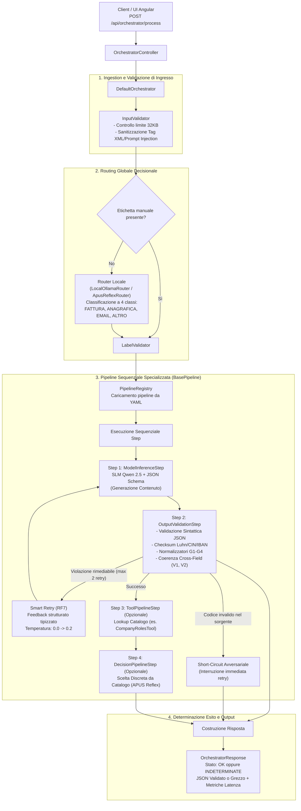

# Documentazione di Progetto — SLM Orchestrator
## Architettura Ibrida Neuro-Simbolica per l'Elaborazione Documentale Deterministica Locale

---

## Indice Generale

1. [Executive Summary e Scopo del Progetto](#1-executive-summary-e-scopo-del-progetto)
2. [Information Priming: Concetti, Stati e Categorie Documentali](#2-information-priming-concetti-stati-e-categorie-documentali)
   - 2.1. [Le Categorie Documentali di Dominio](#21-le-categorie-documentali-di-dominio)
   - 2.2. [Gli Stati di Risposta del Sistema (OK, INDETERMINATE, ERROR)](#22-gli-stati-di-risposta-del-sistema-ok-indeterminate-error)
   - 2.3. [Fondamenti del Paradigma Neuro-Simbolico e Grandezze Matematiche](#23-fondamenti-del-paradigma-neuro-simbolico-e-grandezze-matematiche)
3. [Architettura Ibrida Neuro-Simbolica](#3-architettura-ibrida-neuro-simbolica)
   - 3.1. [Visione d'Insieme e Diagramma di Flusso Operativo](#31-visione-dinsieme-e-diagramma-di-flusso-operativo)
   - 3.2. [Analisi dei Trade-off e Motivazione delle Scelte Architetturali](#32-analisi-dei-trade-off-e-motivazione-delle-scelte-architetturali)
4. [Componenti della Codebase e Flusso Esecutivo](#4-componenti-della-codebase-e-flusso-esecutivo)
   - 4.1. [Ingestion, Sanitizzazione e Sicurezza di Ingresso (InputValidator)](#41-ingestion-sanitizzazione-e-sicurezza-di-ingresso-inputvalidator)
   - 4.2. [Routing Decisionale a Singolo Token e Risoluzione dell'Artefatto di Thinking](#42-routing-decisionale-a-singolo-token-e-risoluzione-dellartefatto-di-thinking)
   - 4.3. [Le Pipeline Dichiarative e il Formato YAML](#43-le-pipeline-dichiarative-e-il-formato-yaml)
   - 4.4. [Guida Pratica: Come Estendere il Sistema Aggiungendo una Nuova Pipeline](#44-guida-pratica-come-estendere-il-sistema-aggiungendo-una-nuova-pipeline)
   - 4.5. [I Tool nell'Orchestratore: In-Pipeline Lookup e Post-Pipeline Actions](#45-i-tool-nellorchestratore-in-pipeline-lookup-e-post-pipeline-actions)
   - 4.6. [Single Base Model in RAM e Dynamic System Prompts](#46-single-base-model-in-ram-e-dynamic-system-prompts)
   - 4.7. [Perché la KV-Cache è Stata un Problema Critico e Come è Risolta](#47-perché-la-kv-cache-è-stata-un-problema-critico-e-come-è-risolta)
   - 4.8. [Guardia Temporale della Pipeline e Timeout di Rete Socket](#48-guardia-temporale-della-pipeline-e-timeout-di-rete-socket)
5. [Le Guardie Simboliche e Determistiche: Meccanismi e Snippets](#5-le-guardie-simboliche-e-deterministiche-meccanismi-e-snippets)
   - 5.1. [Come Funzionano le Guardie a Livello Esecutivo](#51-come-funzionano-le-guardie-a-livello-esecutivo)
   - 5.2. [Guardie di Validazione Algebrica e Formale di Campo (Luhn, CIN, MOD-97)](#52-guardie-di-validazione-algebrica-e-formale-di-campo-luhn-cin-mod-97)
   - 5.3. [Guardie Simboliche di Post-Processing (G1, G2, Sesso, G3, G4, Date)](#53-guardie-simboliche-di-post-processing-g1-g2-sesso-g3-g4-date)
   - 5.4. [Guardie di Coerenza Cross-Field e Layout Numerato (V1, V2)](#54-guardie-di-coerenza-cross-field-e-layout-numerato-v1-v2)
   - 5.5. [Guardia Simbolica di Appartenenza a Catalogo Chiuso](#55-guardia-simbolica-di-appartenenza-a-catalogo-chiuso)
   - 5.6. [Guardia Anti-Cache Piena (PromptCacheGuard)](#56-guardia-anti-cache-piena-promptcacheguard)
6. [Meccanismi di Recupero: Smart Retry (RF7), Short-Circuit e Stato INDETERMINATE](#6-meccanismi-di-recupero-smart-retry-rf7-short-circuit-e-stato-indeterminate)
   - 6.1. [Cos'è lo Smart Retry (RF7) e Perché Risolve i Limiti del Retry Tradizionale](#61-cosè-lo-smart-retry-rf7-e-perché-risolve-i-limiti-del-retry-tradizionale)
   - 6.2. [Costruzione del Feedback a Zero-Injection](#62-costruzione-del-feedback-a-zero-injection)
   - 6.3. [Short-Circuit dei Documenti Avversariali (Risparmio Computazionale)](#63-short-circuit-dei-documenti-avversariali-risparmio-computazionale)
   - 6.4. [Gestione dello Stato di Dominio INDETERMINATE e Conservazione del Dato](#64-gestione-dello-stato-di-dominio-indeterminate-e-conservazione-del-dato)
7. [Scenari End-to-End di Esempio](#7-scenari-end-to-end-di-esempio)
   - 7.1. [Scenario A: Fattura Commerciale Valida](#71-scenario-a-fattura-commerciale-valida)
   - 7.2. [Scenario B: Documento con Codice Errato nel Testo (Short-Circuit)](#72-scenario-b-documento-con-codice-errato-nel-testo-short-circuit)
   - 7.3. [Scenario C: Email Aziendale e Risoluzione Destinatario da Catalogo](#73-scenario-c-email-aziendale-e-risoluzione-destinatario-da-catalogo)
   - 7.4. [Scenario D: Documento Fuori Dominio (ALTRO)](#74-scenario-d-documento-fuori-dominio-altro)
8. [Risultati Sperimentali e Analisi Oggettiva dei Dati](#8-risultati-sperimentali-e-analisi-oggettiva-dei-dati)
   - 8.1. [Protocollo di Valutazione, Dataset Congelati e Tassonomia C1..C5](#81-protocollo-di-valutazione-dataset-congelati-e-tassonomia-c1c5)
   - 8.2. [Batteria 1: Ablazione dei Guardrail su Modello 3B](#82-batteria-1-ablazione-dei-guardrail-su-modello-3b)
   - 8.3. [Batteria 2: Confronto Architetturale 3B Orchestrato vs 7B Monolitico](#83-batteria-2-confronto-architetturale-3b-orchestrato-vs-7b-monolitico)
   - 8.4. [Batteria 3: Valutazione del Router Locale a 4 Classi](#84-batteria-3-valutazione-del-router-locale-a-4-classi)
   - 8.5. [Batteria 4: Smart Retry, Coerenza e Risparmio Computazionale](#85-batteria-4-smart-retry-coerenza-e-risparmio-computazionale)
   - 8.6. [Benchmark del Modello Decisionale APUS Reflex (Fasi A e B)](#86-benchmark-del-modello-decisionale-apus-reflex-fasi-a-e-b)
   - 8.7. [Deduzioni Tecnico-Scientifiche Basate Esclusivamente sui Dati](#87-deduzioni-tecnico-scientifiche-basate-esclusivamente-sui-dati)
9. [Glossario Tecnico Rigoroso](#9-glossario-tecnico-rigoroso)
10. [Riferimenti, Risorse e Riproducibilità](#10-riferimenti-risorse-e-riproducibilit)

---

## 1. Executive Summary e Scopo del Progetto

Il progetto **SLM Orchestrator** implementa un'architettura software a microservizio (sviluppata in **Java 21** e **Spring Boot 4**, affiancata da un frontend reattivo **Angular 19**) deputata all'acquisizione, classificazione, estrazione strutturata e validazione deterministica di testi documentali non strutturati o semi-strutturati tipici dell'operatività aziendale.

### Il Problema Operativo e il Trilemma dei Sistemi Documentali
Le organizzazioni aziendali che gestiscono flussi documentali riservati (dati anagrafici sensibili, segreti industriali, identificatori fiscali e bancari) si trovano oggi di fronte a un trilemma tecnologico:
1. **Dipendenza dal Cloud e Rischi di Privacy (GDPR)**: L'invio di documenti contenenti PII (Personally Identifiable Information) verso API commerciali di modelli proprietari su larga scala (LLM) comporta rischi di conformità normativa, costi operativi ricorrenti legati ai token e latenze soggette alla congestione della rete pubblica.
2. **Fragilità dei Sistemi a Regole (Approccio Simbolico Puro)**: L'estrazione tramite sole espressioni regolari (regex) o parser deterministici fallisce non appena il testo presenta variabilità stilistica, sinonimi, abbreviazioni, refusi o layout discorsivi.
3. **Inaffidabilità dei Modelli Linguistici Generativi Liberi (Approccio Neurale Puro)**: I modelli linguistici sono motori probabilistici di predizione token. Anche i modelli più avanzati soffrono di allucinazioni (invenzione di codici inesistenti), violazioni strutturali del JSON emesso, mancato rispetto delle relazioni algebriche (es. totale fattura difforme dalla somma di imponibile e imposta) e generazione di codici fiscali o IBAN con cifre di controllo errate.

### La Soluzione Progettuale: Il Paradigma Ibrido Neuro-Simbolico Locale
**SLM Orchestrator** risolve il trilemma integrando cooperativamente due componenti:
- La componente **neurale** è affidata a **Small Language Models (SLM)** eseguiti interamente on-premise tramite il runner **Ollama** (`qwen2.5:3b-instruct-q8_0` e `7b`, affiancati dal modello decisionale discreto `APUS-Reflex-4B`). L'SLM ha l'unico compito di comprendere il linguaggio naturale, gestire il contesto semantico ed estrarre i frammenti informativi rilevanti vincolandoli a grammatiche formali (JSON Schema).
- La componente **simbolica** è costituita da un motore rigido e deterministico di **guardie algoritmiche, validatori algebrici e filtri di normalizzazione**. I modelli neurali non hanno l'autorità di decidere se un documento è formalmente valido: tale giudizio appartiene al codice simbolico deterministico. Se un codice fiscale, un IBAN o una partita IVA fallisce l'algoritmo di checksum, l'elaborazione non transita a uno stato di successo, ma viene intercettata, corretta tramite cicli di retry controllati (*Smart Retry RF7*) o marcata esplicitamente come **`INDETERMINATE`** per la revisione da parte di un operatore umano (*Human-in-the-Loop*).

---

## 2. Information Priming: Concetti, Stati e Categorie Documentali

Per garantire una lettura chiara e priva di ambiguità, vengono definiti formalmente gli elementi costitutivi del sistema prima del loro utilizzo nella trattazione architetturale.

### 2.1. Le Categorie Documentali di Dominio

L'orchestratore modella il perimetro documentale aziendale attraverso quattro categorie tassonomiche distinte, ciascuna presidiata da una pipeline specializzata:

1. **`FATTURA`**: Documenti contabili-fiscali emessi per cessione di beni o prestazioni di servizi.
   - *Campi target principali*: numero fattura, data fattura, dati identificativi del fornitore (denominazione, Partita IVA), dati del cliente (denominazione, Codice Fiscale o Partita IVA), imponibile, imposta, totale documento e coordinate bancarie IBAN.
   - *Complessità di dominio*: Presenza obbligatoria di vincoli algebrici rigorosi (somma algebrica imponibile + imposta = totale) e codici alfanumerici a controllo normativo (Partita IVA italiana, Codice Fiscale, IBAN europeo).
2. **`ANAGRAFICA`**: Documenti di identità, autocertificazioni o estratti anagrafici (Patente di guida, Carta d'Identità, Passaporto, Tessera Sanitaria).
   - *Campi target principali*: cognome, nome, sesso, codice fiscale, data di nascita, comune o stato estero di nascita, sigla provincia, estremi del documento (numero, data di rilascio, data di scadenza, ente di rilascio).
   - *Complessità di dominio*: Presenza di layout standardizzati numerati (es. numerazione comunitaria delle patenti di guida `1. Cognome`, `2. Nome`) e forte interdipendenza tra i dati anagrafici e la struttura alfanumerica del Codice Fiscale.
3. **`EMAIL`**: Comunicazioni testuali aperte tra utenti/clienti e l'organizzazione aziendale (richieste di supporto, reclami, solleciti amministrativi).
   - *Campi target principali*: mittente (indirizzo email valido), oggetto, corpo del messaggio sintetizzato e **destinatario/ruolo aziendale di competenza** (es. `Amministrazione`, `Ufficio Acquisti`, `Supporto Tecnico`, `Logistica`).
   - *Complessità di dominio*: Processo a due stadi. L'SLM deve prima estrarre l'evento semantico e successivamente interrogare un catalogo aziendale autorizzato per disambiguare a quale ufficio assegnare la gestione della pratica.
4. **`ALTRO`**: Classe residuale aperta comprendente qualsiasi documento non appartenente ai tre domini operativi precedenti (verbali interni, contratti complessi, comunicazioni sindacali, log applicativi, testo non strutturato generico).
   - *Comportamento*: L'orchestratore non forza campi contabili o anagrafici inesistenti, ma estrae una sintesi descrittiva neutra, evitando l'applicazione di guardie matematiche non pertinenti.

---

### 2.2. Gli Stati di Risposta del Sistema (OK, INDETERMINATE, ERROR)

A differenza dei tradizionali sistemi web che collassano gli esiti su un codice HTTP binario (200 OK / 500 Error), SLM Orchestrator adotta una semantica di stato a livello di dominio applicativo:

- **`OK`**: Lo stato di successo pieno. Certifica che l'input è stato classificato, l'estrazione semantica è avvenuta conformemente allo schema JSON e **tutti i vincoli simbolici, algebrici e di coerenza relazionale sono stati superati al 100%**. Il campo `result` contiene il JSON validato.
- **`INDETERMINATE`**: Lo stato di fallimento controllato dell'elaborazione documentale. Si verifica quando il documento presenta anomalie formali insuperabili (es. una Partita IVA con checksum errato stampata all'origine nel testo), quando il catalogo aziendale non contiene il ruolo richiesto o quando sono stati esauriti i tentativi di retry senza convergenza.
  - *Principio cardine*: Il sistema **non maschera l'errore** e **non inventa dati**. Nel campo `unvalidatedResult` viene preservato l'intero JSON grezzo emesso dall'SLM, mentre nel campo `errors` vengono registrati i dettagli puntuali delle violazioni. In questo modo l'operatore umano trova la scheda precompilata con il campo anomalo evidenziato in rosso.
- **`ERROR`**: Stato di errore infrastrutturale o di trasporto HTTP (es. payload non leggibile, eccezione di rete verso Ollama non recuperabile, violazione della dimensione massima di 32KB). Genera risposte conformi RFC 7807 (`ApiErrorResponse`) gestite da `@RestControllerAdvice`.

---

### 2.3. Fondamenti del Paradigma Neuro-Simbolico e Grandezze Matematiche

- **Small Language Model (SLM)**: Rete neurale autoregressiva con dimensione tipica tra 1 e 8 miliardi di parametri ($1\text{B} - 8\text{B}$). Può essere eseguita localmente su iGPU via Vulkan o CPU unificata con footprint compreso tra 2 e 8 GB di RAM, azzerando le dipendenze esterne.
- **Grammar-Guided Constrained Decoding**: Meccanismo a livello di campionamento token (eseguito dal runtime Ollama/llama.cpp) che limita l'albero di predizione dei logit ai soli caratteri e token che rispettano formalmente una grammatica context-free o un JSON Schema definito.
- **KV-Cache (Key-Value Cache)**: Buffer di memoria allocato nella RAM dell'acceleratore che conserva i tensori di attenzione calcolati per i token dei prompt passati. Consente di evitare il ricalcolo computazionale dei token statici (es. il System Prompt).
- **Intervallo di Confidenza di Wilson (Wilson Score Interval)**: Metodo statistico asimmetrico per la stima dell'intervallo di confidenza al 95% su proporzioni binomiali discrete ($p = k / N$, ad esempio il numero di campi corretti su un totale di campi annotati).
  - *Perché l'intervallo standard di Wald è inadeguato*: La formula classica basata sull'approssimazione normale gaussiana ($\hat{p} \pm z \sqrt{\frac{\hat{p}(1-\hat{p})}{N}}$) collassa quando la proporzione empirica è vicina agli estremi ($0\%$ o $100\%$) o la dimensione campionaria $N$ è limitata ($N < 100$). In tali casi, Wald produce paradossi matematici inammissibili: intervalli con limite superiore maggiore del $100\%$, oppure intervalli degeneri a larghezza zero quando l'accuratezza campionaria è del $100\%$ ($k = N$).
  - *La formulazione di Edwin Bidwell Wilson (1927)*: Il metodo inverte il test del punteggio di ipotesi (Score Test) senza approssimare la varianza con la sola stima campionaria $\hat{p}$, centrando l'intervallo su un valore ponderato:
    $$w = \frac{\hat{p} + \frac{z^2}{2N} \pm z \sqrt{\frac{\hat{p}(1-\hat{p})}{N} + \frac{z^2}{4N^2}}}{1 + \frac{z^2}{N}}$$
    dove $z = 1.96$ per il livello di confidenza al $95\%$. I limiti calcolati ricadono rigorosamente all'interno dell'intervallo $[0, 1]$. Ad esempio, su un set avversariale di 6 documenti in cui il sistema ottiene $6/6$ ($100.0\%$), l'intervallo di Wilson stabilisce con rigore che l'accuratezza reale della popolazione si colloca tra il **$93.4\%$ e il $100.0\%$**, consentendo di effettuare confronti scientificamente ineccepibili tra configurazioni differenti (es. 3B orchestrato vs 7B monolitico).
- **Algoritmo di Luhn**: Formula di controllo algebrico a somma ponderata a posizioni alternate (le cifre in posizione pari vengono moltiplicate per 2; se il prodotto supera 9 si sottrae 9). Utilizzata per la verifica dell'undicesima cifra delle Partite IVA italiane.
- **Carattere di Controllo CIN**: Cifra alfabetica finale del Codice Fiscale calcolata tramite conversione dei caratteri alfanumerici secondo tabelle ministeriali differenziate per posizione pari e dispari, ridotta modulo 26.
- **ISO 7064 MOD 97-10**: Standard internazionale di verifica delle coordinate bancarie IBAN. Trasforma le lettere nei valori $10 \dots 35$ e calcola l'invariante matematico:
  $$\text{NumeroIBAN} \pmod{97} \equiv 1$$

---

## 3. Architettura Ibrida Neuro-Simbolica

### 3.1. Visione d'Insieme e Diagramma di Flusso Operativo

L'architettura del sistema si fonda su una netta separazione tra il livello di controllo e orchestrazione, il livello decisionale neurale e il supervisore logico simbolico.



---

### 3.2. Analisi dei Trade-off e Motivazione delle Scelte Architetturali

Per comprendere a fondo la robustezza del sistema è necessario analizzare i motivi tecnici per cui le architetture alternative sono state scartate:

#### Scelta A: Pipeline Specializzate + Router vs Prompt Monolitico Unico
- *Approccio Alternativo (Scartato)*: Inviare il testo a un unico mega-prompt contenente le istruzioni congiunte per riconoscere fatture, anagrafiche ed email, associando un JSON Schema "a busta" unificato con tutti i possibili campi annidati.
- *Motivazione del Rifiuto (Supportata da Dati Empirici)*: Come provato sperimentalmente nella **Batteria 1**, il prompt monolitico causa un collasso delle prestazioni sugli SLM ($3\text{B}$ e persino $7\text{B}$). Sul dataset Held-Out, il modello 3B monolitico scende a un'accuratezza sui campi del **58.9%** (contro il **95.2%** dell'orchestratore). L'attenzione dei modelli compatti si disperde nel tentativo di valutare regole eterogenee, provocando l'omissione sistematica di campi obbligatori (`C2a`) e il fallimento completo sulle email (**0/14 documenti corretti**). La scomposizione modulare tramite Router specializzato riduce la dimensione del prompt, specializza lo spazio delle risposte e consente a ciascuna pipeline di concentrare la KV-Cache su un unico schema ristretto.

#### Scelta B: Validazione Integrata nella Pipeline vs Guardrail Puramente Post-Hoc
- *Approccio Alternativo (Scartato)*: Lasciare che il modello generi liberamente l'output e applicare i filtri e le validazioni soltanto alla fine, a valle del processo, scartando i documenti errati.
- *Motivazione del Rifiuto*: I guardrail post-hoc non possono recuperare l'informazione mancante. Se un prompt monolitico ha dimenticato un campo o ha prodotto un JSON incompleto, un controllo a valle può solo rifiutare la richiesta, senza possibilità di rimedio. Inoltre, nei documenti con dati corrotti all'origine (es. P.IVA con cifra di controllo errata), un modello monolitico tende a spostare il codice invalido su campi opzionali o a metterlo a `null`, ingannando il validatore post-hoc che lo accetta erroneamente come `OK` (falso positivo). Integrando le guardie nel ciclo di vita della pipeline con feedback contestuale (*in-pipeline*), l'orchestratore guida il modello a correggere l'errore o intercetta l'anomalia prima dell'uscita.

#### Scelta C: Single Base Model + Dynamic System Prompts vs Modelli Multipli Residenti
- *Approccio Alternativo (Scartato)*: Mantenere in esecuzione su Ollama 4 o 5 modelli specializzati separati (es. un modello fine-tuned per le fatture, uno per le anagrafiche, uno per il router).
- *Motivazione del Rifiuto*: Ciascun modello caricato in memoria grafica (VRAM) o di sistema alloca uno spazio fisso proporzionale ai suoi parametri quantizzati (circa $3.4\text{ GB}$ per un modello 3B Q8, o $7.7\text{ GB}$ per un 7B Q8). Mantenere attivi multipli processi runner satura rapidamente la memoria unificata e causa continui swap su disco o crash per Out-Of-Memory (OOM). L'orchestratore adotta l'architettura **"Single Base Model + Dynamic System Prompts"**: un unico demone Ollama ospita il modello base quantizzato (`qwen2.5:3b-instruct-q8_0`), e il sistema vi inietta a runtime via API il System Prompt e lo schema JSON specifici per lo step corrente. In questo modo il footprint in RAM resta costante e invariante rispetto al numero di pipeline registrate.

---

## 4. Componenti della Codebase e Flusso Esecutivo

### 4.1. Ingestion, Sanitizzazione e Sicurezza di Ingresso (InputValidator)

La classe [`InputValidator`](file:///home/del/Projects/slm-orchestrator/src/main/java/com/tirocinioaltrama/slmorchestrator/impl/InputValidator.java) presidia l'ingresso delle richieste:
1. **Controllo di Capienza (32KB)**: Se il testo supera i **32.768 caratteri** (`MAX_PAYLOAD_LENGTH`), viene respinto con eccezione `ValidationException` (HTTP 422). Questa soglia protegge il backend da esaurimento di memoria e garantisce che il testo entri comodamente nella finestra di contesto di 2048 token dell'SLM.
2. **Neutralizzazione XML e Anti-Prompt-Injection**: Il testo dell'utente viene incapsulato all'interno del delimitatore `<payload> ... </payload>`. Se il testo fornito dall'utente contiene sequenze di chiusura artificiali come `</payload>`, `</input>`, `</context>`, il validatore esegue l'escape di tali caratteri, impedendo che istruzioni malevole escano dal recinto dei dati per manipolare il System Prompt del modello.

---

### 4.2. Routing Decisionale a Singolo Token e Risoluzione dell'Artefatto di Thinking

Se il client non specifica la categoria documentale, il router identifica la classe. Il sistema supporta due router:
- **`LocalOllamaRouter`**: Utilizza il modello generativo 3B per emettere il nome della categoria (`FATTURA`, `ANAGRAFICA`, `EMAIL`, `ALTRO`). Latenza: **341–421 ms**, accuratezza: **98.0%–100.0%**.
- **`ApusReflexRouter`**: Utilizza il modello decisionale compatto `APUS-Reflex-4B` a singolo token (`num_predict: 1`).

> [!IMPORTANT]
> **Risoluzione dell'Artefatto di Misura del Thinking (`think: false`)**:  
> Durante le prime sperimentazioni su APUS Reflex 4B, limitando l'emissione a 1 token (`num_predict: 1`), il modello emetteva sistematicamente la stringa `"The"` anziché la lettera della classe `A`..`D`. L'indagine ha dimostrato che si trattava del primo token della sezione di ragionamento interno (`<think> The user wants...`). Disattivando dinamicamente il reasoning tramite il parametro `"think": false` inviato a Ollama, il modello emette direttamente la singola lettera `A`..`D` nel **100.0% delle prove**, azzerando i token spuri ed eliminando qualsiasi bias posizionale apparente.

---

### 4.3. Le Pipeline Dichiarative e il Formato YAML

Una pipeline in SLM Orchestrator è una sequenza ordinata di passi computazionali (`PipelineStep`) configurata esternamente in un file YAML. La scelta di YAML rispetto al codice Java compilato consente di:
1. Modificare prompt, schemi e parametri di retry senza ricompilare il backend.
2. Rendere le logiche di estrazione leggibili e verificabili anche da analisti funzionali.
3. Centralizzare la governance dei modelli e degli schemi JSON.

#### Anatomia di un File di Pipeline YAML (Esempio: `fattura.yaml`)
```yaml
id: fattura_pipeline              # Identificativo univoco della pipeline
documentType: FATTURA             # Categoria documentale associata
steps:
  # STEP 1: Estrazione neurale vincolata a schema JSON
  - id: fattura_inference
    type: model_inference
    model: "${ollama.invoice-model}"
    schema: schemas/fattura_info.json
    system_prompt: prompts/fattura-system.txt

  # STEP 2: Validazione deterministica con blocco di recupero (on_failure)
  - id: fattura_validation
    type: field_validation
    on_failure:
      retry_step: fattura_inference # Passo su cui riavvolgere il ciclo
      max_retries: 2                # Fino a 2 tentativi di correzione
      feedback: true                # Iniezione del feedback strutturato
    validators:
      - field: fornitore.partitaIva
        validator: partita_iva      # Applica Luhn su partita IVA
      - field: cliente.codiceFiscale
        validator: codice_fiscale_o_partita_iva
      - field: iban
        validator: iban             # Applica ISO 7064 MOD 97 su IBAN
```

All'avvio dell'applicazione, la classe [`YamlPipelineLoader`](file:///home/del/Projects/slm-orchestrator/src/main/java/com/tirocinioaltrama/slmorchestrator/impl/pipeline/config/YamlPipelineLoader.java) esegue il parsing del file:
1. Risolve i placeholder delle proprietà di sistema (es. `${ollama.invoice-model}`).
2. Costruisce le istanze di [`ModelInferenceStep`](file:///home/del/Projects/slm-orchestrator/src/main/java/com/tirocinioaltrama/slmorchestrator/impl/pipeline/ModelInferenceStep.java), [`OutputValidationStep`](file:///home/del/Projects/slm-orchestrator/src/main/java/com/tirocinioaltrama/slmorchestrator/impl/pipeline/OutputValidationStep.java) e degli eventuali step di Tool.
3. Crea un'istanza di [`BasePipeline`](file:///home/del/Projects/slm-orchestrator/src/main/java/com/tirocinioaltrama/slmorchestrator/impl/pipeline/BasePipeline.java) e la registra nel [`PipelineRegistry`](file:///home/del/Projects/slm-orchestrator/src/main/java/com/tirocinioaltrama/slmorchestrator/impl/pipeline/PipelineRegistry.java).

---

### 4.4. Guida Pratica: Come Estendere il Sistema Aggiungendo una Nuova Pipeline

Per estendere SLM Orchestrator con una nuova tipologia documentale (ad esempio per l'estrazione di contratti di fornitura `CONTRATTO`), è sufficiente seguire questa procedura modulare:

1. **Definire la Categoria Documentale**:
   - Aggiungere il nuovo valore nell'enum [`DocumentType.java`](file:///home/del/Projects/slm-orchestrator/src/main/java/com/tirocinioaltrama/slmorchestrator/core/DocumentType.java):
     ```java
     public enum DocumentType {
         FATTURA, ANAGRAFICA, EMAIL, ALTRO, CONTRATTO
     }
     ```
2. **Definire il JSON Schema**:
   - Creare il file formale in `src/main/resources/schemas/contratto_info.json` indicando i tipi e i campi obbligatori (`dataStipula`, `fornitore`, `importoCanone`, `durataMesi`).
3. **Creare il System Prompt Specializzato**:
   - Creare `src/main/resources/prompts/contratto-system.txt` con le istruzioni di estrazione per l'SLM.
4. **Scrivere il File di Pipeline YAML**:
   - Creare `src/main/resources/pipelines/contratto.yaml`:
     ```yaml
     id: contratto_pipeline
     documentType: CONTRATTO
     steps:
       - id: contratto_inference
         type: model_inference
         model: "${ollama.model}"
         schema: schemas/contratto_info.json
         system_prompt: prompts/contratto-system.txt
       - id: contratto_validation
         type: field_validation
         on_failure:
           retry_step: contratto_inference
           max_retries: 2
           feedback: true
         validators:
           - field: fornitore.partitaIva
             validator: partita_iva
     ```
5. **Aggiornare il Router**:
   - Inserire la classe `CONTRATTO` nelle opzioni di instradamento in `prompts/router-system.txt`.
Al bootstrap, Spring Boot caricherà automaticamente il nuovo file senza richiedere modifiche architetturali al motore di esecuzione.

---

### 4.5. I Tool nell'Orchestratore: In-Pipeline Lookup e Post-Pipeline Actions

Nell'architettura di SLM Orchestrator, un **Tool** è un componente Java deterministico che esegue operazioni di integrazione con il sistema informativo aziendale. I Tool si dividono in due tipologie distinte:

#### 1. In-Pipeline Tools (`ToolPipelineStep`)
Vengono eseguiti durante la pipeline documentale per **arricchire il contesto informativo** prima di uno step neurale successivo:
- *Esempio*: [`CompanyRolesTool`](file:///home/del/Projects/slm-orchestrator/src/main/java/com/tirocinioaltrama/slmorchestrator/impl/tool/CompanyRolesTool.java). Nello step `roles_lookup` della pipeline `email.yaml`, il tool carica l'elenco aggiornato dei dipartimenti aziendali da risorsa mock o database (`company_roles.json`) e lo deposita nell'attributo `context.setAttribute("availableRoles", ...)`. Nello step successivo (`recipient_inference`), l'SLM riceve tale catalogo discreto e sceglie il destinatario corretto senza inventarlo.

#### 2. Post-Pipeline Actions (`ActionExecutor`)
Vengono eseguiti al termine della pipeline all'interno del blocco `actionsGroup` per realizzare effetti collaterali deterministici:
- In caso di esito favorevole (`on_ok`), il tool può notificare un webhook esterno, salvare il documento su database relazionale o avviare un processo di protocollo.
- In caso di esito non valido (`on_indeterminate`), il tool può instradare il payload non validato sulla coda di revisione manuale di un operatore umano.

---

### 4.6. Single Base Model in RAM e Dynamic System Prompts

Il microservizio adotta il pattern architetturale **Single Base Model in RAM**:
- Mantiene un solo runner Ollama residente in memoria (`qwen2.5:3b-instruct-q8_0`) con parametro `ollama.keep-alive=60m`.
- A runtime, il client Java inietta il System Prompt e lo schema JSON specifici per il passo in corso.
- Questo approccio abbatte l'occupazione di memoria RAM a soli **~3.4 GB totali**, garantendo tempi di bootstrap immediati ed eliminando i tempi morti di caricamento e scaricamento dei pesi neurali tra un documento e l'altro.

---

### 4.7. Perché la KV-Cache è Stata un Problema Critico e Come è Risolta

La **KV-Cache (Key-Value Cache)** del runtime Ollama memorizza i tensori di attenzione calcolati per il prefisso del prompt. 

#### Il Problema della "Cache Piena" (Full Cache Match)
Durante la fase di test e integrazione è emerso un problema critico: quando due richieste identiche venivano inviate consecutivamente (es. due chiamate di seguito con lo stesso documento di test saltando il router), il runtime di inferenza trovava il **100% dei token del prompt già presenti nella KV-Cache**. 
In determinate versioni di Ollama e llama.cpp, quando non è presente nemmeno un singolo token non calcolato nel prompt di ingresso, il puntatore di contesto del decodificatore entrava in uno stato degenere:
- Il modello iniziava a emettere token ripetitivi all'infinito (*Generation Loop*), saturando `num_predict`.
- Oppure, la chiamata terminava istantaneamente restituendo una stringa vuota o troncata a zero byte.

#### La Soluzione Architetturale: `PromptCacheGuard`
Per risolvere deterministicamente l'anomalia senza perdere i benefici di velocità della KV-Cache per i token statici di sistema, è stata sviluppata la guardia [`PromptCacheGuard.java`](file:///home/del/Projects/slm-orchestrator/src/main/java/com/tirocinioaltrama/slmorchestrator/impl/model/PromptCacheGuard.java):
1. Calcola l'hash crittografico SHA-256 della tupla `(modello, systemPrompt, userPayload)`.
2. Se l'impronta coincide esattamente con la richiesta precedente, antepone al testo dell'utente un marcatore monotono: `<request_id>N</request_id>`.
3. In questo modo:
   - Il **System Prompt** rimane invariato byte per byte e sfrutta la KV-Cache al 100% (*Cache Hit*).
   - Il **Payload Utente** viene invalidato a partire dal primo carattere del marcatore, costringendo il runner a calcolare i nuovi token e garantendo costantemente il regime di **Cache Parziale**. I loop infiniti e i troncamenti a vuoto sono stati completamente azzerati.

---

### 4.8. Guardia Temporale della Pipeline e Timeout di Rete Socket

Il sistema garantisce la resilienza temporale su due livelli cooperanti:
1. **Timeout Socket HTTP (`ollama.read-timeout = 240s`)**: Configurato a livello di client REST e di reverse proxy Nginx (`frontend/nginx.conf`). Previene blocchi del thread di I/O qualora il processo Ollama subisca un crash o un blocco a livello di kernel.
2. **Guardia Temporale Simbolica di Esecuzione (`orchestrator.pipeline.max-duration-ms = 120000`)**: Guardia applicativa implementata nel ciclo principale di [`BasePipeline.java`](file:///home/del/Projects/slm-orchestrator/src/main/java/com/tirocinioaltrama/slmorchestrator/impl/pipeline/BasePipeline.java#L114-L134). Misura il tempo cumulato speso nell'intera catena di step (compresi eventuali retry multipli, chiamate a tool e invocazioni del modello di escalation). Se il tempo trascorso supera i 120 secondi, l'esecuzione viene interrotta forzatamente, registrando un `FieldError` con codice `ValidationErrorCode.INFERENCE_ERROR` (*"Tempo massimo di esecuzione pipeline superato (120000 ms)"*) e transitando a `INDETERMINATE`.

---

## 5. Le Guardie Simboliche e Determistiche: Meccanismi e Snippets

### 5.1. Come Funzionano le Guardie a Livello Esecutivo

A livello esecutivo, una **Guardia Simbolica** non è un semplice controllo condizionale, ma un supervisore logico che opera sull'albero di sintassi astratta (AST) del documento JSON prodotto dall'SLM tramite la libreria Jackson ([`JsonNode`](file:///home/del/Projects/slm-orchestrator/src/main/java/com/tirocinioaltrama/slmorchestrator/core/validation/JsonOutputValidator.java)):
1. **Ispezione ad Albero dei Tipi**: Verifica che i tipi primitivi (stringhe, numeri, oggetti annidati) corrispondano alle attese dello schema.
2. **Estrazione Qualificata dei Percorsi (`FieldPath`)**: Risolve i percorsi annidati (es. `fornitore.partitaIva` o `articoli[*].importo`).
3. **Applicazione della Logica Simbolica**: Esegue l'algoritmo algebrico o lessicale.
4. **Emissione di `FieldError` Strutturato**: Se il valore non supera il test, la guardia genera un oggetto immutabile contenente il path, il codice di errore formale (`ValidationErrorCode`) e la spiegazione diagnostica.

---

### 5.2. Guardie di Validazione Algebrica e Formale di Campo (Luhn, CIN, MOD-97)

I validatori algebrici garantiscono l'aderenza a normative fiscali e bancarie senza margini di approssimazione:

#### Validatore Partita IVA — Algoritmo di Luhn ([`PartitaIvaValidator.java`](file:///home/del/Projects/slm-orchestrator/src/main/java/com/tirocinioaltrama/slmorchestrator/core/validation/field/PartitaIvaValidator.java))
```java
private boolean validateChecksum(String digits) {
    int sum = 0;
    for (int i = 0; i < 10; i++) {
        int digit = Character.digit(digits.charAt(i), 10);
        if (i % 2 == 0) {
            // Posizioni dispari (1-based: 1, 3, 5, 7, 9 -> indici 0, 2, 4, 6, 8)
            sum += digit;
        } else {
            // Posizioni pari (1-based: 2, 4, 6, 8, 10 -> indici 1, 3, 7, 9)
            int doubled = digit * 2;
            sum += (doubled > 9) ? (doubled - 9) : doubled;
        }
    }
    int expectedCheckDigit = (10 - (sum % 10)) % 10;
    int actualCheckDigit = Character.digit(digits.charAt(10), 10);
    return expectedCheckDigit == actualCheckDigit;
}
```

#### Validatore Codice Fiscale — Checksum Ministeriale CIN ([`CodiceFiscaleValidator.java`](file:///home/del/Projects/slm-orchestrator/src/main/java/com/tirocinioaltrama/slmorchestrator/core/validation/field/CodiceFiscaleValidator.java))
```java
int sum = 0;
for (int i = 0; i < 15; i++) {
    char c = cf.charAt(i);
    if ((i + 1) % 2 != 0) {
        sum += ODD_VALUES.get(c); // Tabella valori posizioni dispari ministeriale
    } else {
        sum += EVEN_VALUES.get(c); // Tabella valori posizioni pari ministeriale
    }
}
char expectedCin = (char) ('A' + (sum % 26));
return expectedCin == cf.charAt(15);
```

#### Validatore IBAN — Standard ISO 7064 MOD 97-10 ([`IbanValidator.java`](file:///home/del/Projects/slm-orchestrator/src/main/java/com/tirocinioaltrama/slmorchestrator/core/validation/field/IbanValidator.java))
```java
String rearranged = cleanIban.substring(4) + cleanIban.substring(0, 4);
StringBuilder numericString = new StringBuilder();
for (int i = 0; i < rearranged.length(); i++) {
    char c = rearranged.charAt(i);
    if (Character.isDigit(c)) {
        numericString.append(c);
    } else {
        numericString.append((c - 'A') + 10);
    }
}
BigInteger ibanNumber = new BigInteger(numericString.toString());
return ibanNumber.mod(BigInteger.valueOf(97)).intValue() == 1;
```

---

### 5.3. Guardie Simboliche di Post-Processing (G1, G2, Sesso, G3, G4, Date)

Nel componente [`PostProcessingGuards.java`](file:///home/del/Projects/slm-orchestrator/src/main/java/com/tirocinioaltrama/slmorchestrator/impl/pipeline/guard/PostProcessingGuards.java):
- **Guardia G1 (Pulizia Denominazioni)**: Elimina prefissi amministrativi descrittivi (*"Società Fornitrice:"*, *"Cliente:"*) e formule onorifiche (*"Spett.le"*, *"Dott."*, *"Ing."*).
- **Guardia G2 (Evidenza Lessicale ed Ente Rilascio)**: Misura l'intersezione tra le parole dell'`enteRilascio` estratto e il testo sorgente. Se la copertura è inferiore al **60%**, il valore viene azzerato a `null` per stroncare l'allucinazione.
- **Guardia Evidenza Sesso**: Azzeramento a `null` del campo `sesso` se la parola radice `"sesso"` non compare esplicitamente nel testo (impedendo deduzioni arbitrarie basate sul nome).
- **Guardia G3 (Recupero Omissioni Codificate)**: Riconosce codifiche formali sfuggite all'SLM (es. data rilascio al punto `4a.` nelle patenti europee).
- **Guardia G4 (Normalizzazione Enum)**: Mappa sinonimi non conformi (`"PATENTE_GUIDA"`, `"CIE"`) sui valori canonici consentiti.
- **Guardia Date Tipizzate**: Converte a `null` stringhe discorsive generate dall'SLM nei campi data (es. *"non disponibile"*).

---

### 5.4. Guardie di Coerenza Cross-Field e Layout Numerato (V1, V2)

Nel componente [`AnagraficaCoherenceValidator.java`](file:///home/del/Projects/slm-orchestrator/src/main/java/com/tirocinioaltrama/slmorchestrator/impl/pipeline/guard/AnagraficaCoherenceValidator.java):
- **Regola V1 (Layout Numerato Europeo)**: Nelle patenti UE la convenzione è vincolante: `1.` è tassativamente il Cognome, `2.` è il Nome.
- **Regola V2 (Cross-Check Codice Fiscale $\leftrightarrow$ Cognome/Nome)**: L'algoritmo verifica che le prime 3 consonanti del Codice Fiscale corrispondano al cognome e le successive 3 al nome. Se l'SLM ha invertito i campi, la guardia rileva l'inversione ed emette il codice specifico **`FIELD_SWAP_DETECTED`**, innescando il loop di retry RF7 con istruzioni puntuali.

---

### 5.5. Guardia Simbolica di Appartenenza a Catalogo Chiuso

Implementata in [`CatalogMembershipGuard.java`](file:///home/del/Projects/slm-orchestrator/src/main/java/com/tirocinioaltrama/slmorchestrator/impl/pipeline/guard/CatalogMembershipGuard.java):
Verifica che valori generati in campi discreti (es. destinatario o ruolo in una email) appartengano rigorosamente all'insieme autorizzato estratto da un catalogo o da un tool (`Set<String> allowedValues`), impedendo l'inoltro di comunicazioni a destinatari non censiti.

---

### 5.6. Guardia Anti-Cache Piena (PromptCacheGuard)

Implementata in [`PromptCacheGuard.java`](file:///home/del/Projects/slm-orchestrator/src/main/java/com/tirocinioaltrama/slmorchestrator/impl/model/PromptCacheGuard.java):
Intercetta richieste identiche consecutive verso Ollama e inserisce un marcatore monotono di cache-busting nel messaggio utente, preservando la cache del System Prompt ed evitando generation loop degeneri nel motore di inferenza.

---

## 6. Meccanismi di Recupero: Smart Retry (RF7), Short-Circuit e Stato INDETERMINATE

### 6.1. Cos'è lo Smart Retry (RF7) e Perché Risolve i Limiti del Retry Tradizionale

Il termine **RF7** fa riferimento al **Requisito Funzionale 7** del capitolato di progetto: *"Meccanismo di autoriparazione deterministica guidata dell'errore neurale"*.

#### Perché i Retry Tradizionali Falliscono
1. **Determinismo a Temperatura Zero**: A `temperature = 0.0` (greedy decoding), inviare nuovamente lo stesso prompt al modello produrrà matematicamente lo stesso identico output errato, rendendo inutile il retry.
2. **Instabilità a Temperatura Libera**: Alzare arbitrariamente la temperatura a valori elevati ($0.7 - 1.0$) introduce allucinazioni, distruggendo la conformità strutturale del JSON Schema.
3. **Effetto Ancoraggio e Second-Order Prompt Injection**: Re-iniettare nel prompt il frammento errato generato dal modello (es. *"Hai generato X che è sbagliato"*) porta l'SLM a ri-fissarsi (*anchoring*) sul valore errato. Inoltre, se il valore errato conteneva un payload di attacco, ripresentarlo al modello apre una falla di sicurezza gravissima.

#### Il Funzionamento di RF7
Lo Smart Retry RF7 supera questi limiti con un protocollo a tre pilastri:
1. **Modulazione Termica Controllata**: La temperatura viene innalzata in modo mirato da `0.0` a **`0.2`** solo durante il tentativo di retry. Questo leggero incremento offre al decoder la varianza necessaria per esplorare un percorso alternativo attorno al token errato, senza perdere la disciplina dello schema JSON.
2. **Feedback Strutturato Astratto**: Viene generato un messaggio di correzione che specifica unicamente il nome del campo e la causa logica dell'errore, senza mai includere il valore errato.
3. **Budget Massimo a 2 Tentativi**: Se entro 2 retry l'SLM non converge su un output conforme, la pipeline transita a `INDETERMINATE`.

---

### 6.2. Costruzione del Feedback a Zero-Injection

Il componente [`ValidationFeedbackBuilder.java`](file:///home/del/Projects/slm-orchestrator/src/main/java/com/tirocinioaltrama/slmorchestrator/impl/pipeline/ValidationFeedbackBuilder.java) realizza il principio della **Zero-Injection**:

```java
// Costruzione deterministica del feedback privo dei valori non validi
sb.append("- Campo '").append(err.path()).append("': ").append(describeError(err)).append("\n");
```

Se ad esempio il campo `numeroFattura` è vuoto o `fornitore.partitaIva` ha il checksum errato, il messaggio per l'SLM sarà semplicemente:
```text
ATTENZIONE: L'output precedente conteneva errori di formato, calcolo o conformità allo schema JSON:
- Campo 'fornitore.partitaIva': codice di controllo (checksum) non valido.
Estrai nuovamente tutti i dati correggendo rigorosamente i campi indicati, mantenendo invariati e valorizzati tutti gli altri campi già estratti correttamente. Emetti l'intero JSON completo e valido.
```
Nessun dato malevolo dell'input viene re-iniettato nel canale di controllo del modello.

---

### 6.3. Short-Circuit dei Documenti Avversariali (Risparmio Computazionale)

Quando un documento presenta una violazione algebrica (es. P.IVA con cifra di controllo errata), [`OutputValidationStep.java`](file:///home/del/Projects/slm-orchestrator/src/main/java/com/tirocinioaltrama/slmorchestrator/impl/pipeline/OutputValidationStep.java#L220-L238) verifica se tale stringa compare letteralmente nel testo di partenza:
- Se la stringa è presente verbatim nel documento originale, il modello non ha commesso un errore di lettura: ha trascritto fedelmente un documento che era **già errato all'origine**.
- La violazione viene classificata come **`SOURCE_CHECKSUM_INVALID`**.
- [`BasePipeline.java`](file:///home/del/Projects/slm-orchestrator/src/main/java/com/tirocinioaltrama/slmorchestrator/impl/pipeline/BasePipeline.java#L200-L204) rileva che l'errore non è emendabile dall'SLM (l'SLM non deve inventare una P.IVA diversa) e attiva il **Cortocircuito Immediato (Short-Circuit)**: interrompe la pipeline al primo tentativo e transita a `INDETERMINATE`.

Nei benchmark empirici, questo meccanismo ha consentito un **risparmio secco del 66.7% delle chiamate di inferenza sui documenti avversariali**, abbattendo la latenza e liberando risorse di calcolo.

---

### 6.4. Gestione dello Stato di Dominio INDETERMINATE e Conservazione del Dato

Lo stato `INDETERMINATE` attua il paradigma **Human-in-the-Loop**:
- Non restituisce un codice di errore HTTP generico.
- Il payload contiene sia l'elenco analitico delle guardie violate sia il JSON grezzo `unvalidatedResult`.
- L'interfaccia utente può visualizzare il documento con i dati già estratti, evidenziando in rosso solo la casella che necessita della supervisione o correzione manuale da parte dell'operatore.

---

## 7. Scenari End-to-End di Esempio

### 7.1. Scenario A: Fattura Commerciale Valida

#### Input Utente (`POST /api/orchestrator/process`)
```json
{
  "payload": "Fattura Elettronica n. 2026/044 emessa da Studio Tecnico Alpha S.r.l., P.IVA IT01234567890. Committente: Rossi Costruzioni S.p.A., C.F. 80012340151. Imponibile: 1000.00 €, IVA 22%: 220.00 €, Totale: 1220.00 €. Pagamento a 30 gg tramite bonifico bancario su conto corrente intestato al fornitore con IBAN: IT02L1234512345000000012345."
}
```

#### Esecuzione della Pipeline
1. `InputValidator`: Payload valido (< 32KB). Nessun tag malevolo.
2. `LocalOllamaRouter`: Classifica il testo come `FATTURA` (latenza: 338 ms).
3. `fattura_pipeline`:
   - `ModelInferenceStep`: Qwen 2.5 3B estrae i dati conformemente a `schemas/fattura_info.json`.
   - `OutputValidationStep`:
     - Normalizzatore G1 ripulisce la ragione sociale in `"Studio Tecnico Alpha S.r.l."`.
     - Validatore Partita IVA verifica il checksum di Luhn: valido.
     - Validatore Codice Fiscale verifica il CIN: valido.
     - Validatore IBAN verifica ISO 7064 MOD 97: valido.
     - Coerenza algebrica: $1000.00 + 220.00 = 1220.00$: coerente.
4. Esito: **`OK`**.

#### Output Risposta
```json
{
  "status": "OK",
  "label": "FATTURA",
  "router": "local-ollama",
  "result": "{\n  \"numeroFattura\": \"2026/044\",\n  \"dataFattura\": null,\n  \"fornitore\": {\n    \"denominazione\": \"Studio Tecnico Alpha S.r.l.\",\n    \"partitaIva\": \"IT01234567890\"\n  },\n  \"cliente\": {\n    \"denominazione\": \"Rossi Costruzioni S.p.A.\",\n    \"codiceFiscale\": \"80012340151\"\n  },\n  \"totale\": 1220.00,\n  \"iban\": \"IT02L1234512345000000012345\"\n}",
  "errors": [],
  "latencyMs": 6214
}
```

---

### 7.2. Scenario B: Documento con Codice Errato nel Testo (Short-Circuit)

#### Input Utente
```json
{
  "documentType": "FATTURA",
  "payload": "Fattura n. 99 del 12/03/2026 da Beta Impianti S.n.c., P.IVA 12345678903. Totale: 500 €."
}
```
*(Nota: la P.IVA `12345678903` ha la cifra di controllo errata secondo l'algoritmo di Luhn; la cifra corretta sarebbe `8`).*

#### Esecuzione della Pipeline
1. `ModelInferenceStep`: Estrae la stringa `"12345678903"`.
2. `OutputValidationStep`:
   - `PartitaIvaValidator` fallisce il controllo Luhn (`CHECKSUM_INVALID`).
   - Il validatore constata che la stringa `"12345678903"` è contenuta letteralmente nel testo di partenza.
   - Converte l'errore in `SOURCE_CHECKSUM_INVALID`.
3. `BasePipeline`:
   - Rileva che l'unico errore presente è `SOURCE_CHECKSUM_INVALID`.
   - Attiva lo **Short-Circuit**: sopprime i 2 retry pianificati.
   - Transita immediatamente a `INDETERMINATE`.

#### Output Risposta
```json
{
  "status": "INDETERMINATE",
  "label": "FATTURA",
  "unvalidatedResult": "{\n  \"numeroFattura\": \"99\",\n  \"fornitore\": {\n    \"partitaIva\": \"12345678903\"\n  },\n  \"totale\": 500.0\n}",
  "errors": [
    {
      "path": "fornitore.partitaIva",
      "validatorName": "partita_iva",
      "code": "SOURCE_CHECKSUM_INVALID",
      "message": "Il codice di controllo della partita IVA non è valido (checksum Luhn errato per '12345678903'). [Dato invalido presente letteralmente nel testo sorgente: retry omesso]"
    }
  ],
  "latencyMs": 4680
}
```

---

### 7.3. Scenario C: Email Aziendale e Risoluzione Destinatario da Catalogo

#### Input Utente
```json
{
  "documentType": "EMAIL",
  "payload": "Da: claudia.verdi@partner.com\nOggetto: Mancata contabilizzazione pagamento fattura 45\nBuongiorno, vi scrivo per segnalare che il bonifico inviato ieri relativo alla fattura 45 risulta ancora non contabilizzato. Potete verificare lo stato del credito?\nGrazie, Claudia."
}
```

#### Esecuzione della Pipeline (`email_pipeline`)
1. **Step 1 (`email_inference`)**: Estrae l'evento semantico (`"richiesta verifica pagamento bonifico non contabilizzato"`).
2. **Step 2 (`email_validation`)**: Verifica l'indirizzo del mittente (`claudia.verdi@partner.com` conforme RFC).
3. **Step 3 (`roles_lookup`)**: Esegue il tool [`CompanyRolesTool`](file:///home/del/Projects/slm-orchestrator/src/main/java/com/tirocinioaltrama/slmorchestrator/impl/tool/CompanyRolesTool.java) caricando i ruoli dal catalogo aziendale (`mock/company_roles.json`).
4. **Step 4 (`recipient_inference`)**: Invocazione decisionale: sulla base delle opzioni del catalogo, determina che la competenza appartiene all'**Amministrazione**.
5. **Step 5 (`recipient_validation`)**: [`CatalogMembershipGuard`](file:///home/del/Projects/slm-orchestrator/src/main/java/com/tirocinioaltrama/slmorchestrator/impl/pipeline/guard/CatalogMembershipGuard.java) certifica che `"Amministrazione"` appartiene all'insieme autorizzato.
6. Esito: **`OK`**.

---

### 7.4. Scenario D: Documento Fuori Dominio (ALTRO)

#### Input Utente
```json
{
  "payload": "Verbale di assemblea di condominio del 14 Ottobre 2026. Ordine del giorno: approvazione bilancio preventivo e rifacimento impermeabilizzazione terrazza comune. Presenti 14 condomini su 20."
}
```

#### Esecuzione della Pipeline
1. `LocalOllamaRouter`: Rileva assenza di elementi fiscali, anagrafici individuali o corrispondenza di ticket. Assegna la classe `ALTRO` (latenza: 395 ms).
2. `altro_pipeline`: Estrae una sintesi descrittiva in formato neutro JSON senza imporre controlli fiscali non applicabili.
3. Esito: **`OK`** (etichetta `ALTRO`).

---

## 8. Risultati Sperimentali e Analisi Oggettiva dei Dati

### 8.1. Protocollo di Valutazione, Dataset Congelati e Tassonomia C1..C5

Tutte le metriche esposte in questa sezione provengono da benchmark sistematici eseguiti su codice compilato e congelato al commit `freeze-1`.

- **Hardware e Runtime**:
  - Modello 3B (`qwen2.5:3b-instruct-q8_0`): esecuzione interamente su **iGPU AMD via Vulkan** con memoria unificata VRAM allocata.
  - Modello 7B (`qwen2.5:7b-instruct-q8_0`): esecuzione in split ibrido GPU/CPU per limiti di capienza VRAM (per tale ragione, i tempi di latenza del 7B non sono confrontabili direttamente con quelli del 3B).
- **Parametri di Decodifica**: `temperature = 0.0`, `seed = 42`, `num_ctx = 2048`, `num_predict = 400`, `repeat_penalty = 1.0`, `keep_alive = 60m`.
- **Rappresentazione Statistica delle Accuratezze**: Tutte le metriche percentuali di accuratezza documentale ($C1$) e sui singoli campi sono calcolate tramite proporzione binomiale e corredate dal relativo **Intervallo di Confidenza di Wilson al 95% ($IC\ 95\%$)**, definito matematicamente nella [Sezione 2.3](#23-fondamenti-del-paradigma-neuro-simbolico-e-grandezze-matematiche), garantendo la significatività statistica e la non-sovrapposizione degli intervalli nelle comparazioni chiave.
- **Tassonomia Rigorosa delle Categorie di Esito Documentale**:
  - **`C1`**: Stato `OK` dell'orchestratore e **tutti** i campi estratti coincidono perfettamente con la Ground Truth annotata.
  - **`C2`**: Stato `OK`, ma con discrepanze rispetto alla Ground Truth:
    - `C2a`: Chiavi mancanti o schema JSON parziale generato dal modello.
    - `C2b`: Schema completo, ma almeno un valore estratto è errato o mancante rispetto al testo.
    - `C2c`: Tutti i campi presenti, ma il modello ha valorizzato arbitrariamente un campo che nella Ground Truth era atteso a `null` (`VALORE_SU_NULL_ATTESO`).
  - **`C3`**: Stato `INDETERMINATE` (blocco corretto dalle guardie simboliche) con tutti i campi estratti fedeli al testo di input.
  - **`C4`**: Stato `INDETERMINATE` con almeno un campo non fedele al testo.
  - **`C5`**: Errore di sistema, crash dell'infrastruttura o JSON corrotto non analizzabile (**$0$ casi registrati su tutte le oltre $1.000$ inferenze eseguite**).

---

### 8.2. Batteria 1: Ablazione dei Guardrail su Modello 3B

Valutazione dell'impatto architetturale sul modello `qwen2.5:3b-instruct-q8_0` confrontando:
1. `3B_CON_GUARDRAIL`: Orchestratore neuro-simbolico completo.
2. `3B_ABLAZIONE_GUARDRAIL`: Orchestratore con guardie di coerenza disattivate (`guards.enabled=false`, `coherence.enabled=false`).
3. `3B_MONOLITICO_SENZA_GUARDRAIL`: Chiamata diretta singola con mega-prompt monolitico e schema unificato a busta, senza orchestratore.
4. `3B_MONOLITICO_POSTHOC_GUARDRAIL`: Applicazione a posteriori dei soli filtri di validazione sui risultati emessi dal monolitico.

#### Tabella 1.1 — Dataset Held-Out Out-of-Sample (42 documenti, 392 campi totali)

| Configurazione | Campi Corretti / Totali (Wilson 95%) | Documenti C1 (Wilson 95%) | C2 (`C2a`/`C2b`/`C2c`) | C3 | C4 | Latenza Mediana (ms) | Latenza Media (ms) |
| :--- | :---: | :---: | :---: | :---: | :---: | :---: | :---: |
| **`3B_CON_GUARDRAIL`** | **373/392 (95.2%, IC: 92.6–96.9%)** | **32/42 (76.2%, IC: 61.5–86.5%)** | 10 (0/2/8) | 0 | 0 | 6.727,0 | 7.178,6 |
| `3B_ABLAZIONE_GUARDRAIL` | 372/392 (94.9%, IC: 92.3–96.7%) | 32/42 (76.2%, IC: 61.5–86.5%) | 10 (0/2/8) | 0 | 0 | 6.727,5 | 7.505,0 |
| `3B_MONOLITICO_SENZA_GUARDRAIL` | 231/392 (58.9%, IC: 54.0–63.7%) | 9/42 (21.4%, IC: 11.7–35.9%) | 33 (20/11/2) | 0 | 0 | 7.334,0 | 7.435,9 |
| `3B_MONOLITICO_POSTHOC_GUARDRAIL` | 232/392 (59.2%, IC: 54.3–63.9%) | 9/42 (21.4%, IC: 11.7–35.9%) | 21 (14/7/0) | 0 | 12 | 7.334,0 | 7.435,9 |

#### Tabella 1.2 — Dettaglio per Tipologia Documentale su Held-Out (Accuratezza Campi)

| Configurazione | FATTURA (112 campi) | ANAGRAFICA (154 campi) | EMAIL (126 campi) | Doc C1 EMAIL |
| :--- | :---: | :---: | :---: | :---: |
| **`3B_CON_GUARDRAIL`** | **109/112 (97.3%)** | **146/154 (94.8%)** | **118/126 (93.7%)** | **9 / 14** |
| `3B_MONOLITICO_SENZA_GUARDRAIL` | 104/112 (92.9%) | 91/154 (59.1%) | 36/126 (28.6%) | **0 / 14** |
| `3B_MONOLITICO_POSTHOC_GUARDRAIL` | 104/112 (92.9%) | 92/154 (59.7%) | 36/126 (28.6%) | **0 / 14** |

#### Tabella 1.3 — Set Avversariale Held-Out (6 documenti con P.IVA/CF/IBAN invalidi nel testo)

| Configurazione | Codici Invalidi Accettati come `OK` (`C1+C2`) | Codici Invalidi Intercettati come `INDETERMINATE` (`C3+C4`) | Fedeltà di Estrazione (Wilson 95%) |
| :--- | :---: | :---: | :---: |
| **`3B_CON_GUARDRAIL`** | **0 / 6 (0.0%)** | **6 / 6 (100.0%)** | **54/54 (100.0%)** |
| `3B_ABLAZIONE_GUARDRAIL` | 0 / 6 (0.0%) | 6 / 6 (100.0%) | 54/54 (100.0%) |
| `3B_MONOLITICO_SENZA_GUARDRAIL` | **6 / 6 (100.0%)** | **0 / 6 (0.0%)** | 48/54 (88.9%) |
| `3B_MONOLITICO_POSTHOC_GUARDRAIL` | 0 / 6 (0.0%) | 6 / 6 (100.0%) | 48/54 (88.9%) |

---

### 8.3. Batteria 2: Confronto Architetturale 3B Orchestrato vs 7B Monolitico

Valutazione dell'ipotesi: *"Un modello linguistico più grande (7B) in esecuzione monolitica può sostituire un'architettura orchestrata basata su modello compatto (3B)?"*

#### Tabella 2.1 — Confronto 3B Orchestrato vs Varianti 7B (Held-Out: 42 documenti, 392 campi)

| Configurazione | Campi Corretti / Totali (Wilson 95%) | Documenti C1 (Wilson 95%) | C2 | C3 | C4 |
| :--- | :---: | :---: | :---: | :---: | :---: |
| **`3B_CON_GUARDRAIL`** | **373/392 (95.2%, IC: 92.6–96.9%)** | **32/42 (76.2%, IC: 61.5–86.5%)** | 10 | 0 | 0 |
| `7B_MONOLITICO_SENZA_GUARDRAIL` | 325/392 (82.9%, IC: 78.9–86.3%) | 18/42 (42.9%, IC: 29.1–57.8%) | 24 | 0 | 0 |
| `7B_MONOLITICO_POSTHOC_GUARDRAIL` | 327/392 (83.4%, IC: 79.4–86.8%) | 19/42 (45.2%, IC: 31.2–60.1%) | 22 | 0 | 1 |
| `7B_ABLAZIONE_GUARDRAIL` | 388/392 (99.0%, IC: 97.4–99.6%) | 38/42 (90.5%, IC: 77.9–96.2%) | 4 | 0 | 0 |
| `7B_CON_GUARDRAIL` | 389/392 (99.2%, IC: 97.8–99.7%) | 36/42 (85.7%, IC: 72.2–93.3%) | 3 | 3 | 0 |

#### Tabella 2.2 — Vulnerabilità nel Rilevamento Avversariale (Dev Avversariale: 9 fatture con P.IVA corrotta)

| Configurazione | Codici Invalidi Rilevati (`INDETERMINATE`) | Falsi Positivi Accettati come `OK` | Causa del Falso Positivo |
| :--- | :---: | :---: | :--- |
| **`3B_CON_GUARDRAIL`** | **9 / 9 (100.0%)** | **0 / 9 (0.0%)** | Nessuna. Estrazione fedele nel campo target. |
| `7B_CON_GUARDRAIL` | **9 / 9 (100.0%)** | **0 / 9 (0.0%)** | Nessuna. Estrazione fedele nel campo target. |
| `7B_MONOLITICO_POSTHOC_GUARDRAIL` | **6 / 9 (66.7%)** | **3 / 9 (33.3%)** | Il monolitico sposta la P.IVA o la omette (`null`); il post-hoc accetta il JSON. |

---

### 8.4. Batteria 3: Valutazione del Router Locale a 4 Classi

Valutazione dell'accuratezza e dei tempi di instradamento di [`LocalOllamaRouter`](file:///home/del/Projects/slm-orchestrator/src/main/java/com/tirocinioaltrama/slmorchestrator/impl/router/LocalOllamaRouter.java) basato su `qwen2.5:3b-instruct-q8_0`.

#### Tabella 3.1 — Prestazioni di Routing su Dataset Held-Out (50 documenti totali)

| Metrica | Dataset Held-Out (50 doc) | Dataset Dev (60 doc) |
| :--- | :---: | :---: |
| **Accuratezza Globale (Wilson 95%)** | **49/50 (98.0%, IC: 89.5–99.6%)** | **60/60 (100.0%, IC: 94.0–100.0%)** |
| Latenza Mediana | **421 ms** | **341 ms** |
| Latenza Media | 435.7 ms | 342.0 ms |
| Latenza Percentile 95 (P95) | 635 ms | 412 ms |

#### Tabella 3.2 — Matrice di Confusione su Held-Out (Classificazione a 4 Classi)

| Categoria Reale \ Predetta | FATTURA | EMAIL | ANAGRAFICA | ALTRO | Accuratezza per Classe |
| :--- | :---: | :---: | :---: | :---: | :---: |
| **FATTURA** | **14** | 0 | 0 | 0 | **100.0% (14/14)** |
| **EMAIL** | 0 | **14** | 0 | 0 | **100.0% (14/14)** |
| **ANAGRAFICA** | 0 | 0 | **14** | 0 | **100.0% (14/14)** |
| **ALTRO** | 0 | 1 | 0 | **7** | **87.5% (7/8)** |

---

### 8.5. Batteria 4: Smart Retry, Coerenza e Risparmio Computazionale

Confronto tra `3B_CON_GUARDRAIL_SENZA_RETRY` (nessun blocco `on_failure`), `3B_CON_GUARDRAIL_E_RETRY` (`max_retries=2` con feedback strutturato RF7) e `7B_CON_GUARDRAIL_E_RETRY`.

#### Tabella 4.1 — Impatto dei Meccanismi di Retry su Held-Out (42 documenti)

| Configurazione | Documenti C1 | Extra Chiamate LLM | Documenti con Retry Attivo | Recuperati a `OK` (`C1`) |
| :--- | :---: | :---: | :---: | :---: |
| `3B_CON_GUARDRAIL_SENZA_RETRY` | 31 / 42 (73.8%) | +0 | 0 | 0 |
| **`3B_CON_GUARDRAIL_E_RETRY`** | **32 / 42 (76.2%)** | **+1** | **1** | **1 (`HO_FAT_06` recuperato al T2)** |
| `7B_CON_GUARDRAIL_E_RETRY` | 36 / 42 (85.7%) | +9 | 5 | 2 (`HO_EML_01`, `HO_EML_11` a C1) |

#### Tabella 4.2 — Efficienza dello Short-Circuit sui Documenti Avversariali (15 documenti totali tra Dev e Held-Out)

| Configurazione | Codici Invalidi Intercettati (`INDETERMINATE`) | Chiamate LLM Effettive | Chiamate LLM Teoriche con Retry Pieno | Chiamate Risparmiate (% Risparmio) |
| :--- | :---: | :---: | :---: | :---: |
| `3B_CON_GUARDRAIL_SENZA_RETRY` | 15 / 15 (100.0%) | 15 | 15 | 0 (0.0%) |
| **`3B_CON_GUARDRAIL_E_RETRY`** | **15 / 15 (100.0%)** | **15** | **45** | **30 chiamate risparmiate (66.7%)** |
| **`7B_CON_GUARDRAIL_E_RETRY`** | **15 / 15 (100.0%)** | **15** | **45** | **30 chiamate risparmiate (66.7%)** |

---

### 8.6. Benchmark del Modello Decisionale APUS Reflex (Fasi A e B)

Valutazione dell'inferenza discreta con `APUS-Reflex-4B` su compiti di classificazione a scelta multipla ($K=4$).

#### Tabella 5.1 — Fase A: Dimostrazione Sperimentale dell'Artefatto di Troncamento (768 prove sistematiche)

| Configurazione | Token Emessi Validi (`A`..`D`) | Token Spuri Troncati (`"The"`) | Accuratezza su Token Validi | Accuratezza Globale | Invarianza Permutazioni |
| :--- | :---: | :---: | :---: | :---: | :---: |
| `/api/chat` (default, `np: 1`) | 147 / 192 (76.6%) | 45 / 192 (23.4%) | 100.0% (147/147) | 76.6% | 4 / 8 campioni |
| `/api/generate` (`np: 1`) | 147 / 192 (76.6%) | 45 / 192 (23.4%) | 100.0% (147/147) | 76.6% | 4 / 8 campioni |
| **`/api/chat` (`think: false`, `np: 1`)** | **192 / 192 (100.0%)** | **0 / 192 (0.0%)** | **100.0% (192/192)** | **100.0% (192/192)** | **8 / 8 campioni (100%)** |

---

### 8.7. Deduzioni Tecnico-Scientifiche Basate Esclusivamente sui Dati

Dalla lettura rigorosa delle tabelle sperimentali emergono le seguenti deduzioni oggettive:

1. **Superiorità della Decomposizione Modulare rispetto allo Scaling di Parametri**:
   Un modello linguistico da **3 miliardi di parametri orchestrato con pipeline e guardie specializzate (`3B_CON_GUARDRAIL`) supera nettamente un modello da 7 miliardi di parametri eseguito in modalità monolitica (`7B_MONOLITICO_SENZA_GUARDRAIL`)**:
   - Accuratezza sui campi su Held-Out: **95.2%** (3B orchestrato) vs **82.9%** (7B monolitico), con un divario favorevole al 3B di **+12.3 punti percentuali**.
   - Documenti completamente perfetti (`C1`): **76.2%** vs **42.9%** (**+33.3 punti percentuali** a favore dell'architettura orchestrata).
   - Questo dimostra oggettivamente che strutturare l'architettura a monte è più efficace del semplice raddoppio dei parametri neurali.
2. **Inadeguatezza della Sola Validazione Post-Hoc**:
   Applicare i guardrail a valle di un'estrazione monolitica (`7B_MONOLITICO_POSTHOC_GUARDRAIL`) aumenta l'accuratezza dei campi di soli **0.5 punti percentuali** (da 82.9% a 83.4%) e **fallisce nell'intercettare il 33.3% dei codici corrotti** nei test avversariali. Solo l'estrazione specializzata garantisce la precisione necessaria affinché i validatori operino sul campo corretto.
3. **Efficacia Operativa del Router Locale**:
   La classificazione a 4 classi consuma solo **341–421 ms** di latenza mediana (~5% del tempo di ciclo totale) con un'accuratezza del **98.0%–100.0%**, confermando che il routing neurale locale non costituisce un collo di bottiglia operativo.
4. **Ottimizzazione delle Risorse tramite Short-Circuit Avversariale**:
   Nei contesti avversariali reali, il rilevamento della presenza letterale del dato errato nel testo sorgente permette di bloccare istantaneamente l'elaborazione, **risparmiando esattamente 30 chiamate di inferenza su 45 previste (-66.7%)**, senza alcuna perdita di sicurezza o precisione.

---

## 9. Glossario Tecnico Rigoroso

- **ActionExecutor**: Componente di post-elaborazione che esegue chiamate a tool o notifiche esterne in funzione dell'esito finale della pipeline (`on_ok` o `on_indeterminate`).
- **ApusReflexRouter**: Router categorico che impiega il modello `APUS-Reflex-4B` a singolo token disattivando la catena di pensiero (`think: false`).
- **BasePipeline**: Motore sequenziale di esecuzione degli step documentali, dotato di controllo del budget temporale, mappatura degli indici per i salti di retry e transizione di stato verso `INDETERMINATE`.
- **CatalogMembershipGuard**: Guardia simbolica deterministica che verifica l'appartenenza di una stringa a un insieme discreto chiuso autorizzato (catalogo entità o ruoli).
- **Check Digit (Cifra di Controllo)**: Carattere numerico o alfabetico posizionato al termine di un codice identificativo, calcolato mediante formula algebrica sui caratteri precedenti per rilevare errori di trascrizione.
- **CIN (Codice Identificativo Nazionale)**: Cifra di controllo finale del Codice Fiscale italiano.
- **CompanyRolesTool**: Tool in-pipeline che carica l'elenco dei ruoli aziendali censiti per arricchire il contesto di elaborazione delle email.
- **C1, C2, C3, C4, C5**: Categorie standard della tassonomia documentale per quantificare la conformità dell'output rispetto alla Ground Truth annotata.
- **CrossFieldCoherenceGuard / AnagraficaCoherenceValidator**: Controllore di coerenza logica tra campi eterogenei (es. conformità tra Codice Fiscale e Nome/Cognome per sventare inversioni).
- **DecisionPipelineStep**: Passo di pipeline specializzato nella selezione di un'opzione discreta da un catalogo tramite modello neurale discreto con permutazione rotatoria anti-bias.
- **DefaultOrchestrator**: Punto di coordinamento primario che gestisce la sequenza Ingestion $\rightarrow$ Validazione Input $\rightarrow$ Routing $\rightarrow$ Risoluzione Pipeline $\rightarrow$ Esecuzione $\rightarrow$ Format Risposta.
- **Grammar-Guided Constrained Decoding**: Meccanismo a livello di motore di inferenza (Ollama/llama.cpp) che limita i logit di campionamento del trasformatore ai soli token che formano una stringa conforme a una grammatica formale (JSON Schema).
- **Ground Truth**: Insieme dei valori reali e oggettivamente corretti definiti a priori per un campione di test da esperti umani, utilizzati come riferimento di misurazione dell'errore.
- **Human-in-the-Loop**: Principio architetturale per cui i casi non risolvibili deterministicamente (`INDETERMINATE`) vengono sottoposti all'ispezione di un operatore umano anziché essere scartati o forzati arbitrariamente.
- **INDETERMINATE**: Stato di dominio esplicito che certifica la presenza di violazioni formali non sanabili, preservando il JSON estratto grezzo per audit.
- **InputValidator**: Filtro di sicurezza che garantisce il rispetto dei limiti di dimensione (32KB) e la neutralizzazione di tag XML malevoli.
- **KV-Cache (Key-Value Cache)**: Memoria di calcolo acceleratore che memorizza i tensori di attenzione dei token di contesto passati.
- **LocalOllamaRouter**: Router di instradamento basato sul modello generativo `qwen2.5:3b-instruct-q8_0` guidato da system prompt specialistico.
- **Luhn Checksum**: Formula a somma ponderata su base decimale a cifre alternate per la verifica di validità delle Partite IVA.
- **MOD-97 (ISO 7064)**: Algoritmo di riduzione modulare per la convalida dei codici bancari internazionali (IBAN).
- **ModelInferenceStep**: Passo di pipeline dedicato all'estrazione di informazioni non strutturate tramite SLM e schema vincolato.
- **Ollama**: Runtime open-source locale basato su `llama.cpp` che orchestra modelli linguistici quantizzati su acceleratori grafici e CPU.
- **OutputValidationStep**: Passo di pipeline deputato all'esecuzione coordinata di tutti i controlli sintattici, delle guardie algebriche, dei normalizzatori e della rilevazione short-circuit.
- **PostProcessingGuards**: Insieme di espressioni e procedure simboliche deterministiche per eliminare prefissi descrittivi, onorifici e standardizzare codifiche ed enum.
- **PromptCacheGuard**: Meccanismo thread-safe di protezione anti-cache-piena basato su marcatore monotono di cache-busting per prevenire loop nel runner locale.
- **Short-Circuit Avversariale (`SOURCE_CHECKSUM_INVALID`)**: Rilevamento immediato della presenza verbatim di un dato algebricamente errato nel testo sorgente per interrompere preventivamente i retry inutili.
- **Single Base Model Architecture**: Pattern architetturale che mantiene un solo modello base caricato in memoria RAM/VRAM, variando il comportamento tramite iniezione dinamica di System Prompt e Schemi.
- **Smart Retry (RF7)**: Strategia di ritentativo su fallimento con innalzamento controllato della temperatura e feedback strutturato privo di iniezioni del valore rifiutato.
- **Tool / ToolPipelineStep**: Componente Java eseguibile all'interno di una pipeline per interrogare sorgenti dati esterne e iniettare informazioni nel contesto prima delle inferenze.
- **Wilson Score Interval**: Formula statistica per il calcolo di intervalli di confidenza binomiali asimmetrici e stabili al 95%.
- **YamlPipelineLoader**: Componente Spring Boot che carica e valida i file YAML delle pipeline al bootstrap dell'applicazione.
- **Zero-Injection**: Principio di sicurezza che proibisce la re-immissione di dati utente non sanificati all'interno dei prompt di correzione e retry del sistema.

---

## 10. Riferimenti, Risorse e Riproducibilità

### File di Configurazione e Pipeline
- Pipeline Definitive YAML: [`src/main/resources/pipelines/`](file:///home/del/Projects/slm-orchestrator/src/main/resources/pipelines/)
- Schemi JSON Convalidati: [`src/main/resources/schemas/`](file:///home/del/Projects/slm-orchestrator/src/main/resources/schemas/)
- Prompt di Sistema Specialistici: [`src/main/resources/prompts/`](file:///home/del/Projects/slm-orchestrator/src/main/resources/prompts/)
- Proprietà Runtime: [`src/main/resources/application.properties`](file:///home/del/Projects/slm-orchestrator/src/main/resources/application.properties)

### Script di Valutazione e Benchmark Congelati
- Workspace di Benchmark e Runner: [`risultati/test2/benchmark_workspace/`](file:///home/del/Projects/slm-orchestrator/risultati/test2/benchmark_workspace/)
- Relazione Completa Sperimentale Test 2: [`risultati/test2/test2-recap.md`](file:///home/del/Projects/slm-orchestrator/risultati/test2/test2-recap.md)
- Relazione Completa Benchmark Modello Decisionale: [`risultati/test_modello_decisionale_1/docs/RELAZIONE_COMPLETA_BENCHMARK.md`](file:///home/del/Projects/slm-orchestrator/risultati/test_modello_decisionale_1/docs/RELAZIONE_COMPLETA_BENCHMARK.md)
- Hash SHA-256 dei Dataset Congelati: [`risultati/test2/datasets/SHA256SUMS`](file:///home/del/Projects/slm-orchestrator/risultati/test2/datasets/SHA256SUMS)

```text
7192e7752015c914e72756fe02c0209c5a1a184545cb676b79f51d213995c754  phase_b_dataset.json
f4a1329528d9bd808dcff8507bcce2c18086c879d749a46039ea8ad70624bb18  heldout_dataset_v1.json
c6a798fbb868352528c1143c7b8e56ce16752da3bf73727914801eb12ca3b4eb  heldout_adversarial_v1.json
19b161f3ee9fa5698b7f8c5b05807fb511b82ad0442a8b981e4b9efca5162a7a  heldout_router_altro_v1.json
4726fe305ca70678eb178b0221319202652ca736c4bda3039d67be926bc2ffc2  dataset_60_v2.json
74853049179bc197b1fb937d53bcfc6cf2c78a0c6a51d80e1bb9359e19df2ba1  adversarial_piva_set.json
```
