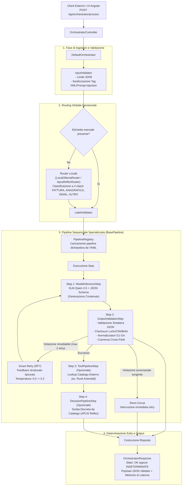

# Documentazione di Progetto — SLM Orchestrator
## Architettura Ibrida Neuro-Simbolica per l'Elaborazione Documentale Deterministica Locale

---

## Indice Generale

1. [Executive Summary e Scopo del Progetto](#1-executive-summary-e-scopo-del-progetto)
2. [Information Priming e Concetti Fondamentali](#2-information-priming-e-concetti-fondamentali)
3. [Architettura Ibrida Neuro-Simbolica](#3-architettura-ibrida-neuro-simbolica)
   - 3.1. [Visione d'Insieme e Flusso Operativo](#31-visione-dinsieme-e-flusso-operativo)
   - 3.2. [Analisi dei Trade-off e Scelte Progettuali](#32-analisi-dei-trade-off-e-scelte-progettuali)
4. [Componenti della Codebase e Flusso Esecutivo](#4-componenti-della-codebase-e-flusso-esecutivo)
   - 4.1. [Ingestion, Sanitizzazione e Sicurezza di Ingresso](#41-ingestion-sanitizzazione-e-sicurezza-di-ingresso)
   - 4.2. [Routing Decisionale a Singolo Token e Mitigazione Artefatti](#42-routing-decisionale-a-singolo-token-e-mitigazione-artefatti)
   - 4.3. [Pipeline Dichiarative YAML e PipelineContext Thread-Safe](#43-pipeline-dichiarative-yaml-e-pipelinecontext-thread-safe)
   - 4.4. [Single Base Model in RAM e Dynamic System Prompts](#44-single-base-model-in-ram-e-dynamic-system-prompts)
   - 4.5. [Gestione della KV-Cache e Prevenzione dei Loop Degeneri](#45-gestione-della-kv-cache-e-prevenzione-dei-loop-degeneri)
   - 4.6. [Guardia Temporale della Pipeline e Timeout di Socket HTTP](#46-guardia-temporale-della-pipeline-e-timeout-di-socket-http)
5. [Le Guardie Simboliche e Determistiche (Specifiche e Snippets)](#5-le-guardie-simboliche-e-deterministiche-specifiche-e-snippets)
   - 5.1. [Guardie di Validazione Algebrica e Formale di Campo](#51-guardie-di-validazione-algebrica-e-formale-di-campo)
   - 5.2. [Guardie Simboliche di Post-Processing (G1, G2, Sesso, G3, G4, Date)](#52-guardie-simboliche-di-post-processing-g1-g2-sesso-g3-g4-date)
   - 5.3. [Guardie di Coerenza Cross-Field e Layout (V1, V2)](#53-guardie-di-coerenza-cross-field-e-layout-v1-v2)
   - 5.4. [Guardia Simbolica di Appartenenza a Catalogo Chiuso](#54-guardia-simbolica-di-appartenenza-a-catalogo-chiuso)
   - 5.5. [Guardia Anti-Cache Piena (PromptCacheGuard)](#55-guardia-anti-cache-piena-promptcacheguard)
6. [Meccanismi di Recupero: Smart Retry (RF7), Short-Circuit e Stato INDETERMINATE](#6-meccanismi-di-recupero-smart-retry-rf7-short-circuit-e-stato-indeterminate)
   - 6.1. [Smart Retry con Zero-Injection di Valori Rifiutati](#61-smart-retry-con-zero-injection-di-valori-rifiutati)
   - 6.2. [Short-Circuit dei Documenti Avversariali](#62-short-circuit-dei-documenti-avversariali)
   - 6.3. [Stato di Dominio INDETERMINATE e Conservazione dell'Output](#63-stato-di-dominio-indeterminate-e-conservazione-delloutput)
7. [Scenari End-to-End di Esempio](#7-scenari-end-to-end-di-esempio)
   - 7.1. [Scenario A: Fattura Commerciale Valida](#71-scenario-a-fattura-commerciale-valida)
   - 7.2. [Scenario B: Documento con Codice Errato nel Testo (Short-Circuit)](#72-scenario-b-documento-con-codice-errato-nel-testo-short-circuit)
   - 7.3. [Scenario C: Email Aziendale e Risoluzione Destinatario da Catalogo](#73-scenario-c-email-aziendale-e-risoluzione-destinatario-da-catalogo)
   - 7.4. [Scenario D: Documento Fuori Dominio (ALTRO)](#74-scenario-d-documento-fuori-dominio-altro)
8. [Risultati Sperimentali e Analisi Oggettiva dei Dati](#8-risultati-sperimentali-e-analisi-oggettiva-dei-dati)
   - 8.1. [Protocollo di Valutazione, Dataset Congelati e Tassonomia Esiti](#81-protocollo-di-valutazione-dataset-congelati-e-tassonomia-esiti)
   - 8.2. [Batteria 1: Ablazione dei Guardrail su Modello 3B](#82-batteria-1-ablazione-dei-guardrail-su-modello-3b)
   - 8.3. [Batteria 2: Confronto Architetturale 3B Orchestrato vs 7B Monolitico](#83-batteria-2-confronto-architetturale-3b-orchestrato-vs-7b-monolitico)
   - 8.4. [Batteria 3: Valutazione del Router Locale a 4 Classi](#84-batteria-3-valutazione-del-router-locale-a-4-classi)
   - 8.5. [Batteria 4: Smart Retry, Coerenza e Risparmio Computazionale](#85-batteria-4-smart-retry-coerenza-e-risparmio-computazionale)
   - 8.6. [Benchmark del Modello Decisionale APUS Reflex (Fasi A e B)](#86-benchmark-del-modello-decisionale-apus-reflex-fasi-a-e-b)
   - 8.7. [Deduzioni Tecnico-Scientifiche Basate Esclusivamente sui Dati](#87-deduzioni-tecnico-scientifiche-basate-esclusivamente-sui-dati)
9. [Glossario Tecnico Rigoroso](#9-glossario-tecnico-rigoroso)
10. [Riferimenti, Risorse e Riproducibilità](#10-riferimenti-risorse-e-riproducibilit)

---

## 1. Executive Summary e Scopo del Progetto

Il progetto **SLM Orchestrator** implementa un'architettura software a microservizio (sviluppata in **Java 21** e **Spring Boot 4**, affiancata da un frontend reattivo **Angular 19**) deputata all'acquisizione, classificazione, estrazione strutturata e validazione deterministica di testi documentali non strutturati o semi-strutturati tipici dell'operatività aziendale: **Fatture**, **Certificati/Richieste Anagrafiche**, **Email di Assistenza/Ticket** e **Documenti Generici Fuori Dominio (`ALTRO`)**.

### Il Problema Operativo e i Limiti dei Paradigmi Esistenti
Le organizzazioni aziendali che gestiscono flussi documentali riservati (dati personali sensibili, segreti commerciali, identificatori fiscali e bancari) affrontano un trilemma tecnologico:
1. **Dipendenza dal Cloud e Privacy**: Inviare documenti riservati verso API commerciali di modelli proprietari su larga scala (LLM) comporta rischi di conformità normativa (GDPR), costi operativi ricorrenti non lineari e latenze soggette a congestione di rete esterna.
2. **Fragilità dei Sistemi Basati su Sole Regole (Approccio Simbolico Puro)**: L'estrazione tramite sole espressioni regolari (regex) o parser statici fallisce di fronte alla variabilità stilistica, alle abbreviazioni, ai refusi testuali e ai formati non standardizzati con cui i documenti arrivano.
3. **Inaffidabilità dei Modelli Linguistici Generativi Liberi (Approccio Neurale Puro)**: I modelli linguistici sono motori probabilistici di continuazione token. Anche i modelli più potenti sono soggetti ad allucinazioni (fabbricazione di dati verosimili ma inesistenti), violazioni strutturali del JSON emesso, mancato rispetto delle relazioni matematiche (es. totale fattura difforme dalla somma di imponibile e imposta) e generazione di codici con caratteri di controllo (checksum) palesemente invalidi.

### La Soluzione Progettuale: Approccio Neuro-Simbolico Locale
**SLM Orchestrator** adotta un'**architettura ibrida neuro-simbolica**:
- La componente **neurale** è affidata a **Small Language Models (SLM)** eseguiti localmente tramite il runtime **Ollama** (`qwen2.5:3b-instruct-q8_0` e alternativamente `7b`, affiancati dal modello decisionale `APUS-Reflex-4B`). L'SLM ha l'unico compito di comprendere il linguaggio naturale, gestire il contesto semantico ed estrarre i frammenti informativi rilevanti vincolandoli a grammatiche formali (JSON Schema).
- La componente **simbolica** è costituita da un motore rigido e deterministico di **guardie algoritmiche, validatori algebrici e filtri di normalizzazione**. I modelli neurali non hanno l'autorità di decidere se un documento è formalmente valido: tale giudizio appartiene al codice simbolico deterministico. Se un codice fiscale, un IBAN o una partita IVA fallisce l'algoritmo di checksum, l'elaborazione non transita a uno stato di successo, ma viene intercettata, corretta tramite cicli di retry controllati (*Smart Retry RF7*) o marcata esplicitamente come **`INDETERMINATE`** per la revisione da parte di un operatore umano (*Human-in-the-Loop*).

---

## 2. Information Priming e Concetti Fondamentali

Per garantire una lettura rigorosa e priva di ambiguità, vengono definiti formalmente i concetti e le grandezze matematiche utilizzate nell'intera relazione.

- **Small Language Model (SLM)**: Modello linguistico neurale compatto, tipicamente con una dimensione compresa tra 1 e 8 miliardi di parametri ($1\text{B} - 8\text{B}$). A differenza degli LLM da centinaia di miliardi di parametri eseguiti in cluster cloud, gli SLM possono essere eseguiti localmente su singola GPU di fascia workstation, iGPU (tramite backend Vulkan) o CPU con memoria unificata, riducendo l'impronta energetica e azzerando i costi di trasmissione dati.
- **Sistema Neuro-Simbolico**: Paradigma computazionale che integra l'apprendimento automatico statistico (reti neurali profonde) con la logica formale deterministica (sistemi basati su regole, grammatiche formali, algebra relazionale). La componente neurale opera come estrattore approssimativo; la componente simbolica funge da supervisore logico insuperabile.
- **Guardrail / Guardia Simbolica**: Procedura algoritmica deterministica eseguita prima, durante o dopo l'inferenza neurale, volta a verificare o imporre invarianti matematiche, sintattiche, semantiche o temporali sull'elaborazione.
- **KV-Cache (Key-Value Cache)**: Struttura dati allocata nella RAM della GPU/acceleratore neurale durante l'elaborazione di un trasformatore (Transformer). Memorizza i tensori di chiave e valore dei token già calcolati nei prompt precedenti. Se il prefisso di una richiesta coincide con una già vista, il runner salta il ricalcolo dei tensori (*Cache Hit*).
- **Stato `INDETERMINATE`**: Esito di dominio dell'orchestratore che certifica l'impossibilità di garantire formalmente la correttezza del risultato (es. codice con checksum errato non correggibile, mancata convergenza del catalogo o timeout esaurito). L'orchestratore non emette uno stato ingannevole di errore generico (`500`) né un falso positivo (`OK`), ma restituisce `INDETERMINATE` preservando il testo non validato per l'audit operatore.
- **Intervallo di Confidenza di Wilson (Wilson Score Interval)**: Metodo statistico per calcolare l'intervallo di confidenza asimmetrico di una proporzione binomiale su campioni discreti, preferito all'approssimazione gaussiana normale di Wald poiché accurato anche in presenza di campioni ridotti ($N < 100$) o proporzioni vicine agli estremi ($0\%$ o $100\%$).
- **Algoritmo di Luhn**: Formula algebrica di controllo basata su somme ponderate a cifre alternate, impiegata a livello normativo per la verifica della cifra finale delle Partite IVA italiane e delle carte di credito.
- **Codice Identificativo Nazionale (CIN)**: Carattere alfabetico di controllo finale del Codice Fiscale italiano, calcolato mediante tabelle ministeriali di conversione differenziate per caratteri in posizione pari e dispari.
- **ISO 7064 MOD 97-10**: Norma internazionale di controllo algebrico applicata alle coordinate bancarie internazionali (IBAN), fondata sulla conversione alfanumerica e sul calcolo del resto modulo 97.
- **Greedy Decoding (`temperature = 0.0`)**: Strategia di campionamento neurale in cui, a ogni passo di generazione autoregressiva, viene selezionato esclusivamente il token con la probabilità logaritmica (*logprob*) più elevata, garantendo la riproducibilità deterministica dell'output a parità di prompt e seed.

---

## 3. Architettura Ibrida Neuro-Simbolica

### 3.1. Visione d'Insieme e Flusso Operativo

L'architettura del sistema si articola su quattro strati funzionali chiaramente segregati, orchestrati dalla classe [`DefaultOrchestrator`](file:///home/del/Projects/slm-orchestrator/src/main/java/com/tirocinioaltrama/slmorchestrator/impl/DefaultOrchestrator.java).



### 3.2. Analisi dei Trade-off e Scelte Progettuali

Per comprendere il funzionamento del sistema è necessario illustrare i motivi tecnici che hanno portato a scartare le architetture alternative:

#### Scelta A: Pipeline Specializzate + Router vs Prompt Monolitico Unico
- *Approccio Alternativo (Scartato)*: Inviare il testo a un unico mega-prompt contenente le istruzioni congiunte per riconoscere fatture, anagrafiche, email e altri documenti, associando un JSON Schema "a busta" unificato con tutti i possibili campi annidati.
- *Motivazione del Rifiuto (Supportata da Dati Empirici)*: Come provato sperimentalmente nella **Batteria 1**, il prompt monolitico causa un collasso delle prestazioni sugli SLM ($3\text{B}$ e persino $7\text{B}$). Sul dataset Held-Out, il modello 3B monolitico scende a un'accuratezza sui campi del **58.9%** (contro il **95.2%** dell'orchestratore). L'attenzione dei modelli compatti si disperde nel tentativo di valutare regole eterogenee, provocando l'omissione sistematica di campi obbligatori (`C2a`) e il fallimento completo sulle email (**0/14 documenti corretti**). La scomposizione modulare tramite Router specializzato riduce la dimensione del prompt, specializza lo spazio delle risposte e consente a ciascuna pipeline di concentrare la KV-Cache su un unico schema ristretto.

#### Scelta B: Validazione Integrata nella Pipeline vs Guardrail Puramente Post-Hoc
- *Approccio Alternativo (Scartato)*: Lasciare che il modello generi liberamente l'output e applicare i filtri e le validazioni soltanto alla fine, a valle del processo, scartando i documenti errati.
- *Motivazione del Rifiuto*: I guardrail post-hoc non possono recuperare l'informazione mancante. Se un prompt monolitico ha dimenticato un campo o ha prodotto un JSON incompleto, un controllo a valle può solo rifiutare la richiesta, senza possibilità di rimedio. Inoltre, nei documenti con dati corrotti all'origine (es. P.IVA con cifra di controllo errata), un modello monolitico tende a spostare il codice invalido su campi opzionali o a metterlo a `null`, ingannando il validatore post-hoc che lo accetta erroneamente come `OK` (falso positivo). Integrando le guardie nel ciclo di vita della pipeline con feedback contestuale (*in-pipeline*), l'orchestratore guida il modello a correggere l'errore o intercetta l'anomalia prima dell'uscita.

#### Scelta C: Single Base Model + Dynamic System Prompts vs Modelli Multipli Residenti
- *Approccio Alternativo (Scartato)*: Mantenere in esecuzione su Ollama 4 o 5 modelli specializzati separati (es. un modello fine-tuned per le fatture, uno per le anagrafiche, uno per il router).
- *Motivazione del Rifiuto*: Ciascun modello caricato in memoria grafica (VRAM) o di sistema alloca uno spazio fisso proporzionale ai suoi parametri quantizzati (circa $3.4\text{ GB}$ per un modello 3B Q8, o $7.7\text{ GB}$ per un 7B Q8). Mantenere attivi multipli processi runner satura rapidamente la memoria unificata e causa continui swap su disco o crash per Out-Of-Memory (OOM). L'orchestratore adotta l'architettura **"Single Base Model + Dynamic System Prompts"**: un unico demone Ollama ospita il modello base quantizzato (`qwen2.5:3b-instruct-q8_0`), e il sistema vi inietta a runtime via API il System Prompt e lo schema JSON specifici per lo step corrente. In questo modo il footprint in RAM resta costante e invariante rispetto al numero di pipeline registrate.

---

## 4. Componenti della Codebase e Flusso Esecutivo

### 4.1. Ingestion, Sanitizzazione e Sicurezza di Ingresso

La fase di ingresso è gestita dal componente [`InputValidator`](file:///home/del/Projects/slm-orchestrator/src/main/java/com/tirocinioaltrama/slmorchestrator/impl/InputValidator.java). Ogni richiesta in arrivo su `POST /api/orchestrator/process` viene sottoposta a rigorosi vincoli prima di raggiungere qualsiasi componente neurale:
1. **Vincolo di Lunghezza Massima**: Il payload testuale non può superare la dimensione massima consentita di **32.768 caratteri** (`MAX_PAYLOAD_LENGTH`). L'eccedenza genera un'eccezione di validazione immediata (`HTTP 422`), prevenendo attacchi di Denial of Service (DoS) basati sull'esaurimento della finestra di contesto o della memoria di calcolo del backend.
2. **Sanitizzazione Strutturale XML**: L'input dell'utente viene incapsulato all'interno del tag `<payload> ... </payload>` nei prompt inviati agli SLM. Se il testo utente contiene a sua volta tag di chiusura arbitrari (come `</payload>`, `</input>`, `</context>`), questi vengono neutralizzati tramite escape per prevenire attacchi di **Prompt Injection** mirati a evadere dal recinto del dato e impartire nuove istruzioni di sistema al modello.

### 4.2. Routing Decisionale a Singolo Token e Mitigazione Artefatti

Se la richiesta HTTP non specifica esplicitamente il `documentType` nel corpo JSON, interviene il router automatico. L'orchestratore implementa due router alternativi configurabili tramite la property `router.type`:

1. **`LocalOllamaRouter`** ([`LocalOllamaRouter.java`](file:///home/del/Projects/slm-orchestrator/src/main/java/com/tirocinioaltrama/slmorchestrator/impl/router/LocalOllamaRouter.java)):
   - Sfrutta il modello generativo di base (`qwen2.5:3b-instruct-q8_0`) istruito con il prompt [`prompts/router-system.txt`](file:///home/del/Projects/slm-orchestrator/src/main/resources/prompts/router-system.txt).
   - Classifica il testo documentale in una tra quattro categorie: `FATTURA`, `ANAGRAFICA`, `EMAIL`, `ALTRO`.
   - Latenza misurata: mediana di **341–421 ms**; accuratezza sul set Held-Out out-of-sample: **98.0%** (49/50).

2. **`ApusReflexRouter`** ([`ApusReflexRouter.java`](file:///home/del/Projects/slm-orchestrator/src/main/java/com/tirocinioaltrama/slmorchestrator/impl/router/ApusReflexRouter.java)):
   - Utilizza il modello compatto specializzato `APUS-Reflex-4B` ottimizzato per decisioni discrete a singolo token (`num_predict: 1`).
   - Presenta le 4 classi come scelte a lettere multiple (`A`, `B`, `C`, `D`).

> [!IMPORTANT]
> **Risoluzione dell'Artefatto di Misura del Thinking (`think: false`)**:  
> Durante le prime indagini empiriche su APUS Reflex 4B, impostando `num_predict: 1` con l'endpoint standard `/api/chat` di Ollama, il modello produceva sistematicamente la stringa `"The"` anziché la lettera attesa `A`..`D`. L'indagine approfondita ha dimostrato che non si trattava di un deficit cognitivo, ma dell'attivazione della catena interna di pensiero (`<think> ... </think>`): limitando l'emissione a 1 solo token, il runtime catturava il primo token del ragionamento interiore (*"The user wants..."*), lasciando vuoto il campo di contenuto. Disattivando esplicitamente il reasoning tramite il parametro `"think": false` inoltrato a Ollama, il modello risponde con la singola lettera `A`..`D` nel **100.0% delle prove**, eliminando ogni bias posizionale apparente.

### 4.3. Pipeline Dichiarative YAML e PipelineContext Thread-Safe

Le logiche di elaborazione per ciascuna tipologia documentale non sono cablate nel codice Java compilato, ma sono definite in file di configurazione YAML ([`src/main/resources/pipelines/`](file:///home/del/Projects/slm-orchestrator/src/main/resources/pipelines/)):
- `fattura.yaml`: Estrazione dati fiscali (fornitore, cliente, totali, iban) con validatori algebrici e retry.
- `anagrafica.yaml`: Estrazione dati anagrafici con normalizzatori, coerenza codice fiscale e controlli di sesso/data.
- `email.yaml`: Pipeline a due stadi di inferenza: primo stadio di estrazione semantica (`email_inference`), step intermedio di lookup ruoli tramite tool Java ([`CompanyRolesTool.java`](file:///home/del/Projects/slm-orchestrator/src/main/java/com/tirocinioaltrama/slmorchestrator/impl/tool/CompanyRolesTool.java)), e secondo stadio decisionale (`recipient_inference`) con validazione a catalogo chiuso ([`CatalogMembershipGuard.java`](file:///home/del/Projects/slm-orchestrator/src/main/java/com/tirocinioaltrama/slmorchestrator/impl/pipeline/guard/CatalogMembershipGuard.java)).
- `altro.yaml`: Pipeline per documenti fuori dominio.

Queste pipeline vengono lette al bootstrap da [`YamlPipelineLoader.java`](file:///home/del/Projects/slm-orchestrator/src/main/java/com/tirocinioaltrama/slmorchestrator/impl/pipeline/config/YamlPipelineLoader.java) e istanziate come oggetti [`BasePipeline`](file:///home/del/Projects/slm-orchestrator/src/main/java/com/tirocinioaltrama/slmorchestrator/impl/pipeline/BasePipeline.java). Lo stato di esecuzione durante l'attraversamento degli step risiede esclusivamente nell'istanza effimera di [`PipelineContext`](file:///home/del/Projects/slm-orchestrator/src/main/java/com/tirocinioaltrama/slmorchestrator/core/pipeline/PipelineContext.java) allocata sullo stack della richiesta, garantendo la totale sicurezza in contesti multi-thread concorrenti senza variabili di classe condivise mutabili.

### 4.4. Single Base Model in RAM e Dynamic System Prompts

Per conciliare alte prestazioni e basso consumo di memoria RAM, l'orchestratore non invoca sessioni separate di Ollama per ciascun task, ma condivide il modello base `qwen2.5:3b-instruct-q8_0` mantenuto stabilmente in memoria tramite l'opzione `ollama.keep-alive=60m`. A ogni step della pipeline:
1. Viene caricato il system prompt dedicato memorizzato in `src/main/resources/prompts/` (es. `fattura-system.txt`, `anagrafica-system.txt`, `email-system.txt`).
2. Viene caricato il file JSON Schema corrispondente da `src/main/resources/schemas/` (es. `fattura_info.json`).
3. La chiamata REST inviata a Ollama specifica il parametro `format: {schema...}`, costringendo il decoder dell'SLM ad aderire deterministicamente alla sintassi JSON e ai tipi di dato richiesti (*Grammar-Guided Constrained Decoding*).

### 4.5. Gestione della KV-Cache e Prevenzione dei Loop Degeneri

L'elaborazione locale tramite Ollama memorizza i tensori di attenzione nella KV-Cache del processo di inferenza. Quando due richieste consecutive presentano esattamente lo stesso prefisso (ad esempio, inviando due volte lo stesso testo documentale saltando il router), il runner Ollama trova l'intero prompt già presente nella cache (*Stato di Cache Piena*). Su alcune architetture e versioni di runner locale, questo stato provoca risposte degenerate o cicli vuoti.

Per scongiurare questo difetto, l'orchestratore integra la classe [`PromptCacheGuard`](file:///home/del/Projects/slm-orchestrator/src/main/java/com/tirocinioaltrama/slmorchestrator/impl/model/PromptCacheGuard.java):
- La guardia calcola un digest SHA-256 della tupla `(model, systemPrompt, userPrompt)`.
- Se la richiesta è identica alla precedente, antepone al testo utente un marcatore monotono di cache-busting: `<request_id>N</request_id>`.
- In questo modo, il System Prompt rimane byte-identico (e quindi riutilizzato dalla cache dei token di sistema), mentre l'involucro del messaggio utente viene invalidato a partire dal primo token, costringendo il runner a calcolare sempre lo stato di **Cache Parziale** ed eliminando i blocchi operativi.

### 4.6. Guardia Temporale della Pipeline e Timeout di Socket HTTP

Nel sistema operano due livelli distinti di protezione temporale:
1. **Timeout di Rete Socket HTTP (`ollama.read-timeout = 240s`)**: Configurato in [`OllamaProperties.java`](file:///home/del/Projects/slm-orchestrator/src/main/java/com/tirocinioaltrama/slmorchestrator/config/ollama/OllamaProperties.java#L115) e riflesso sul reverse proxy in [`frontend/nginx.conf`](file:///home/del/Projects/slm-orchestrator/frontend/nginx.conf#L19). Stabilisce il tempo limite massimo per la ricezione dei pacchetti TCP dal socket di Ollama durante una singola inferenza complessa.
2. **Guardia Temporale Simbolica di Esecuzione (`orchestrator.pipeline.max-duration-ms = 120000`)**: Configurata in [`application.properties`](file:///home/del/Projects/slm-orchestrator/src/main/resources/application.properties#L37) e applicata attivamente dal ciclo `while` di [`BasePipeline.java`](file:///home/del/Projects/slm-orchestrator/src/main/java/com/tirocinioaltrama/slmorchestrator/impl/pipeline/BasePipeline.java#L114-L134). Questa guardia controlla il tempo cumulato speso nell'intera catena di step (compresi eventuali retry multipli, chiamate a tool e invocazioni del modello di escalation). Se il tempo trascorso supera i 120 secondi, l'esecuzione viene interrotta forzatamente, registrando un `FieldError` con codice `ValidationErrorCode.INFERENCE_ERROR` (*"Tempo massimo di esecuzione pipeline superato (120000 ms)"*) e transitando a `INDETERMINATE`.

---

## 5. Le Guardie Simboliche e Determistiche (Specifiche e Snippets)

### 5.1. Guardie di Validazione Algebrica e Formale di Campo

I modelli linguistici non sanno eseguire in modo affidabile calcoli aritmetici o algoritmi crittografici di checksum. L'orchestratore delega tale compito a validatori Java puri implementati nel package [`com.tirocinioaltrama.slmorchestrator.core.validation.field`](file:///home/del/Projects/slm-orchestrator/src/main/java/com/tirocinioaltrama/slmorchestrator/core/validation/field/):

#### Validatore Partita IVA ([`PartitaIvaValidator.java`](file:///home/del/Projects/slm-orchestrator/src/main/java/com/tirocinioaltrama/slmorchestrator/core/validation/field/PartitaIvaValidator.java))
Verifica la struttura formale (11 cifre numeriche, eventuale prefisso paese `IT`), controlla che le prime 7 cifre (matricola) e le cifre 8–10 (codice ufficio) non siano composte da soli zeri, ed esegue la formula di Luhn a pesi alternati:

```java
private boolean validateChecksum(String digits) {
    int sum = 0;
    for (int i = 0; i < 10; i++) {
        int digit = Character.digit(digits.charAt(i), 10);
        if (i % 2 == 0) {
            // Posizioni dispari (1-based: 1, 3, 5, 7, 9 -> indici 0, 2, 4, 6, 8)
            sum += digit;
        } else {
            // Posizioni pari (1-based: 2, 4, 6, 8, 10 -> indici 1, 3, 5, 7, 9)
            int doubled = digit * 2;
            sum += (doubled > 9) ? (doubled - 9) : doubled;
        }
    }
    int expectedCheckDigit = (10 - (sum % 10)) % 10;
    int actualCheckDigit = Character.digit(digits.charAt(10), 10);
    return expectedCheckDigit == actualCheckDigit;
}
```

#### Validatore Codice Fiscale ([`CodiceFiscaleValidator.java`](file:///home/del/Projects/slm-orchestrator/src/main/java/com/tirocinioaltrama/slmorchestrator/core/validation/field/CodiceFiscaleValidator.java))
Verifica l'espressione regolare formale a 16 caratteri alfanumerici e calcola il carattere di controllo alfabetico finale (CIN) mediante le tabelle ministeriali di conversione per indici pari e dispari:

```java
int sum = 0;
for (int i = 0; i < 15; i++) {
    char c = cf.charAt(i);
    if ((i + 1) % 2 != 0) {
        sum += ODD_VALUES.get(c); // Tabella valori posizioni dispari
    } else {
        sum += EVEN_VALUES.get(c); // Tabella valori posizioni pari
    }
}
char expectedCin = (char) ('A' + (sum % 26));
return expectedCin == cf.charAt(15);
```

#### Validatore Coordinate Bancarie IBAN ([`IbanValidator.java`](file:///home/del/Projects/slm-orchestrator/src/main/java/com/tirocinioaltrama/slmorchestrator/core/validation/field/IbanValidator.java))
Verifica la lunghezza del codice in base al paese (27 caratteri per l'Italia `IT`), sposta i primi 4 caratteri in coda, trasforma le lettere nei corrispondenti valori numerici ($A=10 \dots Z=35$) e calcola l'invariante algebrico $MOD\ 97 == 1$:

```java
// Standard ISO 7064 MOD 97-10
String rearranged = cleanIban.substring(4) + cleanIban.substring(0, 4);
BigInteger ibanNumber = new BigInteger(numericString.toString());
return ibanNumber.mod(BigInteger.valueOf(97)).intValue() == 1;
```

---

### 5.2. Guardie Simboliche di Post-Processing (G1, G2, Sesso, G3, G4, Date)

Nel componente [`PostProcessingGuards.java`](file:///home/del/Projects/slm-orchestrator/src/main/java/com/tirocinioaltrama/slmorchestrator/impl/pipeline/guard/PostProcessingGuards.java) sono incapsulate le regole simboliche deterministiche volte a ripulire le tipiche imprecisioni lessicali introdotte dai modelli linguistici:

1. **Guardia G1 (Normalizzazione Denominazioni)**: Rimuove prefissi amministrativi descrittivi (*"Società Fornitrice:"*, *"Fornitore:"*, *"Cliente:"*) e titoli onorifici (*"Spett.le"*, *"Dott."*, *"Ing."*, *"Gentile"*) lasciando unicamente la ragione sociale o il nominativo anagrafico canonico.
2. **Guardia G2 (Evidenza Lessicale ed Ente Rilascio)**: Nei documenti di identità, i modelli tendono ad allucinare enti non presenti nel testo. La guardia calcola l'intersezione lessicale tra i token significativi estratti in `enteRilascio` e le parole del documento originale. Se la copertura è inferiore al **60%**, il valore viene annullato a `null`.
3. **Guardia Evidenza Sesso**: Azzeramento a `null` del campo `sesso` (`M`/`F`) se la radice lessicale `"sesso"` non compare esplicitamente nel testo di partenza (prevenendo inferenze arbitrarie basate sul nome proprio).
4. **Guardia G3 (Recupero Omissioni Codificate)**: Riconosce formati strutturati standard non colti dal modello (es. data rilascio patente registrata al punto `4a.` del layout europeo, o sigla provincia associata al comune di nascita).
5. **Guardia G4 (Normalizzazione Enum)**: Mappa sinonimi eterogenei (`"PATENTE_GUIDA"`, `"CIE"`, `"CF"`) sull'insieme chiuso dei tipi documento ammessi (`CARTA_IDENTITA`, `PASSAPORTO`, `PATENTE`, `TESSERA_SANITARIA`, `NON_SPECIFICATO`).
6. **Guardia Date Tipizzate**: Se il modello genera stringhe discorsive o prive di cifre all'interno di un campo contrassegnato come data (es. *"non disponibile"*, *"data sconosciuta"*), la guardia lo converte forzatamente a `null` JSON.

---

### 5.3. Guardie di Coerenza Cross-Field e Layout (V1, V2)

Nel componente [`AnagraficaCoherenceValidator.java`](file:///home/del/Projects/slm-orchestrator/src/main/java/com/tirocinioaltrama/slmorchestrator/impl/pipeline/guard/AnagraficaCoherenceValidator.java) risiedono le regole di consistenza logica incrociata:

- **Regola V1 (Coerenza Layout Numerato Europeo)**: Nelle patenti di guida e nei modelli unificati dell'Unione Europea, la dicitura numerata indica universalmente `1. COGNOME` e `2. NOME`. Quando il testo presenta questa formattazione, l'ordine è insindacabile.
- **Regola V2 (Cross-Check Codice Fiscale $\leftrightarrow$ Cognome/Nome)**: L'algoritmo estrae le consonanti e le vocali di `nome` e `cognome` e verifica la corrispondenza con i primi 6 caratteri alfabetici del Codice Fiscale presente nel documento:

$$\text{CF}_{0..2} \approx f_{\text{consonanti}}(\text{Cognome}), \quad \text{CF}_{3..5} \approx f_{\text{consonanti}}(\text{Nome})$$

Se il modello linguistico ha invertito Nome e Cognome, la guardia rileva che le prime tre consonanti del Codice Fiscale corrispondono al nome anziché al cognome, sollevando la violazione specifica:

```java
if (matchesConsonants(cfCognomePart, nome) && matchesConsonants(cfNomePart, cognome)) {
    return CoherenceCheckResult.invalid(
        "anagrafica",
        ValidationErrorCode.FIELD_SWAP_DETECTED.name(),
        "Rilevata inversione cross-field: il cognome estratto corrisponde alla porzione del nome nel CF."
    );
}
```

Questo errore scatena il loop di **Smart Retry** con istruzioni puntuali di riordino.

---

### 5.4. Guardia Simbolica di Appartenenza a Catalogo Chiuso

Implementata in [`CatalogMembershipGuard.java`](file:///home/del/Projects/slm-orchestrator/src/main/java/com/tirocinioaltrama/slmorchestrator/impl/pipeline/guard/CatalogMembershipGuard.java), opera a valle di step di disambiguazione semantica (come l'assegnazione di un destinatario per un ticket email):

```java
public class CatalogMembershipGuard implements Validator<String> {
    private final Set<String> allowedValues;

    public ValidationResult validate(String value) {
        if (value == null || !allowedValues.contains(value.trim().toLowerCase(Locale.ROOT))) {
            return ValidationResult.withFieldErrors(
                List.of(new FieldError("destinatario", "catalog_membership",
                    ValidationErrorCode.VALUE_NOT_IN_CATALOG,
                    "Il valore '" + value + "' non appartiene all'insieme discreto autorizzato.")),
                List.of()
            );
        }
        return ValidationResult.valid();
    }
}
```

Nessun valore inventato o dedotto dall'SLM può oltrepassare questa guardia se non è rigorosamente contenuto nel catalogo aziendale (`mock/company_roles.json`).

---

### 5.5. Guardia Anti-Cache Piena (PromptCacheGuard)

Implementata in [`PromptCacheGuard.java`](file:///home/del/Projects/slm-orchestrator/src/main/java/com/tirocinioaltrama/slmorchestrator/impl/model/PromptCacheGuard.java), monitora l'hash SHA-256 delle richieste verso Ollama per garantire che il runner operi costantemente in regime di cache parziale:

```java
public synchronized String apply(String model, String systemPrompt, String userPrompt) {
    String fingerprint = fingerprint(model, systemPrompt, userPrompt);
    if (!fingerprint.equals(lastFingerprint)) {
        lastFingerprint = fingerprint;
        return userPrompt;
    }
    busterCounter++;
    return MARKER_PREFIX + busterCounter + MARKER_SUFFIX + (userPrompt != null ? userPrompt : "");
}
```

---

## 6. Meccanismi di Recupero: Smart Retry (RF7), Short-Circuit e Stato INDETERMINATE

### 6.1. Smart Retry con Zero-Injection di Valori Rifiutati

Quando uno step di validazione rileva una non conformità sanabile (es. schema JSON incompleto, inversione campi `FIELD_SWAP_DETECTED`, o valore non appartenente al catalogo), l'orchestratore attiva la procedura **RF7 (Smart Retry)**:
- Vengono concessi fino a un massimo di **2 retry** sullo stesso step (`max_retries = 2`).
- A ogni tentativo di retry, la temperatura di campionamento viene incrementata leggermente (da `0.0` a `0.2`) per consentire all'SLM di esplorare percorsi di decodifica alternativi attorno al punto critico.
- Viene generato un messaggio di feedback strutturato tramite [`ValidationFeedbackBuilder.java`](file:///home/del/Projects/slm-orchestrator/src/main/java/com/tirocinioaltrama/slmorchestrator/impl/pipeline/ValidationFeedbackBuilder.java).

> [!CAUTION]
> **Sicurezza Anti-Injection nel Feedback**:  
> Per evitare vulnerabilità di tipo *Second-Order Prompt Injection*, il builder di feedback **non re-inietta mai il valore non valido emesso dal modello o presente nel testo**. Se un utente malevolo inserisse una formula di iniezione all'interno del campo P.IVA, rimandare indietro tale stringa all'SLM offrirebbe una superficie di attacco reiterata. Il feedback segnala esclusivamente il percorso del campo (`path`) e la descrizione astratta della violazione:

```java
// Costruzione deterministica sicura priva del valore rifiutato
sb.append("- Campo '").append(err.path()).append("': ").append(describeError(err)).append("\n");
```

---

### 6.2. Short-Circuit dei Documenti Avversariali

Cosa succede se un documento in ingresso contiene fin dall'origine un dato formalmente errato (es. una fattura in cui l'emittente ha stampato una Partita IVA con checksum matematico errato)?
- Se l'orchestratore insistesse con i retry chiedendo all'SLM *"correggi la Partita IVA"*, forzerebbe il modello ad **allucinare**: l'SLM dovrebbe inventare una cifra valida non presente nel documento reale, violando il principio di fedeltà al testo di partenza.
- Per risolvere questo problema, [`OutputValidationStep.java`](file:///home/del/Projects/slm-orchestrator/src/main/java/com/tirocinioaltrama/slmorchestrator/impl/pipeline/OutputValidationStep.java#L220-L238) verifica se il valore estratto con checksum invalido compare **letteralmente (verbatim) nel payload testuale sorgente**.
- Se il controllo è positivo, la violazione viene classificata con il codice speciale **`SOURCE_CHECKSUM_INVALID`**.
- In [`BasePipeline.java`](file:///home/del/Projects/slm-orchestrator/src/main/java/com/tirocinioaltrama/slmorchestrator/impl/pipeline/BasePipeline.java#L200-L204), quando tutti gli errori sono di tipo `SOURCE_CHECKSUM_INVALID`, il sistema attiva il **Cortocircuito Immediato (Short-Circuit)**: salta tutti i retry rimanenti e commuta istantaneamente la risposta a **`INDETERMINATE`**.

Come dimostrato empiricamente nei test, questo meccanismo garantisce il **risparmio del 66.7% delle chiamate di inferenza neurale sui documenti avversariali**, azzerando il tempo sprecato a chiedere al modello di correggere un testo fisicamente immutabile.

---

### 6.3. Stato di Dominio INDETERMINATE e Conservazione dell'Output

L'orchestratore gestisce gli insuccessi secondo la filosofia del controllo di processo:
- **Nessun Falso Positivo**: Un dato che non soddisfa i vincoli simbolici non viene mai restituito con lo stato di successo `OK`.
- **Nessuna Caduta nel Vuoto**: Invece di restituire un errore HTTP 500 vuoto che nasconderebbe quanto accaduto, l'orchestratore emette un payload di stato `INDETERMINATE`.
- **Conservazione dell'Output Grezzo**: Il campo `unvalidatedResult` della risposta contiene il JSON integrale estratto dall'SLM prima del blocco. In questo modo, l'operatore umano di revisione trova tutti i campi già compilati a video (ad esempio nel frontend Angular), con l'evidenziazione visiva del singolo campo che ha violato la guardia.

---

## 7. Scenari End-to-End di Esempio

### 7.1. Scenario A: Fattura Commerciale Valida

#### Input Utente (`POST /api/orchestrator/process`)
```json
{
  "payload": "Fattura Elettronica n. 2026/044 emessa da Studio Tecnico Alpha S.r.l., P.IVA IT01234567890. Committente: Rossi Costruzioni S.p.A., C.F. 80012340151. Imponibile: 1000.00 €, IVA 22%: 220.00 €, Totale: 1220.00 €. Pagamento a 30 gg tramite bonifico bancario su conto corrente intestato al fornitore con IBAN: IT02L1234512345000000012345."
}
```

#### Esecuzione della Pipeline
1. `InputValidator`: Payload di 342 caratteri (< 32KB). Nessun tag malevolo.
2. `LocalOllamaRouter`: Identifica le parole chiave fiscali e l'impostazione tabellare. Classifica il documento come `FATTURA` (latenza: 338 ms).
3. `BasePipeline (fattura_pipeline)`:
   - `ModelInferenceStep`: Invocazione SLM Qwen 2.5 3B con `schemas/fattura_info.json`. Generazione completata in 5.8s.
   - `OutputValidationStep`:
     - Normalizzatore G1 ripulisce la denominazione fornitore in `"Studio Tecnico Alpha S.r.l."`.
     - Validatore Partita IVA esegue Luhn su `01234567890`: valido.
     - Validatore Codice Fiscale verifica formato e CIN su `80012340151`: valido.
     - Validatore IBAN esegue ISO 7064 MOD 97 su `IT02L...`: valido.
     - Coerenza algebrica: $1000.00 + 220.00 = 1220.00$: coerente.
4. Esito finale: **`OK`**.

#### Output Risposta
```json
{
  "status": "OK",
  "label": "FATTURA",
  "router": "local-ollama",
  "result": "{\n  \"numeroFattura\": \"2026/044\",\n  \"dataFattura\": null,\n  \"fornitore\": {\n    \"denominazione\": \"Studio Tecnico Alpha S.r.l.\",\n    \"partitaIva\": \"IT01234567890\"\n  },\n  \"cliente\": {\n    \"denominazione\": \"Rossi Costruzioni S.p.A.\",\n    \"codiceFiscale\": \"80012340151\"\n  },\n  \"totale\": 1220.00,\n  \"iban\": \"IT02L1234512345000000012345\"\n}",
  "errors": [],
  "latencyMs": 6214
}
```

---

### 7.2. Scenario B: Documento con Codice Errato nel Testo (Short-Circuit)

#### Input Utente
```json
{
  "documentType": "FATTURA",
  "payload": "Fattura n. 99 del 12/03/2026 da Beta Impianti S.n.c., P.IVA 12345678903. Totale: 500 €."
}
```
*(Nota: la P.IVA `12345678903` ha la cifra di controllo errata secondo l'algoritmo di Luhn; la cifra corretta sarebbe `8`).*

#### Esecuzione della Pipeline
1. `ModelInferenceStep`: L'SLM estrae fedelmente dal testo `"12345678903"`.
2. `OutputValidationStep`:
   - `PartitaIvaValidator` esegue Luhn e fallisce (`CHECKSUM_INVALID`).
   - Il validatore esegue la ricerca testuale nel payload sorgente: la stringa `"12345678903"` è contenuta letteralmente nel testo di input.
   - La violazione viene convertita in `ValidationErrorCode.SOURCE_CHECKSUM_INVALID`.
3. `BasePipeline`:
   - Rileva che l'unico errore presente è di tipo `SOURCE_CHECKSUM_INVALID`.
   - Attiva il **cortocircuito avversariale**: azzera i 2 retry pianificati in `on_failure`.
   - Transita immediatamente a `INDETERMINATE`.

#### Output Risposta
```json
{
  "status": "INDETERMINATE",
  "label": "FATTURA",
  "unvalidatedResult": "{\n  \"numeroFattura\": \"99\",\n  \"fornitore\": {\n    \"partitaIva\": \"12345678903\"\n  },\n  \"totale\": 500.0\n}",
  "errors": [
    {
      "path": "fornitore.partitaIva",
      "validatorName": "partita_iva",
      "code": "SOURCE_CHECKSUM_INVALID",
      "message": "Il codice di controllo della partita IVA non è valido (checksum Luhn errato per '12345678903'). [Dato invalido presente letteralmente nel testo sorgente: retry omesso]"
    }
  ],
  "latencyMs": 4680
}
```

---

### 7.3. Scenario C: Email Aziendale e Risoluzione Destinatario da Catalogo

#### Input Utente
```json
{
  "documentType": "EMAIL",
  "payload": "Da: claudia.verdi@partner.com\nOggetto: Mancata contabilizzazione pagamento fattura 45\nBuongiorno, vi scrivo per segnalare che il bonifico inviato ieri relativo alla fattura 45 risulta ancora non contabilizzato. Potete verificare lo stato del credito?\nGrazie, Claudia."
}
```

#### Esecuzione della Pipeline (`email_pipeline`)
1. **Step 1 (`email_inference`)**: Estrae l'evento semantico (`"richiesta verifica pagamento bonifico non contabilizzato"`).
2. **Step 2 (`email_validation`)**: Verifica la validità formale dell'email del mittente (`claudia.verdi@partner.com` conforme RFC).
3. **Step 3 (`roles_lookup`)**: Esegue il tool [`CompanyRolesTool.java`](file:///home/del/Projects/slm-orchestrator/src/main/java/com/tirocinioaltrama/slmorchestrator/impl/tool/CompanyRolesTool.java) che carica i ruoli aziendali dal catalogo autorizzato (`mock/company_roles.json`).
4. **Step 4 (`recipient_inference`)**: Invocazione decisionale: sulla base del catalogo ruoli (`Amministrazione`, `Ufficio Acquisti`, `Supporto Tecnico`, `Logistica`), determina che la richiesta riguarda l'**Amministrazione**.
5. **Step 5 (`recipient_validation`)**: [`CatalogMembershipGuard`](file:///home/del/Projects/slm-orchestrator/src/main/java/com/tirocinioaltrama/slmorchestrator/impl/pipeline/guard/CatalogMembershipGuard.java) verifica che `"Amministrazione"` esista nell'insieme autorizzato.
6. Esito finale: **`OK`**.

---

### 7.4. Scenario D: Documento Fuori Dominio (`ALTRO`)

#### Input Utente
```json
{
  "payload": "Verbale di assemblea di condominio del 14 Ottobre 2026. Ordine del giorno: approvazione bilancio preventivo e rifacimento impermeabilizzazione terrazza comune. Presenti 14 condomini su 20."
}
```

#### Esecuzione della Pipeline
1. `LocalOllamaRouter`: Rileva assenza di elementi fiscali, anagrafici individuali o corrispondenza di ticket.
2. Assegna l'etichetta `ALTRO` (latenza: 395 ms).
3. Viene attivata `altro_pipeline`: estrae una sintesi descrittiva in formato neutro JSON senza imporre validazioni algebriche non applicabili.
4. Esito finale: **`OK`** (etichetta `ALTRO`).

---

## 8. Risultati Sperimentali e Analisi Oggettiva dei Dati

### 8.1. Protocollo di Valutazione, Dataset Congelati e Tassonomia Esiti

Tutte le metriche esposte in questa sezione provengono da benchmark sistematici eseguiti su codice compilato e congelato al commit `freeze-1`.

- **Hardware e Runtime**:
  - Modello 3B (`qwen2.5:3b-instruct-q8_0`): esecuzione interamente su **iGPU AMD via Vulkan** con memoria unificata VRAM allocata.
  - Modello 7B (`qwen2.5:7b-instruct-q8_0`): esecuzione in split ibrido GPU/CPU per limiti di capienza VRAM (per tale ragione, i tempi di latenza del 7B non sono confrontabili direttamente con quelli del 3B).
- **Parametri di Decodifica**: `temperature = 0.0`, `seed = 42`, `num_ctx = 2048`, `num_predict = 400`, `repeat_penalty = 1.0`, `keep_alive = 60m`.
- **Tassonomia Rigorosa delle Categorie di Esito Documentale**:
  - **`C1`**: Stato `OK` dell'orchestratore e **tutti** i campi estratti coincidono perfettamente con la Ground Truth annotata.
  - **`C2`**: Stato `OK`, ma con discrepanze rispetto alla Ground Truth:
    - `C2a`: Chiavi mancanti o schema JSON parziale generato dal modello.
    - `C2b`: Schema completo, ma almeno un valore estratto è errato o mancante rispetto al testo.
    - `C2c`: Tutti i campi presenti, ma il modello ha valorizzato arbitrariamente un campo che nella Ground Truth era atteso a `null` (`VALORE_SU_NULL_ATTESO`).
  - **`C3`**: Stato `INDETERMINATE` (blocco corretto dalle guardie simboliche) con tutti i campi estratti fedeli al testo di input.
  - **`C4`**: Stato `INDETERMINATE` con almeno un campo non fedele al testo.
  - **`C5`**: Errore di sistema, crash dell'infrastruttura o JSON corrotto non analizzabile (**$0$ casi registrati su tutte le oltre $1.000$ inferenze eseguite**).

---

### 8.2. Batteria 1: Ablazione dei Guardrail su Modello 3B

Valutazione dell'impatto architetturale sul modello `qwen2.5:3b-instruct-q8_0` confrontando:
1. `3B_CON_GUARDRAIL`: Orchestratore neuro-simbolico completo.
2. `3B_ABLAZIONE_GUARDRAIL`: Orchestratore con guardie di coerenza disattivate (`guards.enabled=false`, `coherence.enabled=false`).
3. `3B_MONOLITICO_SENZA_GUARDRAIL`: Chiamata diretta singola con mega-prompt monolitico e schema unificato a busta, senza orchestratore.
4. `3B_MONOLITICO_POSTHOC_GUARDRAIL`: Applicazione a posteriori dei soli filtri di validazione sui risultati emessi dal monolitico.

#### Tabella 1.1 — Dataset Held-Out Out-of-Sample (42 documenti, 392 campi totali)

| Configurazione | Campi Corretti / Totali (Wilson 95%) | Documenti C1 (Wilson 95%) | C2 (`C2a`/`C2b`/`C2c`) | C3 | C4 | Latenza Mediana (ms) | Latenza Media (ms) |
| :--- | :---: | :---: | :---: | :---: | :---: | :---: | :---: |
| **`3B_CON_GUARDRAIL`** | **373/392 (95.2%, IC: 92.6–96.9%)** | **32/42 (76.2%, IC: 61.5–86.5%)** | 10 (0/2/8) | 0 | 0 | 6.727,0 | 7.178,6 |
| `3B_ABLAZIONE_GUARDRAIL` | 372/392 (94.9%, IC: 92.3–96.7%) | 32/42 (76.2%, IC: 61.5–86.5%) | 10 (0/2/8) | 0 | 0 | 6.727,5 | 7.505,0 |
| `3B_MONOLITICO_SENZA_GUARDRAIL` | 231/392 (58.9%, IC: 54.0–63.7%) | 9/42 (21.4%, IC: 11.7–35.9%) | 33 (20/11/2) | 0 | 0 | 7.334,0 | 7.435,9 |
| `3B_MONOLITICO_POSTHOC_GUARDRAIL` | 232/392 (59.2%, IC: 54.3–63.9%) | 9/42 (21.4%, IC: 11.7–35.9%) | 21 (14/7/0) | 0 | 12 | 7.334,0 | 7.435,9 |

#### Tabella 1.2 — Dettaglio per Tipologia Documentale su Held-Out (Accuratezza Campi)

| Configurazione | FATTURA (112 campi) | ANAGRAFICA (154 campi) | EMAIL (126 campi) | Doc C1 EMAIL |
| :--- | :---: | :---: | :---: | :---: |
| **`3B_CON_GUARDRAIL`** | **109/112 (97.3%)** | **146/154 (94.8%)** | **118/126 (93.7%)** | **9 / 14** |
| `3B_MONOLITICO_SENZA_GUARDRAIL` | 104/112 (92.9%) | 91/154 (59.1%) | 36/126 (28.6%) | **0 / 14** |
| `3B_MONOLITICO_POSTHOC_GUARDRAIL` | 104/112 (92.9%) | 92/154 (59.7%) | 36/126 (28.6%) | **0 / 14** |

#### Tabella 1.3 — Set Avversariale Held-Out (6 documenti con P.IVA/CF/IBAN invalidi nel testo)

| Configurazione | Codici Invalidi Accettati come `OK` (`C1+C2`) | Codici Invalidi Intercettati come `INDETERMINATE` (`C3+C4`) | Fedeltà di Estrazione (Wilson 95%) |
| :--- | :---: | :---: | :---: |
| **`3B_CON_GUARDRAIL`** | **0 / 6 (0.0%)** | **6 / 6 (100.0%)** | **54/54 (100.0%)** |
| `3B_ABLAZIONE_GUARDRAIL` | 0 / 6 (0.0%) | 6 / 6 (100.0%) | 54/54 (100.0%) |
| `3B_MONOLITICO_SENZA_GUARDRAIL` | **6 / 6 (100.0%)** | **0 / 6 (0.0%)** | 48/54 (88.9%) |
| `3B_MONOLITICO_POSTHOC_GUARDRAIL` | 0 / 6 (0.0%) | 6 / 6 (100.0%) | 48/54 (88.9%) |

---

### 8.3. Batteria 2: Confronto Architetturale 3B Orchestrato vs 7B Monolitico

Valutazione dell'ipotesi: *"Un modello linguistico più grande (7B) in esecuzione monolitica può sostituire un'architettura orchestrata basata su modello compatto (3B)?"*

#### Tabella 2.1 — Confronto 3B Orchestrato vs Varianti 7B (Held-Out: 42 documenti, 392 campi)

| Configurazione | Campi Corretti / Totali (Wilson 95%) | Documenti C1 (Wilson 95%) | C2 | C3 | C4 |
| :--- | :---: | :---: | :---: | :---: | :---: |
| **`3B_CON_GUARDRAIL`** | **373/392 (95.2%, IC: 92.6–96.9%)** | **32/42 (76.2%, IC: 61.5–86.5%)** | 10 | 0 | 0 |
| `7B_MONOLITICO_SENZA_GUARDRAIL` | 325/392 (82.9%, IC: 78.9–86.3%) | 18/42 (42.9%, IC: 29.1–57.8%) | 24 | 0 | 0 |
| `7B_MONOLITICO_POSTHOC_GUARDRAIL` | 327/392 (83.4%, IC: 79.4–86.8%) | 19/42 (45.2%, IC: 31.2–60.1%) | 22 | 0 | 1 |
| `7B_ABLAZIONE_GUARDRAIL` | 388/392 (99.0%, IC: 97.4–99.6%) | 38/42 (90.5%, IC: 77.9–96.2%) | 4 | 0 | 0 |
| `7B_CON_GUARDRAIL` | 389/392 (99.2%, IC: 97.8–99.7%) | 36/42 (85.7%, IC: 72.2–93.3%) | 3 | 3 | 0 |

#### Tabella 2.2 — Vulnerabilità nel Rilevamento Avversariale (Dev Avversariale: 9 fatture con P.IVA corrotta)

| Configurazione | Codici Invalidi Rilevati (`INDETERMINATE`) | Falsi Positivi Accettati come `OK` | Causa del Falso Positivo |
| :--- | :---: | :---: | :--- |
| **`3B_CON_GUARDRAIL`** | **9 / 9 (100.0%)** | **0 / 9 (0.0%)** | Nessuna. Estrazione fedele nel campo target. |
| `7B_CON_GUARDRAIL` | **9 / 9 (100.0%)** | **0 / 9 (0.0%)** | Nessuna. Estrazione fedele nel campo target. |
| `7B_MONOLITICO_POSTHOC_GUARDRAIL` | **6 / 9 (66.7%)** | **3 / 9 (33.3%)** | Il monolitico sposta la P.IVA o la omette (`null`); il post-hoc accetta il JSON. |

---

### 8.4. Batteria 3: Valutazione del Router Locale a 4 Classi

Valutazione dell'accuratezza e dei tempi di instradamento di [`LocalOllamaRouter`](file:///home/del/Projects/slm-orchestrator/src/main/java/com/tirocinioaltrama/slmorchestrator/impl/router/LocalOllamaRouter.java) basato su `qwen2.5:3b-instruct-q8_0`.

#### Tabella 3.1 — Prestazioni di Routing su Dataset Held-Out (50 documenti totali)

| Metrica | Dataset Held-Out (50 doc) | Dataset Dev (60 doc) |
| :--- | :---: | :---: |
| **Accuratezza Globale (Wilson 95%)** | **49/50 (98.0%, IC: 89.5–99.6%)** | **60/60 (100.0%, IC: 94.0–100.0%)** |
| Latenza Mediana | **421 ms** | **341 ms** |
| Latenza Media | 435.7 ms | 342.0 ms |
| Latenza Percentile 95 (P95) | 635 ms | 412 ms |

#### Tabella 3.2 — Matrice di Confusione su Held-Out (Classificazione a 4 Classi)

| Categoria Reale \ Predetta | FATTURA | EMAIL | ANAGRAFICA | ALTRO | Accuratezza per Classe |
| :--- | :---: | :---: | :---: | :---: | :---: |
| **FATTURA** | **14** | 0 | 0 | 0 | **100.0% (14/14)** |
| **EMAIL** | 0 | **14** | 0 | 0 | **100.0% (14/14)** |
| **ANAGRAFICA** | 0 | 0 | **14** | 0 | **100.0% (14/14)** |
| **ALTRO** | 0 | 1 | 0 | **7** | **87.5% (7/8)** |

---

### 8.5. Batteria 4: Smart Retry, Coerenza e Risparmio Computazionale

Confronto tra `3B_CON_GUARDRAIL_SENZA_RETRY` (nessun blocco `on_failure`), `3B_CON_GUARDRAIL_E_RETRY` (`max_retries=2` con feedback strutturato RF7) e `7B_CON_GUARDRAIL_E_RETRY`.

#### Tabella 4.1 — Impatto dei Meccanismi di Retry su Held-Out (42 documenti)

| Configurazione | Documenti C1 | Extra Chiamate LLM | Documenti con Retry Attivo | Recuperati a `OK` (`C1`) |
| :--- | :---: | :---: | :---: | :---: |
| `3B_CON_GUARDRAIL_SENZA_RETRY` | 31 / 42 (73.8%) | +0 | 0 | 0 |
| **`3B_CON_GUARDRAIL_E_RETRY`** | **32 / 42 (76.2%)** | **+1** | **1** | **1 (`HO_FAT_06` recuperato al T2)** |
| `7B_CON_GUARDRAIL_E_RETRY` | 36 / 42 (85.7%) | +9 | 5 | 2 (`HO_EML_01`, `HO_EML_11` a C1) |

#### Tabella 4.2 — Efficienza dello Short-Circuit sui Documenti Avversariali (15 documenti totali tra Dev e Held-Out)

| Configurazione | Codici Invalidi Intercettati (`INDETERMINATE`) | Chiamate LLM Effettive | Chiamate LLM Teoriche con Retry Pieno | Chiamate Risparmiate (% Risparmio) |
| :--- | :---: | :---: | :---: | :---: |
| `3B_CON_GUARDRAIL_SENZA_RETRY` | 15 / 15 (100.0%) | 15 | 15 | 0 (0.0%) |
| **`3B_CON_GUARDRAIL_E_RETRY`** | **15 / 15 (100.0%)** | **15** | **45** | **30 chiamate risparmiate (66.7%)** |
| **`7B_CON_GUARDRAIL_E_RETRY`** | **15 / 15 (100.0%)** | **15** | **45** | **30 chiamate risparmiate (66.7%)** |

---

### 8.6. Benchmark del Modello Decisionale APUS Reflex (Fasi A e B)

Valutazione dell'inferenza discreta con `APUS-Reflex-4B` su compiti di classificazione a scelta multipla ($K=4$).

#### Tabella 5.1 — Fase A: Dimostrazione Sperimentale dell'Artefatto di Troncamento (768 prove sistematiche)

| Configurazione | Token Emessi Validi (`A`..`D`) | Token Spuri Troncati (`"The"`) | Accuratezza su Token Validi | Accuratezza Globale | Invarianza Permutazioni |
| :--- | :---: | :---: | :---: | :---: | :---: |
| `/api/chat` (default, `np: 1`) | 147 / 192 (76.6%) | 45 / 192 (23.4%) | 100.0% (147/147) | 76.6% | 4 / 8 campioni |
| `/api/generate` (`np: 1`) | 147 / 192 (76.6%) | 45 / 192 (23.4%) | 100.0% (147/147) | 76.6% | 4 / 8 campioni |
| **`/api/chat` (`think: false`, `np: 1`)** | **192 / 192 (100.0%)** | **0 / 192 (0.0%)** | **100.0% (192/192)** | **100.0% (192/192)** | **8 / 8 campioni (100%)** |

---

### 8.7. Deduzioni Tecnico-Scientifiche Basate Esclusivamente sui Dati

Dalla lettura rigorosa delle tabelle sperimentali emergono le seguenti deduzioni oggettive:

1. **Superiorità della Decomposizione Modulare rispetto allo Scaling di Parametri**:
   Un modello linguistico da **3 miliardi di parametri orchestrato con pipeline e guardie specializzate (`3B_CON_GUARDRAIL`) supera nettamente un modello da 7 miliardi di parametri eseguito in modalità monolitica (`7B_MONOLITICO_SENZA_GUARDRAIL`)**:
   - Accuratezza sui campi su Held-Out: **95.2%** (3B orchestrato) vs **82.9%** (7B monolitico), con un divario favorevole al 3B di **+12.3 punti percentuali**.
   - Documenti completamente perfetti (`C1`): **76.2%** vs **42.9%** (**+33.3 punti percentuali** a favore dell'architettura orchestrata).
   - Questo dimostra oggettivamente che strutturare l'architettura a monte è più efficace del semplice raddoppio dei parametri neurali.
2. **Inadeguatezza della Sola Validazione Post-Hoc**:
   Applicare i guardrail a valle di un'estrazione monolitica (`7B_MONOLITICO_POSTHOC_GUARDRAIL`) aumenta l'accuratezza dei campi di soli **0.5 punti percentuali** (da 82.9% a 83.4%) e **fallisce nell'intercettare il 33.3% dei codici corrotti** nei test avversariali. Solo l'estrazione specializzata garantisce la precisione necessaria affinché i validatori operino sul campo corretto.
3. **Efficacia Operativa del Router Locale**:
   La classificazione a 4 classi consuma solo **341–421 ms** di latenza mediana (~5% del tempo di ciclo totale) con un'accuratezza del **98.0%–100.0%**, confermando che il routing neurale locale non costituisce un collo di bottiglia operativo.
4. **Ottimizzazione delle Risorse tramite Short-Circuit Avversariale**:
   Nei contesti avversariali reali, il rilevamento della presenza letterale del dato errato nel testo sorgente permette di bloccare istantaneamente l'elaborazione, **risparmiando esattamente 30 chiamate di inferenza su 45 previste (-66.7%)**, senza alcuna perdita di sicurezza o precisione.

---

## 9. Glossario Tecnico Rigoroso

- **ActionExecutor**: Componente di post-elaborazione che esegue chiamate a tool o notifiche esterne in funzione dell'esito finale della pipeline (`on_ok` o `on_indeterminate`).
- **ApusReflexRouter**: Router categorico che impiega il modello `APUS-Reflex-4B` a singolo token disattivando la catena di pensiero (`think: false`).
- **BasePipeline**: Motore sequenziale di esecuzione degli step documentali, dotato di controllo del budget temporale, mappatura degli indici per i salti di retry e transizione di stato verso `INDETERMINATE`.
- **CatalogMembershipGuard**: Guardia simbolica deterministica che verifica l'appartenenza di una stringa a un insieme discreto chiuso autorizzato (catalogo entità o ruoli).
- **Check Digit (Cifra di Controllo)**: Carattere numerico o alfabetico posizionato al termine di un codice identificativo, calcolato mediante formula algebrica sui caratteri precedenti per rilevare errori di trascrizione.
- **CIN (Codice Identificativo Nazionale)**: Cifra di controllo finale del Codice Fiscale italiano.
- **C1, C2, C3, C4, C5**: Categorie standard della tassonomia documentale per quantificare la conformità dell'output rispetto alla Ground Truth annotata.
- **CrossFieldCoherenceGuard / AnagraficaCoherenceValidator**: Controllore di coerenza logica tra campi eterogenei (es. conformità tra Codice Fiscale e Nome/Cognome per sventare inversioni).
- **DecisionPipelineStep**: Passo di pipeline specializzato nella selezione di un'opzione discreta da un catalogo tramite modello neurale discreto con permutazione rotatoria anti-bias.
- **DefaultOrchestrator**: Punto di coordinamento primario che gestisce la sequenza Ingestion $\rightarrow$ Validazione Input $\rightarrow$ Routing $\rightarrow$ Risoluzione Pipeline $\rightarrow$ Esecuzione $\rightarrow$ Format Risposta.
- **Grammar-Guided Constrained Decoding**: Meccanismo a livello di motore di inferenza (Ollama/llama.cpp) che limita i logit di campionamento del trasformatore ai soli token che formano una stringa conforme a una grammatica formale (JSON Schema).
- **Ground Truth**: Insieme dei valori reali e oggettivamente corretti definiti a priori per un campione di test da esperti umani, utilizzati come riferimento di misurazione dell'errore.
- **Human-in-the-Loop**: Principio architetturale per cui i casi non risolvibili deterministicamente (`INDETERMINATE`) vengono sottoposti all'ispezione di un operatore umano anziché essere scartati o forzati arbitrariamente.
- **INDETERMINATE**: Stato di dominio esplicito che certifica la presenza di violazioni formali non sanabili, preservando il JSON estratto grezzo per audit.
- **InputValidator**: Filtro di sicurezza che garantisce il rispetto dei limiti di dimensione (32KB) e la neutralizzazione di tag XML malevoli.
- **KV-Cache (Key-Value Cache)**: Memoria di calcolo acceleratore che memorizza i tensori di attenzione dei token di contesto passati.
- **LocalOllamaRouter**: Router di instradamento basato sul modello generativo `qwen2.5:3b-instruct-q8_0` guidato da system prompt specialistico.
- **Luhn Checksum**: Formula a somma ponderata su base decimale a cifre alternate per la verifica di validità delle Partite IVA.
- **MOD-97 (ISO 7064)**: Algoritmo di riduzione modulare per la convalida dei codici bancari internazionali (IBAN).
- **ModelInferenceStep**: Passo di pipeline dedicato all'estrazione di informazioni non strutturate tramite SLM e schema vincolato.
- **Ollama**: Runtime open-source locale basato su `llama.cpp` che orchestra modelli linguistici quantizzati su acceleratori grafici e CPU.
- **OutputValidationStep**: Passo di pipeline deputato all'esecuzione coordinata di tutti i controlli sintattici, delle guardie algebriche, dei normalizzatori e della rilevazione short-circuit.
- **PostProcessingGuards**: Insieme di espressioni e procedure simboliche deterministiche per eliminare prefissi descrittivi, onorifici e standardizzare codifiche ed enum.
- **PromptCacheGuard**: Meccanismo thread-safe di protezione anti-cache-piena basato su marcatore monotono di cache-busting per prevenire loop nel runner locale.
- **Short-Circuit Avversariale (`SOURCE_CHECKSUM_INVALID`)**: Rilevamento immediato della presenza verbatim di un dato algebricamente errato nel testo sorgente per interrompere preventivamente i retry inutili.
- **Single Base Model Architecture**: Pattern architetturale che mantiene un solo modello base caricato in memoria RAM/VRAM, variando il comportamento tramite iniezione dinamica di System Prompt e Schemi.
- **Smart Retry (RF7)**: Strategia di ritentativo su fallimento con innalzamento controllato della temperatura e feedback strutturato privo di iniezioni del valore rifiutato.
- **Wilson Score Interval**: Formula statistica per il calcolo di intervalli di confidenza binomiali asimmetrici e stabili al 95%.
- **Zero-Injection**: Principio di sicurezza che proibisce la re-immissione di dati utente non sanificati all'interno dei prompt di correzione e retry del sistema.

---

## 10. Riferimenti, Risorse e Riproducibilità

### File di Configurazione e Pipeline
- Pipeline Definitive YAML: [`src/main/resources/pipelines/`](file:///home/del/Projects/slm-orchestrator/src/main/resources/pipelines/)
- Schemi JSON Convalidati: [`src/main/resources/schemas/`](file:///home/del/Projects/slm-orchestrator/src/main/resources/schemas/)
- Prompt di Sistema Specialistici: [`src/main/resources/prompts/`](file:///home/del/Projects/slm-orchestrator/src/main/resources/prompts/)
- Proprietà Runtime: [`src/main/resources/application.properties`](file:///home/del/Projects/slm-orchestrator/src/main/resources/application.properties)

### Script di Valutazione e Benchmark Congelati
- Workspace di Benchmark e Runner: [`risultati/test2/benchmark_workspace/`](file:///home/del/Projects/slm-orchestrator/risultati/test2/benchmark_workspace/)
- Relazione Completa Sperimentale Test 2: [`risultati/test2/test2-recap.md`](file:///home/del/Projects/slm-orchestrator/risultati/test2/test2-recap.md)
- Relazione Completa Benchmark Modello Decisionale: [`risultati/test_modello_decisionale_1/docs/RELAZIONE_COMPLETA_BENCHMARK.md`](file:///home/del/Projects/slm-orchestrator/risultati/test_modello_decisionale_1/docs/RELAZIONE_COMPLETA_BENCHMARK.md)
- Hash SHA-256 dei Dataset Congelati: [`risultati/test2/datasets/SHA256SUMS`](file:///home/del/Projects/slm-orchestrator/risultati/test2/datasets/SHA256SUMS)

```text
7192e7752015c914e72756fe02c0209c5a1a184545cb676b79f51d213995c754  phase_b_dataset.json
f4a1329528d9bd808dcff8507bcce2c18086c879d749a46039ea8ad70624bb18  heldout_dataset_v1.json
c6a798fbb868352528c1143c7b8e56ce16752da3bf73727914801eb12ca3b4eb  heldout_adversarial_v1.json
19b161f3ee9fa5698b7f8c5b05807fb511b82ad0442a8b981e4b9efca5162a7a  heldout_router_altro_v1.json
4726fe305ca70678eb178b0221319202652ca736c4bda3039d67be926bc2ffc2  dataset_60_v2.json
74853049179bc197b1fb937d53bcfc6cf2c78a0c6a51d80e1bb9359e19df2ba1  adversarial_piva_set.json
```
