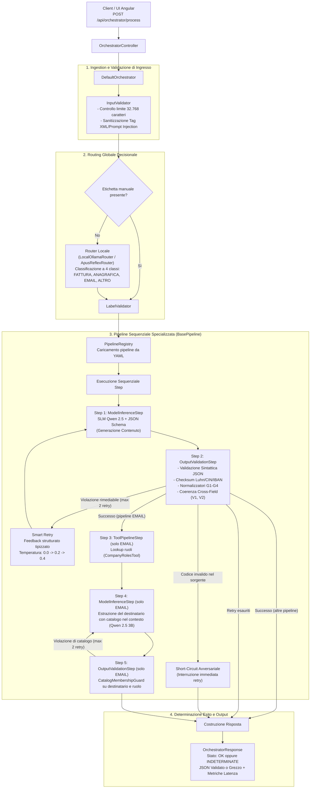

# Documentazione di Progetto — SLM Orchestrator
## Estrazione documentale con piccoli modelli linguistici locali e validazione deterministica

> **Stato del documento (6 novembre 2026).** Le cifre del §8 sono ricalcolate dai file di riepilogo congelati e dai log grezzi e coincidono con quelle riportate. I percorsi dei file sono relativi alla radice del repository (la riorganizzazione sotto `risultati/` e `frontend/` rispecchia il branch `develop`; al tag `freeze-1` il benchmark decisionale risiedeva nella directory radice `test_modello_decisionale_1/`). L'esito delle verifiche sui punti aperti è riportato nel §11.3.

---

## Indice Generale

1. [Executive Summary e Scopo del Progetto](#1-executive-summary-e-scopo-del-progetto)
2. [Information Priming: Concetti, Stati e Categorie Documentali](#2-information-priming-concetti-stati-e-categorie-documentali)
   - 2.1. [Le Categorie Documentali di Dominio](#21-le-categorie-documentali-di-dominio)
   - 2.2. [Gli Stati di Risposta del Sistema e la Gestione degli Errori](#22-gli-stati-di-risposta-del-sistema-e-la-gestione-degli-errori)
   - 2.3. [Concetti di base e grandezze matematiche](#23-concetti-di-base-e-grandezze-matematiche)
3. [Architettura](#3-architettura)
   - 3.1. [Visione d'Insieme e Diagramma di Flusso Operativo](#31-visione-dinsieme-e-diagramma-di-flusso-operativo)
   - 3.2. [Analisi dei Trade-off e Motivazione delle Scelte Architetturali](#32-analisi-dei-trade-off-e-motivazione-delle-scelte-architetturali)
4. [Componenti della Codebase e Flusso Esecutivo](#4-componenti-della-codebase-e-flusso-esecutivo)
   - 4.1. [Ingestion, Sanitizzazione e Sicurezza di Ingresso (InputValidator)](#41-ingestion-sanitizzazione-e-sicurezza-di-ingresso-inputvalidator)
   - 4.2. [Routing Decisionale a Singolo Token e Risoluzione dell'Artefatto di Thinking](#42-routing-decisionale-a-singolo-token-e-risoluzione-dellartefatto-di-thinking)
   - 4.3. [Le Pipeline Dichiarative e il Formato YAML](#43-le-pipeline-dichiarative-e-il-formato-yaml)
   - 4.4. [Guida Pratica: Come Estendere il Sistema Aggiungendo una Nuova Pipeline](#44-guida-pratica-come-estendere-il-sistema-aggiungendo-una-nuova-pipeline)
   - 4.5. [I Tool nell'Orchestratore: In-Pipeline Lookup e Post-Pipeline Actions](#45-i-tool-nellorchestratore-in-pipeline-lookup-e-post-pipeline-actions)
   - 4.6. [Single Base Model in RAM e Dynamic System Prompts](#46-single-base-model-in-ram-e-dynamic-system-prompts)
   - 4.7. [Perché la KV-Cache è Stata un Problema Critico e Come è Risolta](#47-perché-la-kv-cache-è-stata-un-problema-critico-e-come-è-risolta)
   - 4.8. [Guardia Temporale della Pipeline e Timeout di Rete Socket](#48-guardia-temporale-della-pipeline-e-timeout-di-rete-socket)
5. [Le Guardie Simboliche e Deterministiche: Meccanismi e Snippets](#5-le-guardie-simboliche-e-deterministiche-meccanismi-e-snippets)
   - 5.1. [Come Funzionano le Guardie a Livello Esecutivo](#51-come-funzionano-le-guardie-a-livello-esecutivo)
   - 5.2. [Guardie di Validazione Algebrica e Formale di Campo (Luhn, CIN, MOD-97)](#52-guardie-di-validazione-algebrica-e-formale-di-campo-luhn-cin-mod-97)
   - 5.3. [Guardie Simboliche di Post-Processing (G1, G2, Sesso, G3, G4, Date)](#53-guardie-simboliche-di-post-processing-g1-g2-sesso-g3-g4-date)
   - 5.4. [Guardie di Coerenza Cross-Field e Layout Numerato (V1, V2)](#54-guardie-di-coerenza-cross-field-e-layout-numerato-v1-v2)
   - 5.5. [Guardia Simbolica di Appartenenza a Catalogo Chiuso](#55-guardia-simbolica-di-appartenenza-a-catalogo-chiuso)
   - 5.6. [Guardia Anti-Cache Piena (PromptCacheGuard)](#56-guardia-anti-cache-piena-promptcacheguard)
6. [Meccanismi di Recupero: Smart Retry, Short-Circuit e Stato INDETERMINATE](#6-meccanismi-di-recupero-smart-retry-short-circuit-e-stato-indeterminate)
   - 6.1. [Cos'è lo Smart Retry e Perché Risolve i Limiti del Retry Tradizionale](#61-cosè-lo-smart-retry-e-perché-risolve-i-limiti-del-retry-tradizionale)
   - 6.2. [Costruzione del Feedback a Zero-Injection](#62-costruzione-del-feedback-a-zero-injection)
   - 6.3. [Short-Circuit dei Documenti Avversariali (Risparmio Computazionale)](#63-short-circuit-dei-documenti-avversariali-risparmio-computazionale)
   - 6.4. [Gestione dello Stato di Dominio INDETERMINATE e Conservazione del Dato](#64-gestione-dello-stato-di-dominio-indeterminate-e-conservazione-del-dato)
7. [Scenari End-to-End di Esempio](#7-scenari-end-to-end-di-esempio)
   - 7.1. [Scenario A: Fattura Commerciale Valida](#71-scenario-a-fattura-commerciale-valida)
   - 7.2. [Scenario B: Documento con Codice Errato nel Testo (Short-Circuit)](#72-scenario-b-documento-con-codice-errato-nel-testo-short-circuit)
   - 7.3. [Scenario C: Email Aziendale e Instradamento al Destinatario](#73-scenario-c-email-aziendale-e-instradamento-al-destinatario)
   - 7.4. [Scenario D: Documento Fuori Dominio (ALTRO)](#74-scenario-d-documento-fuori-dominio-altro)
8. [Risultati Sperimentali](#8-risultati-sperimentali)
   - 8.1. [Protocollo di Valutazione, Dataset Congelati e Tassonomia C1..C5](#81-protocollo-di-valutazione-dataset-congelati-e-tassonomia-c1c5)
   - 8.2. [Batteria 1: Ablazione dei Guardrail su Modello 3B](#82-batteria-1-ablazione-dei-guardrail-su-modello-3b)
   - 8.3. [Batteria 2: Confronto Architetturale 3B Orchestrato vs 7B Monolitico](#83-batteria-2-confronto-architetturale-3b-orchestrato-vs-7b-monolitico)
   - 8.4. [Batteria 3: Valutazione del Router Locale a 4 Classi](#84-batteria-3-valutazione-del-router-locale-a-4-classi)
   - 8.5. [Batteria 4: Smart Retry, Coerenza e Risparmio Computazionale](#85-batteria-4-smart-retry-coerenza-e-risparmio-computazionale)
   - 8.6. [Benchmark del Modello Decisionale APUS Reflex (Fase A e Fase B)](#86-benchmark-del-modello-decisionale-apus-reflex-fase-a-e-fase-b)
   - 8.7. [Cosa dicono i dati e cosa no](#87-cosa-dicono-i-dati-e-cosa-no)
9. [Glossario](#9-glossario)
10. [Riferimenti, Risorse e Riproducibilità](#10-riferimenti-risorse-e-riproducibilità)
11. [Limiti noti e punti aperti](#11-limiti-noti-e-punti-aperti)
   - 11.1. [Scostamenti dal riepilogo iniziale (150 ore)](#111-scostamenti-dal-riepilogo-iniziale-150-ore)
   - 11.2. [Limiti tecnici](#112-limiti-tecnici)
   - 11.3. [Punti da verificare nel repository](#113-punti-da-verificare-nel-repository)

---

## 1. Executive Summary e Scopo del Progetto

SLM Orchestrator è un servizio (Java 21, Spring Boot 4, con un frontend Angular 21) che riceve testi di documenti aziendali non strutturati, li classifica, ne estrae i campi in JSON e li valida con controlli deterministici. È nato come progetto di tirocinio (UNICAL – Altrama, dal 1 ottobre al 30 novembre 2026; relatore accademico: Carmine Dodaro; responsabile tecnico dell'azienda: Stefano Vena) con una stima iniziale di 150 ore. L'obiettivo era verificare se una catena di piccoli modelli linguistici locali (1–4 miliardi di parametri), con validazione a ogni passo, riesca a svolgere compiti brevi e ripetitivi in modo affidabile. Il frontend Angular non compare nel riepilogo iniziale del progetto; gli scostamenti rispetto a quel riepilogo sono nel §11.

### Il problema
Le organizzazioni che trattano documenti riservati (dati anagrafici, segreti industriali, identificativi fiscali e bancari) hanno davanti tre problemi:
1. **Dipendenza dal Cloud e Rischi di Privacy (GDPR)**: L'invio di documenti contenenti PII (Personally Identifiable Information) verso API commerciali di modelli proprietari su larga scala (LLM) comporta rischi di conformità normativa, costi operativi ricorrenti legati ai token e latenze soggette alla congestione della rete pubblica.
2. **Fragilità dei Sistemi a Regole (Approccio Simbolico Puro)**: L'estrazione tramite sole espressioni regolari (regex) o parser deterministici fallisce non appena il testo presenta variabilità stilistica, sinonimi, abbreviazioni, refusi o layout discorsivi.
3. **Inaffidabilità dei Modelli Linguistici Generativi Liberi (Approccio Neurale Puro)**: I modelli linguistici sono motori probabilistici di predizione token. Anche i modelli più avanzati soffrono di allucinazioni (invenzione di codici inesistenti), violazioni strutturali del JSON emesso, mancato rispetto delle relazioni algebriche (es. totale fattura difforme dalla somma di imponibile e imposta) e generazione di codici fiscali o IBAN con cifre di controllo errate.

Eseguire i modelli in locale elimina l'invio di documenti a terzi, ma non esaurisce gli obblighi GDPR: restano i log, la conservazione di `unvalidatedResult` e il controllo degli accessi, che questo documento non tratta.

### La soluzione: modello locale e validatori deterministici
SLM Orchestrator combina due parti:
- La parte **neurale** usa piccoli modelli linguistici (SLM) eseguiti in locale con Ollama: `qwen2.5:3b-instruct-q8_0` (estrazione e router), `qwen2.5:7b-instruct-q8_0` (usato nei benchmark di confronto) e `APUS-Reflex-4B` per le scelte a risposta discreta. Il modello legge il testo ed estrae i campi, con l'output vincolato a uno schema JSON tramite decoding guidato da grammatica. Origine e licenze dei modelli (verificate il 5 novembre 2026, fonti nel §10): `APUS-Reflex-4B` è un modello di APUS AI Lab, derivato da Qwen3.5-4B, con pesi Apache 2.0; `qwen2.5:7b-instruct` è Apache 2.0; **`Qwen2.5-3B`, il modello base del sistema, non è Apache 2.0: è rilasciato con la Qwen Research License**, una licenza di ricerca. Per un uso aziendale va letto il testo della licenza o va scelto un modello a licenza permissiva (§11.2).
- La parte **deterministica** è codice Java: validatori algebrici (Luhn, CIN, MOD-97), normalizzatori e controlli di coerenza tra campi. Il giudizio sulla validità formale spetta a questo codice, non al modello. Se un codice fiscale, un IBAN o una partita IVA non supera il checksum, la richiesta non finisce in `OK`: viene ritentata (*Smart Retry*, al massimo 2 volte, con un feedback sul campo sbagliato) oppure chiusa come **`INDETERMINATE`** per la revisione di un operatore. Il sistema controlla la forma dei dati, non la loro veridicità: un valore plausibile ma sbagliato non viene fermato.

---

## 2. Information Priming: Concetti, Stati e Categorie Documentali

Per garantire una lettura chiara e priva di ambiguità, vengono definiti formalmente gli elementi costitutivi del sistema prima del loro utilizzo nella trattazione architetturale.

### 2.1. Le Categorie Documentali di Dominio

L'orchestratore modella il perimetro documentale aziendale attraverso quattro categorie tassonomiche distinte, ciascuna presidiata da una pipeline specializzata:

1. **`FATTURA`**: Documenti contabili-fiscali emessi per cessione di beni o prestazioni di servizi.
   - *Campi target principali*: numero fattura, data fattura, dati identificativi del fornitore (denominazione, Partita IVA), dati del cliente (denominazione, Codice Fiscale), importo totale del documento e coordinate bancarie IBAN (come definito formalmente in `schemas/fattura_info.json`).
   - *Complessità di dominio*: Codici alfanumerici a controllo normativo vincolante (Partita IVA italiana, Codice Fiscale, IBAN europeo). La pipeline `fattura.yaml` valida formalmente i checksum algebrici di questi campi; non applica invece verifiche tra imponibile e imposta poiché lo schema estrae direttamente `importoTotale`.
2. **`ANAGRAFICA`**: Documenti di identità, autocertificazioni o estratti anagrafici (Patente di guida, Carta d'Identità, Passaporto, Tessera Sanitaria).
   - *Campi target principali*: tipo documento, cognome, nome, sesso, codice fiscale, data di nascita, comune o stato estero di nascita, estremi del documento (numero, data di rilascio, data di scadenza, ente di rilascio) secondo lo schema `schemas/anagrafica_documento.json`.
   - *Complessità di dominio*: Presenza di layout standardizzati numerati (es. numerazione comunitaria delle patenti di guida `1. Cognome`, `2. Nome`) e forte interdipendenza tra i dati anagrafici e la struttura alfanumerica del Codice Fiscale.
3. **`EMAIL`**: Comunicazioni testuali aperte tra utenti/clienti e l'organizzazione aziendale (richieste di supporto, reclami, richieste preventivi, solleciti).
   - *Campi target principali*: nello Step 1 (`email_inference`, schema `schemas/email_info.json`) l'SLM estrae i 9 campi valutati nei benchmark empirici rispetto alla ground truth: `mittente`, `email`, `telefono`, `azienda`, `oggetto`, `citta`, `numeroPartecipanti`, `budgetEuro`, `dataEvento`. Lo schema contiene 12 proprietà: ai 9 campi si aggiungono `destinatario`, `ruoloDestinatario` e `motivoInstradamento`, che nel risultato finale compaiono nello stesso JSON (§7.3) ma non sono valutati. Nello Step 4 (`recipient_inference`, schema `schemas/email_recipient_info.json`) individua inoltre `destinatario`, `ruoloDestinatario` e `motivoInstradamento` con l'insieme delle 5 funzioni aziendali censite nel catalogo (`mock/company_roles.json`) presente nel contesto; la scelta non è vincolata dallo schema e l'appartenenza al catalogo è verificata a posteriori da `CatalogMembershipGuard` (§5.5): `Direttore` (`stefano.vena@azienda.it`), `H.R.` (`claudia.frammartino@azienda.it`), `Reparto Tecnico` (`marco.rossi@azienda.it`), `Testers` (`testers@azienda.it`), `Developers` (`developers@azienda.it`).
   - *Complessità di dominio*: Processo a due stadi. L'SLM estrae l'evento semantico primario e successivamente, dopo l'arricchimento del contesto tramite il tool `CompanyRolesTool`, seleziona il referente aziendale autorizzato a gestire la pratica.
4. **`ALTRO`**: Classe residuale aperta comprendente qualsiasi documento non appartenente ai tre domini operativi precedenti (verbali interni, comunicati stampa, contratti complessi, log applicativi, testo non strutturato generico).
   - *Comportamento*: L'orchestratore non forza campi contabili o anagrafici inesistenti, ma estrae una sintesi descrittiva neutra conforme a `schemas/altro_info.json` (`categoriaRilevata`, `argomentoPrincipale`, `motivoEsclusione`, `entitaRilevate`), evitando l'applicazione di guardie matematiche non pertinenti.

---

### 2.2. Gli Stati di Risposta del Sistema e la Gestione degli Errori

A differenza dei tradizionali sistemi web che collassano gli esiti su un codice HTTP binario (200 OK / 500 Error), SLM Orchestrator adotta una semantica di stato a livello di dominio applicativo:

- **`OK`**: classificazione eseguita, estrazione conforme allo schema JSON e tutti i controlli configurati nella pipeline (checksum, formati, coerenza tra campi) superati. Il campo `result` contiene il JSON validato. **`OK` non garantisce che i valori siano giusti**: un valore plausibile ma sbagliato, o inventato dove il documento non lo contiene, passa lo stesso. Nell'held-out, 10 documenti su 42 del 3B orchestrato sono `OK` con almeno un valore diverso dalla ground truth (§8.1, categoria C2). Per la pipeline `ALTRO`, che non ha validatori, `OK` significa solo che il JSON rispetta lo schema.
- **`INDETERMINATE`**: Lo stato di fallimento controllato dell'elaborazione documentale. Si verifica quando il documento presenta anomalie formali insuperabili (es. una Partita IVA con checksum errato stampata all'origine nel testo), quando il catalogo aziendale non contiene il ruolo richiesto o quando sono stati esauriti i tentativi di retry senza convergenza.
  - *Principio cardine*: Il sistema **non maschera l'errore** e **non inventa dati**. Nel campo `unvalidatedResult` viene preservato l'intero JSON grezzo emesso dall'SLM, mentre nel campo `errors` vengono registrati i dettagli puntuali delle violazioni. L'interfaccia può mostrare all'operatore i dati già estratti con il campo anomalo evidenziato.
- **Errori di richiesta o di infrastruttura (non sono uno stato di dominio)**: payload non leggibile, Ollama non raggiungibile, input oltre il limite di dimensione. Nel codice sorgente (`src/main/java/com/tirocinioaltrama/slmorchestrator/core/OrchestratorStatus.java`), l'enum `OrchestratorStatus` definisce due soli valori:
  ```java
  public enum OrchestratorStatus {
      OK,
      INDETERMINATE
  }
  ```
  Non esistono gli stati `ERROR` né `FAILURE`. `FAILURE` compare solo nel nome del metodo factory statico `OrchestratorResponse.failure(...)`, che restituisce una risposta con stato `OrchestratorStatus.INDETERMINATE`. Tutti gli errori infrastrutturali o di validazione preliminare vengono gestiti a livello HTTP tramite eccezioni catturate da `@RestControllerAdvice` (`GlobalExceptionHandler`), che restituisce un JSON strutturato proprietario (`ApiErrorResponse`), ispirato ai Problem Details ma non conforme integralmente a RFC 7807. Specificamente: `ValidationException` produce HTTP 422 (Unprocessable Entity); `IllegalArgumentException` e `HttpMessageNotReadableException` producono HTTP 400 (Bad Request); `RoutingException` produce HTTP 502 (Bad Gateway); `PipelineExecutionException` produce HTTP 503 (Service Unavailable); qualsiasi altra eccezione non gestita produce HTTP 500 (Internal Server Error). Il superamento del tempo massimo di pipeline (§4.8) non produce un'eccezione ma conclude la pipeline con stato `INDETERMINATE` e HTTP 200.

---

### 2.3. Concetti di base e grandezze matematiche

- **Small Language Model (SLM)**: Rete neurale autoregressiva con dimensione tipica tra 1 e 8 miliardi di parametri ($1\text{B} - 8\text{B}$). Può essere eseguita localmente su iGPU via Vulkan o CPU unificata con footprint compreso tra 2 e 8 GB di RAM, senza dipendere da servizi esterni.
- **Grammar-Guided Constrained Decoding**: Meccanismo a livello di campionamento token (eseguito dal runtime Ollama/llama.cpp) che limita l'albero di predizione dei logit ai soli caratteri e token che rispettano formalmente una grammatica context-free o un JSON Schema definito.
- **KV-Cache (Key-Value Cache)**: Buffer di memoria allocato nella RAM dell'acceleratore che conserva i tensori di attenzione calcolati per i token dei prompt passati. Consente di evitare il ricalcolo computazionale dei token statici (es. il System Prompt).
- **Intervallo di Confidenza di Wilson (Wilson Score Interval)**: Metodo statistico asimmetrico per la stima dell'intervallo di confidenza al 95% su proporzioni binomiali discrete ($p = k / N$, ad esempio il numero di campi corretti su un totale di campi annotati).
  - *Perché l'intervallo standard di Wald è inadeguato*: La formula classica basata sull'approssimazione normale gaussiana ($\hat{p} \pm z \sqrt{\frac{\hat{p}(1-\hat{p})}{N}}$) collassa quando la proporzione empirica è vicina agli estremi ($0\%$ o $100\%$) o la dimensione campionaria $N$ è limitata ($N < 100$). In tali casi, Wald può dare intervalli con limite superiore oltre il $100\%$, oppure di larghezza zero quando l'accuratezza campionaria è del $100\%$ ($k = N$).
  - *La formulazione di Edwin Bidwell Wilson (1927)*: Il metodo inverte il test del punteggio di ipotesi (Score Test) senza approssimare la varianza con la sola stima campionaria $\hat{p}$, centrando l'intervallo su un valore ponderato:
    $$w = \frac{\hat{p} + \frac{z^2}{2N} \pm z \sqrt{\frac{\hat{p}(1-\hat{p})}{N} + \frac{z^2}{4N^2}}}{1 + \frac{z^2}{N}}$$
    dove $z = 1.96$ per il livello di confidenza al $95\%$. I limiti ricadono sempre in $[0, 1]$. Esempio: 6 corretti su 6 danno un intervallo di circa 61,0%–100%, quindi con 6 documenti si può dire poco. Con 54/54 (i campi di quei 6 documenti) l'intervallo è 93,4%–100%, ma i campi di uno stesso documento non sono indipendenti e l'intervallo è più ottimista del reale. Wilson dà un ordine di grandezza dell'incertezza; per confrontare configurazioni sugli stessi documenti servirebbe un test appaiato (vedi §8.1).
- **Algoritmo di Luhn**: Formula di controllo algebrico a somma ponderata a posizioni alternate (le cifre in posizione pari vengono moltiplicate per 2; se il prodotto supera 9 si sottrae 9). Utilizzata per la verifica dell'undicesima cifra delle Partite IVA italiane.
- **Carattere di Controllo CIN**: Cifra alfabetica finale del Codice Fiscale calcolata tramite conversione dei caratteri alfanumerici secondo tabelle ministeriali differenziate per posizione pari e dispari, ridotta modulo 26.
- **ISO 7064 MOD 97-10**: Standard internazionale di verifica delle coordinate bancarie IBAN. Trasforma le lettere nei valori $10 \dots 35$ e calcola l'invariante matematico:
  $$\text{NumeroIBAN} \pmod{97} \equiv 1$$

---

## 3. Architettura

### 3.1. Visione d'Insieme e Diagramma di Flusso Operativo

Il sistema separa tre cose: orchestrazione, modelli (estrazione e scelte discrete) e validazione deterministica.



---

### 3.2. Analisi dei Trade-off e Motivazione delle Scelte Architetturali

Le alternative scartate e i motivi. Le motivazioni si appoggiano sui dati del §8, con i limiti discussi nel §8.7.

#### Scelta A: Pipeline Specializzate + Router vs Prompt Monolitico Unico
- *Approccio Alternativo (Scartato)*: Inviare il testo a un unico mega-prompt contenente le istruzioni congiunte per riconoscere fatture, anagrafiche ed email, associando un JSON Schema "a busta" unificato con tutti i possibili campi annidati.
- *Motivazione del rifiuto (dati della Batteria 1)*: sul dataset Held-Out il 3B monolitico arriva al 58,9% di campi corretti contro il 95,2% del 3B orchestrato; il 7B monolitico all'82,9%. Il 3B monolitico omette sistematicamente campi obbligatori (`C2a`) e sulle email non produce nessun documento corretto (0/14). Va detto che il baseline usa uno schema "a busta" con tutti i campi possibili, una scelta di partenza sfavorevole: il confronto misura quel baseline, non ogni possibile prompt unico. Il router con pipeline specializzate riduce la dimensione del prompt e restringe lo schema per ogni caso.

#### Scelta B: Validazione Integrata nella Pipeline vs Guardrail Puramente Post-Hoc
- *Approccio Alternativo (Scartato)*: Lasciare che il modello generi liberamente l'output e applicare i filtri e le validazioni soltanto alla fine, a valle del processo, scartando i documenti errati.
- *Motivazione del rifiuto*: un controllo a valle può solo accettare o rifiutare, non recuperare un campo mancante. Nei dati, il 7B monolitico con guardrail post-hoc migliora i campi di 0,5 punti (82,9% → 83,4%) e lascia passare come `OK` 3 documenti su 9 del set avversariale di sviluppo, perché sposta o omette (`null`) la P.IVA invalida e il validatore non la vede. Sono pochi documenti: indicano una direzione, non una misura stabile. Il 3B monolitico con post-hoc, sul set avversariale held-out (6 documenti), le ha intercettate tutte.

#### Scelta C: Single Base Model + Dynamic System Prompts vs Modelli Multipli Residenti
- *Approccio Alternativo (Scartato)*: Mantenere in esecuzione su Ollama 4 o 5 modelli specializzati separati (es. un modello fine-tuned per le fatture, uno per le anagrafiche, uno per il router).
- *Motivazione del rifiuto*: ogni modello caricato occupa memoria proporzionale ai pesi (circa 3,3 GB per un 3B Q8_0 misurati da `ollama list`, e circa 7,6–7,7 GB per un 7B Q8_0); più modelli residenti consumano memoria unificata e rischiano swap o errori di memoria. Si usa quindi un modello base per l'estrazione, e a ogni richiesta si passano il system prompt e lo schema JSON dello step. Il consumo non cresce con il numero di pipeline. Nella configurazione di default definita in `application.properties` (`ollama.model`, `ollama.email-model`, `ollama.router-model`), tutti i componenti puntano a `qwen2.5:3b-instruct-q8_0`: vi è quindi **un solo modello residente in memoria**. Fanno eccezione configurazioni con `APUS-Reflex-4B` (usabile come router alternativo) o con un modello di escalation (`ollama.escalation-model`), che risiedono in memoria solo se abilitati esplicitamente.

---

## 4. Componenti della Codebase e Flusso Esecutivo

### 4.1. Ingestion, Sanitizzazione e Sicurezza di Ingresso (InputValidator)

La classe [`InputValidator`](src/main/java/com/tirocinioaltrama/slmorchestrator/core/validation/InputValidator.java) presidia l'ingresso delle richieste:
1. **Limite di dimensione**: un testo oltre `MAX_PAYLOAD_LENGTH` (32.768 caratteri, non byte) viene respinto con `ValidationException` (HTTP 422). Il limite protegge la memoria del backend, ma non garantisce che il testo entri nel contesto del modello: 32.768 caratteri di italiano sono dell'ordine di 8–10 mila token, contro i 2048 di `num_ctx` usati nei benchmark (prompt di sistema e schema inclusi). Nel codice attuale, `InputValidator` valida solo la lunghezza in caratteri: quando un prompt complessivo supera la finestra di contesto del runtime Ollama, quest'ultimo tronca silenziosamente la parte eccedente del prompt senza restituire errori né warning all'orchestratore, provocando la perdita di porzioni del testo. L'allineamento automatico tra limite di payload e finestra di contesto, così come il rilevamento esplicito del troncamento, restano punti aperti del prototipo (§11.2).
2. **Delimitazione ed escape**: il testo è racchiuso in `<payload> ... </payload>`. Se contiene sequenze di chiusura come `</payload>`, `</input>`, `</context>`, vengono neutralizzate, così il testo non può uscire dal delimitatore. Questo non protegge da istruzioni scritte in linguaggio naturale dentro il documento ("ignora le istruzioni precedenti"): contro quelle restano lo schema vincolato e i validatori, che limitano ciò che può uscire ma non impediscono al modello di esserne influenzato. Non c'è un modello di minaccia più ampio di questo.

---

### 4.2. Routing Decisionale a Singolo Token e Risoluzione dell'Artefatto di Thinking

Se il client non specifica la categoria documentale, il router identifica la classe. Il sistema supporta due router:
- **`LocalOllamaRouter`**: usa il modello 3B per emettere il nome della categoria (`FATTURA`, `ANAGRAFICA`, `EMAIL`, `ALTRO`). Latenza mediana 341–421 ms; accuratezza 49/50 sull'held-out e 60/60 sul dev (§8.4).
- **`ApusReflexRouter`**: usa il modello a scelta discreta `APUS-Reflex-4B` con una sola risposta (`num_predict: 1`). Sul dataset documentale held-out del §8.4 questo router non è stato valutato in pipeline; il §8.6 riporta la valutazione su `dataset/phase_b_dataset.json` (Fase B), in cui il compito «router su 4 opzioni» (sezione `router_candidates_4`) usa le stesse quattro etichette (`FATTURA`, `EMAIL`, `ANAGRAFICA`, `ALTRO`) ma su testi diversi da quelli del §8.4 e con risposta a lettera su opzioni permutate.

Sul branch `develop` (commit `17ab31a492`), l'enum [`RouterType`](src/main/java/com/tirocinioaltrama/slmorchestrator/core/RouterType.java) è stato integrato con le annotazioni Jackson `@JsonCreator` e `@JsonValue` per consentire la deserializzazione diretta di stringhe kebab-case (`"local-ollama"`, `"reflex"`) dal payload JSON delle richieste inviate all'endpoint `/api/orchestrator/process`.

> [!IMPORTANT]
> **Risoluzione dell'Artefatto di Misura del Thinking (`think: false`)**:  
> Durante le prime sperimentazioni su APUS Reflex 4B, limitando l'emissione a 1 token (`num_predict: 1`), il modello in 45 prove su 192 emetteva la stringa `"The"` anziché la lettera della classe `A`..`D`. Dall'indagine è risultato che si trattava del primo token della sezione di ragionamento interno (`<think> The user wants...`). Disattivando dinamicamente il reasoning tramite il parametro `"think": false` inviato a Ollama, il modello emette direttamente la singola lettera `A`..`D` in 192 prove su 192 (senza `think: false` una risposta valida in 147 su 192, vedi §8.6). Il comportamento è coerente con la scheda del modello, che chiede di disattivare sempre il thinking con Ollama (`--think=false`, fonte nel §10).

---

### 4.3. Le Pipeline Dichiarative e il Formato YAML

Una pipeline in SLM Orchestrator è una sequenza ordinata di passi computazionali (`PipelineStep`) configurata esternamente in un file YAML. La scelta di YAML rispetto al codice Java compilato consente di:
1. Modificare prompt, schemi e parametri di retry senza ricompilare il backend.
2. Rendere le logiche di estrazione leggibili e verificabili anche da analisti funzionali.
3. Centralizzare la governance dei modelli e degli schemi JSON.

#### Anatomia di un File di Pipeline YAML (Esempio: `fattura.yaml`)
```yaml
id: fattura_pipeline              # Identificativo univoco della pipeline
documentType: FATTURA             # Categoria documentale associata
steps:
  # STEP 1: Estrazione neurale vincolata a schema JSON
  - id: fattura_inference
    type: model_inference
    model: "${ollama.invoice-model}"
    schema: schemas/fattura_info.json
    system_prompt: prompts/fattura-system.txt

  # STEP 2: Validazione deterministica con blocco di recupero (on_failure)
  - id: fattura_validation
    type: field_validation
    on_failure:
      retry_step: fattura_inference # Passo su cui riavvolgere il ciclo
      max_retries: 2                # Fino a 2 tentativi di correzione
      feedback: true                # Iniezione del feedback strutturato
    validators:
      - field: fornitore.partitaIva
        validator: partita_iva      # Applica Luhn su partita IVA
      - field: cliente.codiceFiscale
        validator: codice_fiscale_o_partita_iva
      - field: iban
        validator: iban             # Applica ISO 7064 MOD 97 su IBAN
```

All'avvio dell'applicazione, la classe [`YamlPipelineLoader`](src/main/java/com/tirocinioaltrama/slmorchestrator/impl/pipeline/config/YamlPipelineLoader.java) esegue il parsing del file:
1. Risolve i placeholder delle proprietà di sistema (es. `${ollama.invoice-model}`).
2. Costruisce le istanze di [`ModelInferenceStep`](src/main/java/com/tirocinioaltrama/slmorchestrator/impl/pipeline/ModelInferenceStep.java), [`OutputValidationStep`](src/main/java/com/tirocinioaltrama/slmorchestrator/impl/pipeline/OutputValidationStep.java) e degli eventuali step di Tool.
3. Crea un'istanza di [`BasePipeline`](src/main/java/com/tirocinioaltrama/slmorchestrator/impl/pipeline/BasePipeline.java) e la registra nel [`PipelineRegistry`](src/main/java/com/tirocinioaltrama/slmorchestrator/core/pipeline/PipelineRegistry.java).

---

### 4.4. Guida Pratica: Come Estendere il Sistema Aggiungendo una Nuova Pipeline

Per aggiungere una nuova tipologia documentale (ad esempio i contratti di fornitura, `CONTRATTO`) servono questi passi. Il primo richiede una modifica Java e una ricompilazione; gli altri sono file di configurazione:

1. **Definire la Categoria Documentale**:
   - Aggiungere il nuovo valore nell'enum [`DocumentType.java`](src/main/java/com/tirocinioaltrama/slmorchestrator/core/DocumentType.java):
     ```java
     public enum DocumentType {
         FATTURA, ANAGRAFICA, EMAIL, ALTRO, CONTRATTO
     }
     ```
2. **Definire il JSON Schema**:
   - Creare il file formale in `src/main/resources/schemas/contratto_info.json` indicando i tipi e i campi obbligatori (`dataStipula`, `fornitore` come oggetto con `denominazione` e `partitaIva`, `importoCanone`, `durataMesi`).
3. **Creare il System Prompt Specializzato**:
   - Creare `src/main/resources/prompts/contratto-system.txt` con le istruzioni di estrazione per l'SLM.
4. **Scrivere il File di Pipeline YAML**:
   - Creare `src/main/resources/pipelines/contratto.yaml`:
     ```yaml
     id: contratto_pipeline
     documentType: CONTRATTO
     steps:
       - id: contratto_inference
         type: model_inference
         model: "${ollama.model}"
         schema: schemas/contratto_info.json
         system_prompt: prompts/contratto-system.txt
       - id: contratto_validation
         type: field_validation
         on_failure:
           retry_step: contratto_inference
           max_retries: 2
           feedback: true
         validators:
           - field: fornitore.partitaIva
             validator: partita_iva
     ```
5. **Aggiornare il Router**:
   - Inserire la classe `CONTRATTO` nelle opzioni di instradamento in `prompts/router-system.txt`.
6. **Aggiungere i dati di prova**: documenti di esempio con ground truth per la nuova pipeline e qualche documento per il router. Senza questi non si sa se la pipeline estrae bene né se il router la sceglie.

Al bootstrap l'applicazione carica e valida il nuovo file senza altre modifiche al motore di esecuzione. Il nome della proprietà del modello nell'esempio (`${ollama.model}`) dipende da `application.properties`: `fattura.yaml` usa `${ollama.invoice-model}`.

---

### 4.5. I Tool nell'Orchestratore: In-Pipeline Lookup e Post-Pipeline Actions

Nell'architettura di SLM Orchestrator, un **Tool** è un componente Java deterministico che esegue operazioni di integrazione con il sistema informativo aziendale. I Tool si dividono in due tipologie distinte:

#### 1. In-Pipeline Tools (`ToolPipelineStep`)
Vengono eseguiti durante la pipeline documentale per **arricchire il contesto informativo** prima di uno step neurale successivo:
- *Esempio*: [`CompanyRolesTool`](src/main/java/com/tirocinioaltrama/slmorchestrator/impl/tool/CompanyRolesTool.java). Nello step `roles_lookup` della pipeline `email.yaml` il tool carica l'elenco dei reparti aziendali dal file mock `mock/company_roles.json` e lo deposita nell'attributo `context.setAttribute("availableRoles", ...)`. Nello step successivo (`recipient_inference`) l'SLM riceve il catalogo e sceglie il destinatario tra le voci elencate. Nella configurazione documentata il catalogo è un mock: non c'è un'integrazione con un sistema aziendale reale. Nel codice i tool sono registrati staticamente come bean Spring in `ToolRegistry`; non è presente una whitelist dinamica configurabile da file, né sono implementati meccanismi di timeout o retry a livello di singolo tool.

#### 2. Post-Pipeline Actions (`ActionExecutor`)
Vengono eseguiti al termine della pipeline all'interno del blocco `actionsGroup` per realizzare effetti collaterali deterministici:
- Con esito favorevole (`on_ok`) un tool può, ad esempio, notificare un webhook, salvare il documento su un database o avviare un protocollo.
- Con esito `INDETERMINATE` (`on_indeterminate`) un tool può, ad esempio, mettere il payload non validato in una coda di revisione manuale.
Nel repository l'unico tool effettivamente implementato è `CompanyRolesTool`; gli esempi di azioni `on_ok` e `on_indeterminate` descrivono il meccanismo e sono illustrativi. Se un tool fallisce sollevando un'eccezione Java durante l'esecuzione di un `ToolPipelineStep`, l'errore non viene gestito con retry interni ma si propaga a `DefaultOrchestrator`, che interrompe la richiesta e genera una risposta HTTP 503 (`PipelineExecutionException`). Per le azioni post-pipeline, eventuali fallimenti vengono registrati nella lista `actionErrors` della risposta senza alterare lo stato primario (`OK` o `INDETERMINATE`).

---

### 4.6. Single Base Model in RAM e Dynamic System Prompts

Il microservizio adotta il pattern architetturale **Single Base Model in RAM**:
- Mantiene un solo runner Ollama residente in memoria (`qwen2.5:3b-instruct-q8_0`) con parametro `ollama.keep-alive=60m`.
- A runtime, il client Java inietta il System Prompt e lo schema JSON specifici per il passo in corso.
- Il modello base occupa circa 3,3 GB su disco e in memoria (pesi del 3B in Q8_0 verificati con `ollama list`, KV-cache esclusa) e questo valore non cresce con il numero di pipeline. Vale per le pipeline che usano solo il 3B: `APUS-Reflex-4B` (router alternativo, circa 2,7 GB in Q4_K_M) e un eventuale 7B (circa 7,6–7,7 GB) sono modelli distinti, con il loro consumo di memoria.

---

### 4.7. Perché la KV-Cache è Stata un Problema Critico e Come è Risolta

La **KV-Cache (Key-Value Cache)** del runtime Ollama memorizza i tensori di attenzione calcolati per il prefisso del prompt. 

#### Il Problema della "Cache Piena" (Full Cache Match)
Durante la fase di test e integrazione è emerso un problema critico: quando due richieste identiche venivano inviate consecutivamente (es. due chiamate di seguito con lo stesso documento di test saltando il router), il runtime di inferenza trovava il **100% dei token del prompt già presenti nella KV-Cache**. 
Durante lo sviluppo e il collaudo del prototipo (anomalia documentata nel Javadoc di `PromptCacheGuard.java` fin dall'importazione iniziale del codice nel commit `9d7c6aaa34c3f2b9ae7a1b0af9ab21d2ab934853` del 29/10/2026; il successivo commit `21ad59472b0d6191f077d4c407d9fe2ad6df250f` del 30/10/2026 è stato un mero refactoring di package da `llmorchestrator` a `slmorchestrator` che ha reso pubblici i delimitatori senza registrare nuove anomalie), quando non era presente nemmeno un singolo token non calcolato nel prompt di ingresso inviato a Ollama, il runtime entrava in uno stato degenere:
- Il modello iniziava a emettere token ripetitivi all'infinito (*Generation Loop*), esaurendo il budget di token di `num_predict`.
- Oppure, la chiamata terminava istantaneamente restituendo una stringa vuota o troncata a zero byte.

#### La Soluzione Architetturale: `PromptCacheGuard`
Per evitare l'anomalia senza perdere i benefici di velocità della KV-Cache per i token statici di sistema, è stata sviluppata la guardia [`PromptCacheGuard.java`](src/main/java/com/tirocinioaltrama/slmorchestrator/impl/model/PromptCacheGuard.java):
1. Calcola l'hash crittografico SHA-256 della tupla `(modello, systemPrompt, userPayload)`.
2. Se l'impronta coincide esattamente con la richiesta precedente, antepone al testo dell'utente un marcatore monotono: `<request_id>N</request_id>`.
3. In questo modo:
   - Il **System Prompt** rimane invariato byte per byte e sfrutta la KV-Cache al 100% (*Cache Hit*).
   - Il **Payload Utente** viene invalidato a partire dal primo carattere del marcatore, costringendo il runner a calcolare i nuovi token e mantenendo il regime di **cache parziale**. La classe di test [`PromptCacheGuardTest`](src/test/java/com/tirocinioaltrama/slmorchestrator/impl/model/PromptCacheGuardTest.java) verifica a livello unitario l'inserimento deterministico del marcatore incrementale `<request_id>N</request_id>` a fronte di richieste identiche consecutive; durante le successive esecuzioni sequenziali dei benchmark completi non sono stati riscontrati loop di generazione né risposte vuote.

**Limiti.** La guardia confronta la richiesta solo con quella immediatamente precedente memorizzata in un blocco `synchronized` su una singola variabile di istanza (`lastFingerprint`): con richieste concorrenti su pipeline condivise l'impronta viene sovrascritta in modo non deterministico. Inoltre il marcatore cambia il prompt, quindi lo stesso documento inviato due volte può produrre output diversi. Per questo il progetto garantisce una validazione deterministica, non l'identità bit a bit degli output; nei benchmark lo stato della cache è stato controllato imponendo l'esecuzione sequenziale dei documenti in ordine naturale, con warmup preliminare di Ollama e parametro `keep_alive=60m` costante.

---

### 4.8. Guardia Temporale della Pipeline e Timeout di Rete Socket

Il sistema garantisce la resilienza temporale su due livelli cooperanti:
1. **Timeout Socket HTTP (`ollama.read-timeout`)**: Configurato a livello di client REST e di reverse proxy Nginx (`frontend/nginx.conf`). Previene blocchi del thread di I/O qualora il processo Ollama subisca un crash o un blocco a livello di kernel. Al tag di congelamento `freeze-1` il parametro era impostato a **`120s`** (2 minuti); sul branch `develop` è stato raddoppiato a **`240s`** (4 minuti, commit `17ab31a4920380ffb2f8188c60681bd6a77bc366` del 05/11/2026) per prevenire disconnessioni su carichi elevati.
2. **Guardia Temporale Simbolica di Esecuzione (`orchestrator.pipeline.max-duration-ms`)**: Guardia applicativa implementata all'inizio del ciclo `while` in [`BasePipeline.java`](src/main/java/com/tirocinioaltrama/slmorchestrator/impl/pipeline/BasePipeline.java). Misura il tempo cumulato speso nell'intera catena di step (compresi eventuali retry multipli, chiamate a tool e invocazioni del modello di escalation). Al tag `freeze-1` il limite era impostato a **`60000`** (60 secondi / 1 minuto); sul branch `develop` è stato raddoppiato a **`120000`** (120 secondi / 2 minuti, commit `17ab31a4920380ffb2f8188c60681bd6a77bc366` in `application.properties`, `BasePipeline` e `YamlPipelineLoader`). Il controllo avviene esclusivamente prima di avviare il passo successivo: non interrompe la chiamata HTTP bloccante al modello già in corso.
3. **Calcolo del Caso Peggiore (Worst-Case Latency)**: Nel caso peggiore (step avviato un istante prima della scadenza della durata pipeline che incorre nel timeout di lettura socket verso Ollama), la durata massima teorica della richiesta prima dell'interruzione congiunta è pari a:
   - Al tag `freeze-1` (valori effettivi applicati a tutte le sessioni di benchmark): $60\text{ s} + 120\text{ s} = \mathbf{180\text{ s}}$ (3 minuti);
   - Su branch `develop`: $120\text{ s} + 240\text{ s} = \mathbf{360\text{ s}}$ (6 minuti).
Superato il limite all'inizio di un passo, l'esecuzione si ferma registrando un `FieldError` con codice `ValidationErrorCode.INFERENCE_ERROR` (*"Tempo massimo di esecuzione pipeline superato"*) e concludendo la risposta con stato `INDETERMINATE` e HTTP 200. Nei dati congelati di benchmark (1.404 file JSON documentali di Test 2 e 3.968 righe di Fase B) si sono registrati **zero errori di timeout su ogni cella e configurazione** (zero occorrenze di `INFERENCE_ERROR`), con una latenza mediana del 3B orchestrato di circa 6,7 s per documento (§8.2); per il 7B, eseguito in split GPU/CPU, i tempi non sono confrontabili (§8.1).

---

## 5. Le Guardie Simboliche e Deterministiche: Meccanismi e Snippets

### 5.1. Come Funzionano le Guardie a Livello Esecutivo

A livello esecutivo, una **guardia** è un controllo deterministico che opera sul JSON prodotto dall'SLM, letto come albero Jackson ([`JsonNode`](src/main/java/com/tirocinioaltrama/slmorchestrator/core/validation/JsonOutputValidator.java)):
1. **Ispezione ad Albero dei Tipi**: Verifica che i tipi primitivi (stringhe, numeri, oggetti annidati) corrispondano alle attese dello schema.
2. **Estrazione Qualificata dei Percorsi (`FieldPath`)**: Risolve i percorsi annidati (es. `fornitore.partitaIva` o `articoli[*].importo`).
3. **Applicazione della Logica Simbolica**: Esegue l'algoritmo algebrico o lessicale.
4. **Emissione di `FieldError` Strutturato**: Se il valore non supera il test, la guardia genera un oggetto immutabile contenente il path, il codice di errore formale (`ValidationErrorCode`) e la spiegazione diagnostica.

---

### 5.2. Guardie di Validazione Algebrica e Formale di Campo (Luhn, CIN, MOD-97)

I validatori controllano la correttezza formale di P.IVA, codice fiscale e IBAN. L'esito dipende solo dalla stringa; non dicono se il codice appartiene davvero a quel soggetto:

#### Validatore Partita IVA — Algoritmo di Luhn ([`PartitaIvaValidator.java`](src/main/java/com/tirocinioaltrama/slmorchestrator/core/validation/field/PartitaIvaValidator.java))
```java
private boolean validateChecksum(String digits) {
    int sum = 0;
    for (int i = 0; i < 10; i++) {
        int digit = Character.digit(digits.charAt(i), 10);
        if (i % 2 == 0) {
            // Posizioni dispari (1-based: 1, 3, 5, 7, 9 -> indici 0, 2, 4, 6, 8)
            sum += digit;
        } else {
            // Posizioni pari (1-based: 2, 4, 6, 8, 10 -> indici 1, 3, 5, 7, 9)
            int doubled = digit * 2;
            sum += (doubled > 9) ? (doubled - 9) : doubled;
        }
    }
    int expectedCheckDigit = (10 - (sum % 10)) % 10;
    int actualCheckDigit = Character.digit(digits.charAt(10), 10);
    return expectedCheckDigit == actualCheckDigit;
}
```

#### Validatore Codice Fiscale — Checksum Ministeriale CIN ([`CodiceFiscaleValidator.java`](src/main/java/com/tirocinioaltrama/slmorchestrator/core/validation/field/CodiceFiscaleValidator.java))
```java
int sum = 0;
for (int i = 0; i < 15; i++) {
    char c = cf.charAt(i);
    if ((i + 1) % 2 != 0) {
        sum += ODD_VALUES.get(c); // Tabella valori posizioni dispari ministeriale
    } else {
        sum += EVEN_VALUES.get(c); // Tabella valori posizioni pari ministeriale
    }
}
char expectedCin = (char) ('A' + (sum % 26));
return expectedCin == cf.charAt(15);
```

#### Validatore IBAN — Standard ISO 7064 MOD 97-10 ([`IbanValidator.java`](src/main/java/com/tirocinioaltrama/slmorchestrator/core/validation/field/IbanValidator.java))
```java
String rearranged = cleanIban.substring(4) + cleanIban.substring(0, 4);
StringBuilder numericString = new StringBuilder();
for (int i = 0; i < rearranged.length(); i++) {
    char c = rearranged.charAt(i);
    if (Character.isDigit(c)) {
        numericString.append(c);
    } else {
        numericString.append((c - 'A') + 10);
    }
}
BigInteger ibanNumber = new BigInteger(numericString.toString());
return ibanNumber.mod(BigInteger.valueOf(97)).intValue() == 1;
```

Prima del calcolo algebrico dei checksum, i validatori eseguono controlli preliminari di normalizzazione, lunghezza e formato regex:
- **Partita IVA** ([`PartitaIvaValidator.java`](src/main/java/com/tirocinioaltrama/slmorchestrator/core/validation/field/PartitaIvaValidator.java)): normalizza rimuovendo spazi e convertendo in maiuscolo; convalida contro la regex `^(?:IT)?([0-9]{11})$` (esigendo esattamente 11 cifre numeriche, con eventuale prefisso paese `IT`); scarta codici con matricola interamente a zero (`0000000`) o codice ufficio provinciale (cifre 8–10) uguale a `000` (l'algoritmo esclude esplicitamente `"000"` tramite `"000".equals(officeCode)`, ammettendo tutti i valori numerici da `001` a `999`); solo successivamente applica la formula di Luhn sui primi 10 caratteri per verificare l'11ª cifra di controllo.
- **Codice Fiscale** ([`CodiceFiscaleValidator.java`](src/main/java/com/tirocinioaltrama/slmorchestrator/core/validation/field/CodiceFiscaleValidator.java)): normalizza con `trim().toUpperCase()`; valida il formato con la regex ministeriale a 16 caratteri `^[A-Z]{6}[0-9LMNPQRSTUV]{2}[A-EHLMPR-T][0-9LMNPQRSTUV]{2}[A-Z][0-9LMNPQRSTUV]{3}[A-Z]$` (che gestisce esplicitamente i caratteri di omocodia alfabetica per le cifre numeriche); infine calcola il carattere alfabetico di controllo CIN sui primi 15 caratteri tramite tabelle ministeriali pari/dispari. Gli identificativi a 11 cifre delle persone giuridiche usati nel campo committente non hanno CIN e vengono delegati al validatore congiunto `CodiceFiscaleOPartitaIvaValidator`, che li tratta con l'algoritmo di Luhn.
- **IBAN** ([`IbanValidator.java`](src/main/java/com/tirocinioaltrama/slmorchestrator/core/validation/field/IbanValidator.java)): rimuove tutti i caratteri di spaziatura e converte in maiuscolo (`cleanIban = iban.replaceAll("\\s+", "").toUpperCase()`); verifica il formato specifico per paese (per l'Italia: lunghezza di 27 caratteri e regex `^IT[0-9]{2}[A-Z][0-9]{10}[0-9A-Z]{12}$`); riordina la stringa spostando i primi 4 caratteri in coda; converte i caratteri alfabetici nel rispettivo valore numerico ($A=10, \dots, Z=35$); calcola l'operazione di modulo 97 su `BigInteger`, che deve restituire esattamente 1.

---

### 5.3. Guardie Simboliche di Post-Processing (G1, G2, Sesso, G3, G4, Date)

Nel componente [`PostProcessingGuards.java`](src/main/java/com/tirocinioaltrama/slmorchestrator/impl/pipeline/guard/PostProcessingGuards.java):
- **Guardia G1 (Pulizia Denominazioni)**: Elimina prefissi amministrativi descrittivi (*"Società Fornitrice:"*, *"Cliente:"*) e formule onorifiche (*"Spett.le"*, *"Dott."*, *"Ing."*).
- **Guardia G2 (evidenza lessicale dell'ente di rilascio)**: misura quante parole dell'`enteRilascio` estratto compaiono nel testo sorgente. Sotto il **60%** di copertura il valore viene azzerato a `null`. La soglia del 60% era già presente nell'importazione iniziale del codice (commit `9d7c6aaa34c3` del 29/10/2026) ed è stata preservata durante il refactoring dei package nel commit `21ad594` (30/10/2026) come euristica empirica per tollerare stopwords e varianti lessicali (es. "Comune di Milano" vs "Milano") senza un esperimento formale dedicato documentato nel repository; può tuttavia azzerare valori corretti scritti in altra forma nel documento (abbreviazioni, sigle).
- **Guardia evidenza sesso (euristica lessicale conservativa)**: il campo `sesso` diventa `null` se la parola `"sesso"` non compare nel testo, per evitare che il modello lo deduca dal nome. Effetto collaterale: nei documenti che riportano M/F senza l'etichetta il valore viene azzerato anche se presente. Il sesso è comunque ricavabile dal codice fiscale (giorno di nascita + 40 per le donne), quindi un controllo di coerenza sarebbe possibile.
- **Guardia G3 (Recupero Omissioni Codificate, `guardG3OmissionRecovery`)**: Opera **esclusivamente** sui documenti di tipologia `ANAGRAFICA` (se invocata su altri tipi documentali termina immediatamente restituendo `false`). Interviene su tre specifiche casistiche:
  1. *Data di rilascio da patente europea (punto 4a)*: se `dataRilascio` è assente, nullo o vuoto, ricerca nel testo il pattern comunitario `\b4a\.\s*(\d{2}[/\-\.]\d{2}[/\-\.]\d{4})\b` e ne inietta il valore;
  2. *Sigla provinciale su luogo di nascita*: se `luogoNascita` è presente e non termina già con una sigla tra parentesi (`(XX)`), ricerca nel testo la presenza del comune seguito da sigla provinciale (`\b<luogo>\s*\(([A-Za-z]{2})\)`) e accoda la sigla trovata (es. `"Bologna"` $\rightarrow$ `"Bologna (BO)"`);
  3. *Codice Fiscale da patente europea (punto 4d)*: se `codiceFiscale` è assente, nullo o vuoto, ricerca nel testo il pattern ministeriale `\b4d\.\s*([A-Z]{6}[0-9LMNPQRSTUV]{2}[A-EHLMPR-T][0-9LMNPQRSTUV]{2}[A-Z][0-9LMNPQRSTUV]{3}[A-Z])\b` e ne inietta la stringa in maiuscolo.
- **Guardia G4 (Normalizzazione Enum)**: Mappa sinonimi non conformi (`"PATENTE_GUIDA"`, `"CIE"`) sui valori canonici consentiti.
- **Guardia Date Tipizzate**: Converte a `null` stringhe discorsive generate dall'SLM nei campi data (es. *"non disponibile"*).

**Effetto misurato.** Nell'held-out queste guardie non alterano il numero di documenti C1 del modello 3B: 32 documenti C1 su 42 sia con che senza guardie (373/392 campi corretti con le guardie contro 372/392 senza, +1 campo corretto). Sul modello 7B, escludendo la guardia di catalogo (`CatalogMembershipGuard`) che interviene sui destinatari esterni delle email (§8.3), l'effetto combinato di tutte le altre guardie (G1–G4, V1–V2) è pari a **+1 documento C1** (il singolo documento `HO_ANA_06` recuperato da G3 da C2 a C1 grazie all'integrazione della sigla provinciale su `luogoNascita`). Trattandosi tuttavia dell'esito riscontrato su un singolo documento, non è metodologicamente possibile trarre conclusioni generali sull'efficacia o inefficacia complessiva della guardia al di fuori del campione osservato.

---

### 5.4. Guardie di Coerenza Cross-Field e Layout Numerato (V1, V2)

Nel componente [`AnagraficaCoherenceValidator.java`](src/main/java/com/tirocinioaltrama/slmorchestrator/impl/pipeline/guard/AnagraficaCoherenceValidator.java):
- **Regola V1 (Layout Numerato Europeo)**: Nelle patenti UE la convenzione è vincolante: `1.` è il Cognome, `2.` è il Nome.
- **Regola V2 (cross-check codice fiscale ↔ cognome/nome)**: confronta le lettere iniziali del codice fiscale con cognome e nome. Nel metodo `AnagraficaCoherenceValidator.computeCfNameCode`, la regola ministeriale per il nome è implementata estraendo tutte le consonanti: se sono quattro o più, vengono selezionate la 1ª, la 3ª e la 4ª consonante (indici 0, 2, 3); se sono meno di quattro, si prendono le consonanti disponibili, seguite dalle vocali nell'ordine di apparizione, completando con il carattere `'X'` fino a raggiungere tre caratteri. Per il cognome si prendono le prime tre consonanti (o vocali/`X`). I caratteri di omocodia alfabetica non impattano questa verifica poiché si applicano solo ai caratteri numerici del codice fiscale (posizioni 7–15). Se l'SLM ha invertito cognome e nome, la guardia rileva la discrepanza, emette l'errore `FIELD_SWAP_DETECTED` e innesca lo Smart Retry con feedback mirato.

---

### 5.5. Guardia Simbolica di Appartenenza a Catalogo Chiuso

Implementata in [`CatalogMembershipGuard.java`](src/main/java/com/tirocinioaltrama/slmorchestrator/impl/pipeline/guard/CatalogMembershipGuard.java):
Verifica che valori generati in campi discreti (es. destinatario o ruolo in una email) appartengano all'insieme autorizzato estratto da un catalogo o da un tool (`Set<String> allowedValues`), impedendo l'inoltro di comunicazioni a destinatari non censiti. Nella pipeline `email.yaml` standard il destinatario è prodotto come testo dal modello (§7.3), quindi la guardia è l'unico controllo di appartenenza. Con `DecisionPipelineStep`, che non è collegato a quella pipeline, la scelta sarebbe invece vincolata a una lettera sul catalogo e l'appartenenza sarebbe garantita per costruzione.

---

### 5.6. Guardia Anti-Cache Piena (PromptCacheGuard)

Implementata in [`PromptCacheGuard.java`](src/main/java/com/tirocinioaltrama/slmorchestrator/impl/model/PromptCacheGuard.java):
Intercetta richieste identiche consecutive verso Ollama e inserisce un marcatore monotono di cache-busting nel messaggio utente, preservando la cache del System Prompt ed evitando generation loop degeneri nel motore di inferenza. Limiti ed effetti collaterali: §4.7.

---

## 6. Meccanismi di Recupero: Smart Retry, Short-Circuit e Stato INDETERMINATE

### 6.1. Cos'è lo Smart Retry e Perché Risolve i Limiti del Retry Tradizionale

Lo **Smart Retry** è il meccanismo di autoriparazione guidata dell'errore del modello: quando un controllo deterministico fallisce, l'orchestratore chiede al modello di rigenerare l'output con un feedback sul campo sbagliato, entro un budget limitato di tentativi.

#### Perché i Retry Tradizionali Falliscono
1. **Stesso prompt, stesso output**: a `temperature = 0.0` (decoding greedy), rimandare lo stesso prompt dà in pratica lo stesso output sbagliato, a parità di stato della cache e di hardware. Un retry identico serve a poco.
2. **Temperature alte**: valori come 0,7–1,0 rendono l'output più variabile e aumentano gli errori di contenuto. La struttura JSON resta garantita dal decoding vincolato, i valori no.
3. **Ancoraggio e injection di secondo livello**: rimettere nel prompt il valore errato ("hai generato X, che è sbagliato") può ancorare il modello su quel valore. Se poi il valore contiene testo malevolo preso dal documento, lo si ripresenta al modello nel canale delle istruzioni.

#### Il Funzionamento dello Smart Retry
Lo Smart Retry supera questi limiti con un protocollo a tre pilastri:
1. **Modulazione Termica Controllata**: La temperatura viene incrementata in modo mirato al fallimento di uno step. Nel metodo `prepareContextForRetry` di `BasePipeline.java`, se non è configurato un modello di escalation, il campionamento viene impostato con `double temperature = Math.min(0.2 * retryAttempt, 0.8)`. Al primo retry (`retryAttempt = 1`) la temperatura sale quindi da `0.0` a **`0.2`**, e al secondo (`retryAttempt = 2`) a **`0.4`**. Questo incremento controllato offre al decodificatore la varianza necessaria a esplorare un percorso alternativo attorno al token errato, preservando la disciplina del decoding guidato da schema. Con modello di escalation attivo, la temperatura resta fissata a `0.0`.
2. **Feedback Strutturato Astratto**: Viene generato un messaggio di correzione che specifica unicamente il nome del campo e la causa logica dell'errore, senza mai includere il valore errato.
3. **Budget Massimo di 2 Retry**: dopo il primo tentativo sono ammessi al massimo 2 retry (3 chiamate in tutto). Se l'SLM non converge su un output conforme, la pipeline transita a `INDETERMINATE`.

**Cosa dicono i dati.** Il feedback cambia il prompt, quindi anche a temperatura 0 il retry può dare un risultato diverso: i 0,2 sono una scelta in più, non una necessità. Non c'è un esperimento che separi l'effetto della temperatura da quello del feedback. Sull'held-out il retry recupera 1 documento su 42 con il 3B (`HO_FAT_06`, errore di formato con codice `FORMAT_INVALID` su `iban` per emissione della stringa letterale `'null'`, risolto al secondo tentativo) e 2 su 42 con il 7B (`HO_EML_01` e `HO_EML_11`): nel caso del 7B il retry recupera violazioni di catalogo sul destinatario nello Step 4, non errori sui campi valutati dalla ground truth (§8.5, §8.7).

---

### 6.2. Costruzione del Feedback a Zero-Injection

Il componente [`ValidationFeedbackBuilder.java`](src/main/java/com/tirocinioaltrama/slmorchestrator/impl/pipeline/ValidationFeedbackBuilder.java) realizza il principio della **Zero-Injection**:

```java
// Costruzione deterministica del feedback privo dei valori non validi
sb.append("- Campo '").append(err.path()).append("': ").append(describeError(err)).append("\n");
```

Se ad esempio il campo `numeroFattura` è vuoto o `fornitore.partitaIva` ha il checksum errato, il messaggio per l'SLM sarà semplicemente:
```text
ATTENZIONE: L'output precedente conteneva errori di formato, calcolo o conformità allo schema JSON:
- Campo 'fornitore.partitaIva': codice di controllo (checksum) non valido.
Estrai nuovamente tutti i dati correggendo rigorosamente i campi indicati, mantenendo invariati e valorizzati tutti gli altri campi già estratti correttamente. Emetti l'intero JSON completo e valido.
```
Il feedback contiene solo il percorso del campo e il tipo di errore, mai il valore rifiutato. Il campo `message` della risposta può invece contenere il valore (vedi §7.2): è pensato per l'operatore, non per il modello.

---

### 6.3. Short-Circuit dei Documenti Avversariali (Risparmio Computazionale)

Quando un documento presenta una violazione algebrica (es. P.IVA con cifra di controllo errata), [`OutputValidationStep.java`](src/main/java/com/tirocinioaltrama/slmorchestrator/impl/pipeline/OutputValidationStep.java) verifica se tale stringa compare letteralmente nel testo di partenza:
- Se la stringa è presente verbatim nel documento originale, il modello non ha commesso un errore di lettura: ha trascritto fedelmente un documento che era **già errato all'origine**.
- La violazione viene classificata come **`SOURCE_CHECKSUM_INVALID`**.
- [`BasePipeline.java`](src/main/java/com/tirocinioaltrama/slmorchestrator/impl/pipeline/BasePipeline.java) rileva che l'errore non è emendabile dall'SLM (l'SLM non deve inventare una P.IVA diversa) e attiva il **cortocircuito (short-circuit)**: interrompe la pipeline al primo tentativo e transita a `INDETERMINATE`.

Nei benchmark, su 15 documenti avversariali (9 di sviluppo, 6 held-out) le chiamate al modello sono state 15 invece delle 45 che si sarebbero fatte con 2 retry ciascuno: −66,7%. La cifra è aritmetica: con `max_retries = 2` e tutti i documenti bloccati al primo tentativo il risparmio è sempre 2/3. Misura quanto si risparmia rispetto a un sistema che ritenta anche quando l'errore sta nel documento, non rispetto a un'alternativa ragionevole (§8.5).

**Limiti.** Nel codice di [`OutputValidationStep.java`](src/main/java/com/tirocinioaltrama/slmorchestrator/impl/pipeline/OutputValidationStep.java), la presenza nel testo viene verificata con un doppio test: confronto diretto `rawPayload.strip().toLowerCase().contains(val.strip().toLowerCase())` e confronto compatto senza spazi `rawPayload.replaceAll("\\s+", "").toLowerCase().contains(val.replaceAll("\\s+", "").toLowerCase())`. Questo meccanismo presenta due limiti oggettivi:
1. *Mancata normalizzazione del prefisso `IT`*: il controllo non aggiunge né rimuove il prefisso nazionale. Se il testo sorgente riporta la sola sequenza di cifre `01234567890` e l'SLM emette `IT01234567890`, il confronto fallisce: il codice non viene riconosciuto nel testo, il codice di errore `SOURCE_CHECKSUM_INVALID` non viene assegnato e il cortocircuito non scatta, innescando inutilmente i retry. Nel caso inverso (sorgente con `IT`, modello senza prefisso) la stringa emessa è una sottostringa del testo, quindi il controllo la trova e il cortocircuito scatta.
2. *Assenza di disambiguazione semantica/posizionale*: il controllo valuta solo la presenza globale della stringa in `rawPayload`. Se il documento contiene una P.IVA formalmente errata del cliente e una P.IVA valida del fornitore, ma il modello le inverte assegnando quella errata al fornitore, la stringa errata risulta presente nel testo: scatta quindi `SOURCE_CHECKSUM_INVALID` e l'elaborazione viene interrotta immediatamente, perdendo l'opportunità di autoriparare lo scambio di campi tramite retry.

---

### 6.4. Gestione dello Stato di Dominio INDETERMINATE e Conservazione del Dato

Lo stato `INDETERMINATE` attua il paradigma **Human-in-the-Loop**:
- Viene restituito con **HTTP status code 200 OK**: per il protocollo di rete la richiesta è stata elaborata con successo fino alla determinazione dello stato di incertezza documentale.
- La forma esatta della risposta corrisponde al record Java immutabile [`OrchestratorResponse`](src/main/java/com/tirocinioaltrama/slmorchestrator/core/OrchestratorResponse.java) nel package `com.tirocinioaltrama.slmorchestrator.core`:
  ```java
  public record OrchestratorResponse(
          OrchestratorStatus status,
          DocumentType label,
          String router,
          String result,
          String unvalidatedResult,
          List<FieldError> errors,
          List<String> actionErrors,
          long latencyMs,
          ExecutionMetrics metrics
  )
  ```
- La serializzazione JSON risultante contiene tutti e 9 i campi del record:
  - `status`: `"INDETERMINATE"` (oppure `"OK"` in caso di esito favorevole);
  - `label`: tipologia documentale identificata dal router o specificata dal client (`FATTURA`, `ANAGRAFICA`, `EMAIL`, `ALTRO`);
  - `router`: identificativo del router utilizzato (es. `"Ollama Local (qwen2.5:3b-instruct-q8_0)"` o `"CLIENT_SPECIFIED"`);
  - `result`: `null` quando lo stato è `INDETERMINATE` (nessun output non verificato viene esposto come certificato);
  - `unvalidatedResult`: stringa JSON grezza prodotta dall'ultimo step neurale prima del blocco, preservata per l'ispezione;
  - `errors`: lista di oggetti `FieldError` contenenti `path` (percorso del campo violato), `validatorName` (validatore o guardia intervenuta), `code` (codice diagnostico, es. `SOURCE_CHECKSUM_INVALID`, `VALUE_NOT_IN_CATALOG`) e `message` esplicativo;
  - `actionErrors`: lista di eventuali errori derivanti dall'esecuzione di tool o notifiche post-pipeline (vuota `[]` se assenti);
  - `latencyMs`: durata end-to-end dell'intera elaborazione in millisecondi;
  - `metrics`: oggetto strutturato `ExecutionMetrics` con telemetria di osservabilità (`totalDurationMs`, `totalPromptTokens`, `totalCompletionTokens`, `steps` analitici).
- Il payload contiene sia l'elenco analitico delle guardie violate sia il JSON grezzo `unvalidatedResult`.
- L'interfaccia utente può visualizzare il documento con i dati già estratti, evidenziando in rosso solo la casella che necessita della supervisione o correzione manuale da parte dell'operatore.

---

## 7. Scenari End-to-End di Esempio

Gli Scenari A, B e C riportano record reali estratti direttamente dai log dei benchmark congelati eseguiti sui dataset sintetici (§8.1: held-out definito con dizionari Python nello script `scripts/create_heldout_dataset.py`, sviluppo memorizzato in file statici privi di generatore e Fase B generata proceduralmente da script con seed 20261030); lo Scenario D illustra la struttura attesa per documenti fuori dominio (`ALTRO`). I codici sintetici conformi sono stati verificati con gli stessi algoritmi del §5.2 (Luhn, ISO 7064 MOD-97).

### 7.1. Scenario A: Fattura Commerciale Valida

Esempio reale tratto direttamente dai log del benchmark congelato (`risultati/test2/batteria1_3b_guardrail_ablation/3B_CON_GUARDRAIL/heldout/docs/HO_FAT_01.json`).

#### Input Utente (`POST /api/orchestrator/process`)
```json
{
  "payload": "STUDIO DI INGEGNERIA CIVILE ING. MATTEO VALENTINI\nVia delle Terme 42, 50123 Firenze (FI) - P.IVA 04128930486\n\nFattura Professionale n. 2026/PAR-084 emessa in data 12/03/2026\nSpettabile Committente: Impresa Costruzioni Generali Edilizia Moderna S.p.A.\nCantiere: Riqualificazione strutturale compendio immobiliare 'Le Terrazze'.\n\nOggetto: Onorario per collaudo statico in corso d'opera delle strutture in c.a.\nImponibile concordato: Euro 2.800,00\nContributo previdenziale Cassa Ingegneri (4%): Euro 112,00\nImponibile IVA: Euro 2.912,00\nIVA ordinaria 22%: Euro 640,64\nTotale dovuto da saldare: Euro 3.552,64\n\nEstremi di pagamento: Bonifico Bancario presso Banca Monte dei Paschi di Siena\nIBAN: IT81S0306909606100000019482\nCondizioni: rimessa a 30 giorni data fattura."
}
```

#### Esecuzione della Pipeline
1. `InputValidator`: Payload valido (≤ 32.768 caratteri). Nessun tag malevolo.
2. `LocalOllamaRouter`: Classifica il testo come `FATTURA`.
3. `fattura_pipeline`:
   - `ModelInferenceStep`: Qwen 2.5 3B estrae i dati conformemente a `schemas/fattura_info.json`.
   - `OutputValidationStep`:
     - Normalizzatore G1: nessuna modifica necessaria (ragione sociale già priva di prefissi).
     - Validatore Partita IVA verifica il checksum di Luhn per `04128930486`: valido.
     - Committente: ragione sociale estratta, codice fiscale `null` (non presente nel testo, ammesso dallo schema).
     - Validatore IBAN verifica ISO 7064 MOD 97 per `IT81S0306909606100000019482`: valido.
4. Esito: **`OK`**.

#### Output Risposta (Registrazione Reale da Benchmark)
```json
{
  "status": "OK",
  "label": "FATTURA",
  "router": "Ollama Local (qwen2.5:3b-instruct-q8_0)",
  "result": "{\"numeroFattura\": \"2026/PAR-084\", \"dataFattura\": \"12/03/2026\", \"fornitore\": {\"denominazione\": \"STUDIO DI INGEGNERIA CIVILE ING. MATTEO VALENTINI\", \"partitaIva\": \"04128930486\"}, \"cliente\": {\"denominazione\": \"Impresa Costruzioni Generali Edilizia Moderna S.p.A.\",\"codiceFiscale\": null}, \"importoTotale\": 3552.64, \"iban\": \"IT81S0306909606100000019482\"}",
  "unvalidatedResult": null,
  "errors": [],
  "actionErrors": [],
  "latencyMs": 7437,
  "metrics": {
    "totalDurationMs": 6695,
    "totalPromptTokens": 787,
    "totalCompletionTokens": 170,
    "steps": [
      {
        "stepId": "fattura_inference",
        "type": "MODEL_INFERENCE",
        "model": "qwen2.5:3b-instruct-q8_0",
        "latencyMs": 6692,
        "promptTokens": 787,
        "completionTokens": 170,
        "doneReason": "stop"
      }
    ]
  }
}
```

---

### 7.2. Scenario B: Documento con Codice Errato nel Testo (Short-Circuit)

Esempio reale tratto direttamente dai log del benchmark congelato (`risultati/test2/batteria1_3b_guardrail_ablation/3B_CON_GUARDRAIL/heldout_adversarial/docs/HO_ADV_01.json`).

#### Input Utente
```json
{
  "payload": "TERMOIDRAULICA F.LLI SARTORI S.N.C.\nVia Brennero 40, 38122 Trento (TN)\nPartita IVA: 07319450284\n\nFattura n. FAT-2026-049 del 02/03/2026\nSpettabile: HOTEL DOLOMITI RESORT S.R.L.\nIntervento: Sostituzione valvola miscelatrice impianto termico centrale.\nImponibile: Euro 1.100,00\nIVA 22%: Euro 242,00\nTotale Documento: Euro 1.342,00\n\nAccredito bonifico:\nIBAN: IT36K0503411701000000038472"
}
```
*(Nota: la P.IVA `07319450284` ha la cifra di controllo errata secondo l'algoritmo di Luhn).*

#### Esecuzione della Pipeline
1. `ModelInferenceStep`: Estrae la stringa `"07319450284"`.
2. `OutputValidationStep`:
   - `PartitaIvaValidator` fallisce il controllo Luhn (`CHECKSUM_INVALID`).
   - Il validatore constata che la stringa `"07319450284"` è contenuta letteralmente nel testo di partenza.
   - Converte l'errore in `SOURCE_CHECKSUM_INVALID`.
3. `BasePipeline`:
   - Rileva che l'unico errore presente è `SOURCE_CHECKSUM_INVALID`.
   - Attiva lo **Short-Circuit**: sopprime i 2 retry pianificati.
   - Transita immediatamente a `INDETERMINATE`.

#### Output Risposta (Registrazione Reale da Benchmark)
```json
{
  "status": "INDETERMINATE",
  "label": "FATTURA",
  "router": "Ollama Local (qwen2.5:3b-instruct-q8_0)",
  "result": null,
  "unvalidatedResult": "{\"numeroFattura\": \"FAT-2026-049\", \"dataFattura\": \"02/03/2026\", \"fornitore\": {\"denominazione\": \"TERMOIDRAULICA F.LLI SARTORI S.N.C.\", \"partitaIva\": \"07319450284\"}, \"cliente\": {\"denominazione\": \"HOTEL DOLOMITI RESORT S.R.L.\",\"codiceFiscale\": null}, \"importoTotale\": 1342.0, \"iban\": \"IT36K0503411701000000038472\"}",
  "errors": [
    {
      "path": "fornitore.partitaIva",
      "validatorName": "partita_iva",
      "code": "SOURCE_CHECKSUM_INVALID",
      "message": "Il codice di controllo della partita IVA non è valido (checksum Luhn errato per '07319450284'). [Dato invalido presente letteralmente nel testo sorgente: retry omesso]"
    }
  ],
  "actionErrors": [],
  "latencyMs": 6584,
  "metrics": {
    "totalDurationMs": 6076,
    "totalPromptTokens": 657,
    "totalCompletionTokens": 161,
    "steps": [
      {
        "stepId": "fattura_inference",
        "type": "MODEL_INFERENCE",
        "model": "qwen2.5:3b-instruct-q8_0",
        "latencyMs": 6074,
        "promptTokens": 657,
        "completionTokens": 161,
        "doneReason": "stop"
      }
    ]
  }
}
```

---

### 7.3. Scenario C: Email Aziendale e Instradamento al Destinatario

Esempio reale tratto direttamente dai log del benchmark congelato (`risultati/test2/batteria1_3b_guardrail_ablation/3B_CON_GUARDRAIL/heldout/docs/HO_EML_01.json`).

*Nota*: le email del dataset sono scritte a organizzazioni esterne, mentre il catalogo contiene i ruoli interni di una software house. Lo scenario mostra il flusso tecnico dello Step 4, non una capacità di instradamento misurata (§11.2).

#### Input Utente
```json
{
  "payload": "Da: Stefano Brambilla <s.brambilla@eventi-aziendali-roma.it>\nData: 10/03/2026 09:15\nA: preventivi@banqueting-excellence.it\nOggetto: Richiesta preventivo catering convention aziendale annuale\n\nGentile Team Banqueting,\nper conto di Eventi Aziendali Roma S.r.l., desidero richiedere una proposta di catering per la convention annuale prevista a Roma il giorno 28/05/2026.\nLa platea attesa è di 150 partecipanti e prevediamo un coffee break mattutino e un buffet lunch.\nIl nostro budget allocato per il servizio è di Euro 12.000,00.\nResto a disposizione per concordare un sopralluogo.\n\nCordiali saluti,\nStefano Brambilla\nEventi Aziendali Roma S.r.l.\nTelefono: +39 06 48920145"
}
```

#### Esecuzione della Pipeline (`email_pipeline`)
1. **Step 1 (`email_inference`)**: Estrae mittente, email, telefono, azienda, oggetto, città, numero partecipanti, budget e data evento conformemente a `schemas/email_info.json`.
2. **Step 2 (`email_validation`)**: Verifica l'indirizzo email mittente `s.brambilla@eventi-aziendali-roma.it` (conforme RFC).
3. **Step 3 (`roles_lookup`)**: Esegue il tool [`CompanyRolesTool`](src/main/java/com/tirocinioaltrama/slmorchestrator/impl/tool/CompanyRolesTool.java) caricando i ruoli dal catalogo aziendale (`mock/company_roles.json`).
4. **Step 4 (`recipient_inference`)**: Invocazione estrattiva guidata da `schemas/email_recipient_info.json` che seleziona il referente di competenza. Il testo in ingresso è indirizzato a un'organizzazione esterna (`A: preventivi@banqueting-excellence.it`); il modello estrae come referente interno `"Claudia Frammartino"` con ruolo `"H.R."`, valorizzando `motivoInstradamento` con la ripetizione dell'oggetto (`"Richiesta preventivo catering convention aziendale annuale"`). La ground truth del benchmark non valuta la pertinenza dell'instradamento (né il campo destinatario, assente dallo schema di valutazione `schemas/email_info.json`).
5. **Step 5 (`recipient_validation`)**: [`CatalogMembershipGuard`](src/main/java/com/tirocinioaltrama/slmorchestrator/impl/pipeline/guard/CatalogMembershipGuard.java) certifica esclusivamente l'appartenenza formale di `"Claudia Frammartino"` e `"H.R."` all'insieme autorizzato censito nel catalogo (`mock/company_roles.json`), senza verificarne la pertinenza rispetto al contenuto dell'email (cfr. §5.5).
6. Esito: **`OK`**.

#### Output Risposta (Registrazione Reale da Benchmark)
```json
{
  "status": "OK",
  "label": "EMAIL",
  "router": "Ollama Local (qwen2.5:3b-instruct-q8_0)",
  "result": "{\"mittente\":\"Stefano Brambilla\",\"email\":\"s.brambilla@eventi-aziendali-roma.it\",\"telefono\":\"+39 06 48920145\",\"azienda\":\"Eventi Aziendali Roma S.r.l.\",\"oggetto\":\"Richiesta preventivo catering convention aziendale annuale\",\"citta\":\"Roma\",\"numeroPartecipanti\":150,\"budgetEuro\":12000,\"dataEvento\":\"28/05/2026\",\"destinatario\":\"Claudia Frammartino\",\"ruoloDestinatario\":\"H.R.\",\"motivoInstradamento\":\"Richiesta preventivo catering convention aziendale annuale\"}",
  "unvalidatedResult": null,
  "errors": [],
  "actionErrors": [],
  "latencyMs": 9885,
  "metrics": {
    "totalDurationMs": 9398,
    "totalPromptTokens": 2164,
    "totalCompletionTokens": 193,
    "steps": [
      {
        "stepId": "email_inference",
        "type": "MODEL_INFERENCE",
        "model": "qwen2.5:3b-instruct-q8_0",
        "latencyMs": 5782,
        "promptTokens": 685,
        "completionTokens": 142,
        "doneReason": "stop"
      },
      {
        "stepId": "recipient_inference",
        "type": "MODEL_INFERENCE",
        "model": "qwen2.5:3b-instruct-q8_0",
        "latencyMs": 3610,
        "promptTokens": 1479,
        "completionTokens": 51,
        "doneReason": "stop"
      }
    ]
  }
}
```

---

### 7.4. Scenario D: Documento Fuori Dominio (ALTRO)

*(Esempio illustrativo della struttura JSON attesa da `schemas/altro_info.json`, non output registrato nei log di benchmark: i campi `latencyMs` e `metrics` sono omessi)*

#### Input Utente
```json
{
  "payload": "Verbale di assemblea di condominio del 14 Ottobre 2026. Ordine del giorno: approvazione bilancio preventivo e rifacimento impermeabilizzazione terrazza comune. Presenti 14 condomini su 20."
}
```

#### Esecuzione della Pipeline
1. `LocalOllamaRouter`: Il testo non è né una fattura, né un'anagrafica, né un'email. Assegna la classe `ALTRO`.
2. `altro_pipeline`: Estrae una sintesi descrittiva in formato neutro JSON conforme a `schemas/altro_info.json` (`categoriaRilevata`, `argomentoPrincipale`, `motivoEsclusione`, `entitaRilevate`) senza imporre controlli fiscali non applicabili.
3. Esito: **`OK`** (etichetta `ALTRO`). Qui `OK` attesta la validità sintattica del JSON rispetto allo schema: la pipeline non applica validatori deterministici di campo.

#### Output Risposta (Esempio Illustrativo)
```json
{
  "status": "OK",
  "label": "ALTRO",
  "router": "Ollama Local (qwen2.5:3b-instruct-q8_0)",
  "result": "{\n  \"categoriaRilevata\": \"Verbale assembleare condominiale\",\n  \"argomentoPrincipale\": \"Approvazione bilancio preventivo e manutenzione terrazza comune\",\n  \"motivoEsclusione\": \"Non contiene elementi fiscali (P.IVA/IBAN), documenti di identità né comunicazioni email\",\n  \"entitaRilevate\": [\"14 Ottobre 2026\", \"14 condòmini su 20\"]\n}",
  "unvalidatedResult": null,
  "errors": [],
  "actionErrors": []
}
```

---

## 8. Risultati Sperimentali

### 8.1. Protocollo di Valutazione, Dataset Congelati e Tassonomia C1..C5

Le metriche di questa sezione provengono dai benchmark eseguiti sul codice al tag `freeze-1` (commit `e2aca6cb2ccc7df0c5f88404c053a3ad3193fff5`). È fondamentale distinguere la modalità di esecuzione delle diverse celle:
- **Celle Orchestratore (`CON_GUARDRAIL`, `ABLAZIONE_GUARDRAIL`)**: sono state eseguite interrogando via HTTP (`/api/orchestrator/process`) l'applicazione Spring Boot reale avviata su porta locale (18080/18081). Le richieste attraversano l'intero stack applicativo: filtri, router, pipeline YAML, step Java, validatori e guardie.
- **Celle Monolitiche (`MONOLITICO_SENZA_GUARDRAIL`)**: sono state eseguite da un test harness client Java separato (`OllamaMonolithicClient`) che interroga direttamente l'endpoint nativo `/api/generate` di Ollama passando un mega-prompt unificato (`prompt-monolitico.txt`) e uno schema a busta (`schema-busta.json`), senza passare da Spring Boot né dall'orchestratore.
- **Celle Post-Hoc (`MONOLITICO_POSTHOC_GUARDRAIL`)**: non rappresentano un'esecuzione online dell'orchestratore, bensì una derivazione deterministica a posteriori prodotta offline dallo script runner `PostHocDeriveRunner.java`. Questo applica la logica di normalizzazione e validazione di `PostHocGuardrails.java` sui file JSON grezzi precedentemente salvati dalla corsa monolitica.
- **Valutazione C1..C5**: è calcolata a posteriori dalla classe di harness `GroundTruthComparator.java` confrontando i JSON estratti con i campi della ground truth congelata. Non è una metrica prodotta a runtime dall'orchestratore.

- **Hardware e Runtime (ambiente Galaxy Book5 Pro 360 confermato; non registrato nei log dei benchmark)**:
  - Macchina: Samsung Galaxy Book5 Pro 360 (NP960QHA), Intel Core Ultra 7 / 5 200V Series.
  - Memoria RAM: 16 GB RAM LPDDR5X (memoria unificata condivisa tra processore e grafica integrata, `free -h`: 15 GiB totali).
  - Processore (CPU): Intel® Core™ Ultra 7 Processor 256V (architettura x86_64 Lunar Lake, P-core fino a 4.8 GHz, 12 MB LLC Cache, riscontrata da `lscpu`).
  - Acceleratore Grafico (iGPU): Intel® Arc™ 140V GPU integrata (8GB allocabili su memoria unificata; driver Mesa Intel 26.2.5, backend Vulkan 1.4.354 riscontrato da `vulkaninfo`).
  - Sistema Operativo: Fedora Linux 44 (x86_64), Kernel Linux 7.2.15-200.fc44.x86_64 (da `uname -r`).
  - Runtime di inferenza locale: sul sistema host il client CLI riporta versione 0.40.4 (`ollama --version`: `Warning: client version is 0.40.4` con demone inattivo, oppure `ollama version is 0.40.4` con servizio avviato) e l'endpoint server locale risponde con versione 0.40.4 (`GET /api/version`: `{"version":"0.40.4"}`); nella relazione preliminare del 30/10/2026 (`randomized_decision_ground_truth_report.md`) l'ambiente è documentato come «Ollama v0.40.4 in locale», senza distinzione formale tra client e server. Nei log grezzi delle batterie di Test 2 la versione dell'eseguibile Ollama non è registrata nei file JSON.
  - Modello 3B (`qwen2.5:3b-instruct-q8_0`): esecuzione accelerata su iGPU (backend Vulkan) con footprint di 3,3 GB su memoria unificata.
  - Modello 7B (`qwen2.5:7b-instruct-q8_0`): footprint stimato in 7,6–7,7 GB in base alla quantizzazione Q8_0 a 7 miliardi di parametri (non residente su disco alla data della stesura); esecuzione descritta nei log dei benchmark in split GPU/CPU (per tale ragione, i tempi di latenza del 7B non sono confrontabili direttamente con quelli del 3B).
- **Parametri di Decodifica e Limiti Runtime**:
  - Parametri di decodifica (invariati tra `freeze-1` e `develop`): `temperature = 0.0`, `seed = 42`, `num_ctx = 2048`, `num_predict = 400`, `repeat_penalty = 1.0`, `connect_timeout = 10s`, `keep_alive = 60m`.
  - Timeout socket HTTP (`ollama.read-timeout`): impostato a **`120s`** al tag `freeze-1` (valore applicato a tutti i benchmark) e portato a **`240s`** su `develop` (commit `17ab31a492`).
  - Limite durata pipeline (`orchestrator.pipeline.max-duration-ms`): impostato a **`60000`** (60s) al tag `freeze-1` (valore applicato a tutti i benchmark) e portato a **`120000`** (120s) su `develop` (commit `17ab31a492`).
  - Worst-case latency teorica: 180s (3 min) al tag `freeze-1`, 360s (6 min) su `develop`.
  - Riscontro empirico sui timeout nei benchmark: l'ispezione dei log grezzi di tutte le celle di Test 2 (1.404 file JSON documentali) e di Fase B (3.968 righe JSONL) rileva **zero errori di timeout per ogni cella e configurazione** (zero occorrenze di `INFERENCE_ERROR` o messaggi relativi al tempo massimo). Nessun documento è quindi confluito nelle categorie C3, C4 o C5 a causa di timeout.
- **Provenienza dei dataset e redazione con LLM**:
  Tutti i dataset impiegati nei benchmark (`dataset_60_v2.json`, `adversarial_piva_set.json`, `heldout_dataset_v1.json`, `heldout_adversarial_v1.json`, `heldout_router_altro_v1.json` e il dataset di Fase B) sono sintetici; template e ground truth sono stati redatti da Claude (Anthropic) e usati come generati, senza una verifica manuale successiva. A livello di memorizzazione ed esecuzione nel repository si distinguono:
  - *Dataset di sviluppo* (`dataset_60_v2.json`, 60 doc; `adversarial_piva_set.json`, 9 fatture avversariali): file statici presenti nella cartella `data/` fin dal commit `9d7c6aaa34c3` (29/10/2026), privi di generatore e dei prompt di redazione nel repository.
  - *Dataset Held-Out out-of-sample* (`heldout_dataset_v1.json`, 42 doc; `heldout_adversarial_v1.json`, 6 doc; `heldout_router_altro_v1.json`, 8 doc): costruito con dizionari Python scritti direttamente nello script `scripts/create_heldout_dataset.py` (presente nel commit `9d7c6aaa34c3`, poi congelato nei file JSON in `risultati/test2/datasets/` nel commit `08ae41ac39a9`) e non generato «proceduralmente»: lo script assembla stringhe statiche e codici deterministici senza impiegare librerie pseudo-casuali né dichiarare un seed di generazione.
  - *Disgiunzione dei template*: [`split.json`](risultati/test2/datasets/split.json) dichiara la suddivisione nominale dei campioni tra osservati e non osservati. Non è stata misurata la distanza tra i template del set di sviluppo e quelli dell'held-out, redatti entrambi dallo stesso modello: la disgiunzione è quindi solo nominale. Il generatore del set di sviluppo non è nel repository, per cui non è possibile una verifica algoritmica.
  - *Dataset di Fase B* (`dataset_all.jsonl`, 1.470 campioni, con split `dataset_dev.jsonl` e `dataset_test.jsonl`): generati proceduralmente dallo script deterministico `generate_decision_dataset.py` guidato dal seed fisso `20261030` (`manifest.json`), documentato in [`dataset claude/README.md`](dataset%20claude/README.md) e introdotto al tag `freeze-1` nel commit `e2aca6cb2ccc`.
- **Validità formale dei token identificativi nei dataset (Luhn, CIN, MOD-97)**:
  L'applicazione sistematica degli algoritmi del §5.2 mediante script esterno sui quattro dataset di Test 2 fornisce il seguente riscontro puntuale:
  - *`dataset_60_v2.json`* (60 doc): 20 Partite IVA (Luhn), 13 Codici Fiscali (CIN) e 4 IBAN (MOD-97), tutti formalmente validi (37/37 validi, 0 invalidi, conformità del 100%).
  - *`heldout_dataset_v1.json`* (42 doc): 14 Partite IVA (Luhn), 15 Codici Fiscali (CIN) e 7 IBAN (MOD-97), tutti formalmente validi (36/36 validi, 0 invalidi, conformità del 100%).
  - *`adversarial_piva_set.json`* (9 fatture dev): 9 Partite IVA analizzate, tutte e 9 con cifra di controllo Luhn errata (0 valide, 9 corrotte, 100% intercettate).
  - *`heldout_adversarial_v1.json`* (6 doc held-out): sono presenti complessivamente 10 token identificativi tra testo e annotazioni. Di questi, esattamente i **6 token bersaglio dell'attacco avversariale risultano corrotti** (2 P.IVA con Luhn errato in `HO_ADV_01` e `HO_ADV_02`, 2 CF con CIN errato in `HO_ADV_03` e `HO_ADV_04`, 2 IBAN con MOD-97 errato in `HO_ADV_05` e `HO_ADV_06`), mentre i restanti **4 token collaterali presenti nelle fatture sono formalmente validi** (gli IBAN regolari in `HO_ADV_01`–`02` e le P.IVA regolari in `HO_ADV_05`–`06`). Nei set avversariali risulta quindi corrotto solo il codice bersaglio, manipolato per innescare lo short-circuit (`SOURCE_CHECKSUM_INVALID`), non la totalità dei token del documento.
- **Trascrizione del destinatario email in ablazione**:
  Nel modello 7B privo di guardie (`7B_ABLAZIONE_GUARDRAIL`), l'indirizzo presente nell'intestazione `A:` del documento viene trascritto fedelmente nel campo `destinatario` in **5 delle 14 email held-out** (`HO_EML_01`, `HO_EML_08`, `HO_EML_09`, `HO_EML_11`, `HO_EML_12`). In particolare, in `HO_EML_11` il valore estratto `corporate-sales@lease-plan-italia.it` compare verbatim nel testo del documento (`A: corporate-sales@lease-plan-italia.it`). Nelle restanti 9 email held-out, il modello 7B in ablazione non ha trascritto l'intestazione esterna ma ha assegnato autonomamente referenti interni del catalogo (`Marco Rossi`, `Stefano Vena` o `Claudia Frammartino`): la trascrizione letterale dell'intestazione non costituisce quindi una regola sistematica uniforme su tutte le email, ma un comportamento osservato su specifici campioni.
- **Intervalli di confidenza**: le percentuali hanno un intervallo di Wilson al 95% (§2.3). Due avvertenze: i campi di uno stesso documento non sono indipendenti, quindi gli intervalli sui campi sono più stretti del reale; e i confronti tra configurazioni sono fatti sugli stessi documenti, per cui la sovrapposizione degli intervalli è solo un'indicazione grossolana (non è stato eseguito un test appaiato, come McNemar o un bootstrap sui documenti). Con 42 documenti, differenze di pochi documenti (ad esempio 32 contro 36 C1) non si distinguono dal caso.
- **Regole di confronto con la ground truth (`GroundTruthComparator.java`)**: il comparatore applica normalizzazioni mirate per tipologia di campo. I valori nulli, vuoti o token generici (`null`, `none`, `n/a`) vengono unificati a `null`. Le date (ISO `YYYY-MM-DD`, standard italiano `DD/MM/YYYY` o con mese discorsivo in italiano) vengono convertite nel formato ISO canonico `YYYY-MM-DD`. I numeri e importi gestiscono formati europei e americani con tolleranza $|ne - ng| < 10^{-4}$. I recapiti telefonici rimuovono prefisso `+39`/`0039` e spazi. Le denominazioni eliminano formule onorifiche/titoli (`Spett.le`, `Dott.`, `Ing.`) e punteggiatura iniziale. Tutti gli altri campi testuali (inclusi `luogoNascita`, `codiceFiscale`, `enteRilascio`) sono trattati come testo generico normalizzato solo con `strip().toLowerCase()`: di conseguenza, `"Bologna"` e `"Bologna (BO)"` non subiscono normalizzazione di sigla provinciale e sono considerati diversi (generando una discrepanza classificata in C2).
- **Categorie di esito documentale**:
  - **`C1`**: Stato `OK` dell'orchestratore e **tutti** i campi estratti coincidono con la Ground Truth annotata.
  - **`C2`**: Stato `OK`, ma con discrepanze rispetto alla Ground Truth:
    - `C2a`: Chiavi mancanti o schema JSON parziale generato dal modello.
    - `C2b`: Schema completo, ma almeno un valore estratto è errato o mancante rispetto al testo.
    - `C2c`: Tutti i campi presenti, ma il modello ha valorizzato arbitrariamente un campo che nella Ground Truth era atteso a `null` (`VALORE_SU_NULL_ATTESO`).
  - **`C3`**: Stato `INDETERMINATE` (blocco da guardie simboliche o validatori) con tutti i campi estratti fedeli al testo di input.
  - **`C4`**: Stato `INDETERMINATE` con almeno un campo non fedele al testo.
  - **`C5`**: Errore di sistema, crash dell'infrastruttura o JSON corrotto non analizzabile (**$0$ casi registrati su 1.404 file JSON documentali valutati in Test 2, pari a 1.712 step di inferenza estrattiva**).

---

### 8.2. Batteria 1: Ablazione dei Guardrail su Modello 3B

Valutazione dell'impatto architetturale sul modello `qwen2.5:3b-instruct-q8_0` confrontando:
1. `3B_CON_GUARDRAIL`: Orchestratore neuro-simbolico completo.
2. `3B_ABLAZIONE_GUARDRAIL`: Orchestratore con guardie di coerenza disattivate (`guards.enabled=false`, `coherence.enabled=false`).
3. `3B_MONOLITICO_SENZA_GUARDRAIL`: Chiamata diretta singola con mega-prompt monolitico e schema unificato a busta, senza orchestratore.
4. `3B_MONOLITICO_POSTHOC_GUARDRAIL`: Applicazione a posteriori dei soli filtri di validazione sui risultati emessi dal monolitico.

#### Tabella 1.1 — Dataset Held-Out Out-of-Sample (42 documenti, 392 campi totali)

| Configurazione | Campi Corretti / Totali (Wilson 95%) | Documenti C1 (Wilson 95%) | C2 (`C2a`/`C2b`/`C2c`) | C3 | C4 | Latenza Mediana (ms) | Latenza Media (ms) |
| :--- | :---: | :---: | :---: | :---: | :---: | :---: | :---: |
| **`3B_CON_GUARDRAIL`** | **373/392 (95.2%, IC: 92.6–96.9%)** | **32/42 (76.2%, IC: 61.5–86.5%)** | 10 (0/2/8) | 0 | 0 | 6.727,0 | 7.178,6 |
| `3B_ABLAZIONE_GUARDRAIL` | 372/392 (94.9%, IC: 92.3–96.7%) | 32/42 (76.2%, IC: 61.5–86.5%) | 10 (0/2/8) | 0 | 0 | 6.727,5 | 7.505,0 |
| `3B_MONOLITICO_SENZA_GUARDRAIL` | 231/392 (58.9%, IC: 54.0–63.7%) | 9/42 (21.4%, IC: 11.7–35.9%) | 33 (20/11/2) | 0 | 0 | 7.334,0 | 7.435,9 |
| `3B_MONOLITICO_POSTHOC_GUARDRAIL` | 232/392 (59.2%, IC: 54.3–63.9%) | 9/42 (21.4%, IC: 11.7–35.9%) | 21 (14/7/0) | 0 | 12 | 7.334,0 | 7.435,9 |

#### Tabella 1.2 — Dettaglio per Tipologia Documentale su Held-Out (Accuratezza Campi)

| Configurazione | FATTURA (112 campi) | ANAGRAFICA (154 campi) | EMAIL (126 campi) | Doc C1 EMAIL |
| :--- | :---: | :---: | :---: | :---: |
| **`3B_CON_GUARDRAIL`** | **109/112 (97.3%)** | **146/154 (94.8%)** | **118/126 (93.7%)** | **9 / 14** |
| `3B_MONOLITICO_SENZA_GUARDRAIL` | 104/112 (92.9%) | 91/154 (59.1%) | 36/126 (28.6%) | **0 / 14** |
| `3B_MONOLITICO_POSTHOC_GUARDRAIL` | 104/112 (92.9%) | 92/154 (59.7%) | 36/126 (28.6%) | **0 / 14** |

#### Tabella 1.3 — Set Avversariale Held-Out (6 documenti con P.IVA/CF/IBAN invalidi nel testo)

| Configurazione | Codici Invalidi Accettati come `OK` (`C1+C2`) | Codici Invalidi Intercettati come `INDETERMINATE` (`C3+C4`) | Fedeltà di Estrazione (Wilson 95%) |
| :--- | :---: | :---: | :---: |
| **`3B_CON_GUARDRAIL`** | **0 / 6 (0.0%)** | **6 / 6 (100.0%)** | **54/54 (100.0%)** |
| `3B_ABLAZIONE_GUARDRAIL` | 0 / 6 (0.0%) | 6 / 6 (100.0%) | 54/54 (100.0%) |
| `3B_MONOLITICO_SENZA_GUARDRAIL` | **6 / 6 (100.0%)** | **0 / 6 (0.0%)** | 48/54 (88.9%) |
| `3B_MONOLITICO_POSTHOC_GUARDRAIL` | 0 / 6 (0.0%) | 6 / 6 (100.0%) | 48/54 (88.9%) |

**Come leggere queste tabelle.**

- La differenza grande è tra orchestrato e monolitico (per il 3B, 95,2% contro 58,9% di campi corretti). Le guardie simboliche (G1–G4, V1–V2) non alterano il numero di documenti C1 del 3B (32/42 sia con che senza guardie) e producono una variazione marginale sui campi corretti: 373/392 con le guardie, 372/392 senza (+1 campo corretto). Sul 7B (§8.3), escludendo la guardia di catalogo, l'effetto delle altre guardie è unicamente di +1 documento C1 (`HO_ANA_06`, grazie a G3), su un solo documento e senza consentire inferenze generali.
- L'errore più frequente del 3B orchestrato è C2c: 8 dei 10 documenti `OK` ma sbagliati hanno un valore dove la ground truth prevede `null`, cioè un campo inventato. Le guardie attuali non lo intercettano in generale, e il sistema non dà alcun segnale di incertezza: nessuno di questi documenti è finito a un operatore.
- Nel set avversariale i 6 codici invalidi sono bloccati dalla validazione algebrica, che resta attiva anche nella configurazione "ablazione". Il 6/6 dipende dal validatore deterministico; all'SLM basta trascrivere fedelmente (54/54 campi fedeli).
- Sono 6 documenti: servono a verificare che il meccanismo funzioni, non a stimare un tasso di rilevazione.

---

### 8.3. Batteria 2: Confronto Architetturale 3B Orchestrato vs 7B Monolitico

Valutazione dell'ipotesi: *"Un modello linguistico più grande (7B) in esecuzione monolitica può sostituire un'architettura orchestrata basata su modello compatto (3B)?"*

#### Tabella 2.1 — Confronto 3B Orchestrato vs Varianti 7B (Held-Out: 42 documenti, 392 campi)

| Configurazione | Campi Corretti / Totali (Wilson 95%) | Documenti C1 (Wilson 95%) | C2 | C3 | C4 |
| :--- | :---: | :---: | :---: | :---: | :---: |
| **`3B_CON_GUARDRAIL`** | **373/392 (95.2%, IC: 92.6–96.9%)** | **32/42 (76.2%, IC: 61.5–86.5%)** | 10 | 0 | 0 |
| `7B_MONOLITICO_SENZA_GUARDRAIL` | 325/392 (82.9%, IC: 78.9–86.3%) | 18/42 (42.9%, IC: 29.1–57.8%) | 24 | 0 | 0 |
| `7B_MONOLITICO_POSTHOC_GUARDRAIL` | 327/392 (83.4%, IC: 79.4–86.8%) | 19/42 (45.2%, IC: 31.2–60.1%) | 22 | 0 | 1 |
| `7B_ABLAZIONE_GUARDRAIL` | 388/392 (99.0%, IC: 97.4–99.6%) | 38/42 (90.5%, IC: 77.9–96.2%) | 4 | 0 | 0 |
| `7B_CON_GUARDRAIL` | 389/392 (99.2%, IC: 97.8–99.7%) | 36/42 (85.7%, IC: 72.2–93.3%) | 3 | 3 | 0 |

#### Tabella 2.2 — Vulnerabilità nel Rilevamento Avversariale (Dev Avversariale: 9 fatture con P.IVA corrotta)

| Configurazione | Codici Invalidi Rilevati (`INDETERMINATE`) | Codici Invalidi Non Rilevati (accettati come `OK`) | Causa del Mancato Rilevamento |
| :--- | :---: | :---: | :--- |
| **`3B_CON_GUARDRAIL`** | **9 / 9 (100.0%)** | **0 / 9 (0.0%)** | Nessuna. Estrazione fedele nel campo target. |
| `7B_CON_GUARDRAIL` | **9 / 9 (100.0%)** | **0 / 9 (0.0%)** | Nessuna. Estrazione fedele nel campo target. |
| `7B_MONOLITICO_POSTHOC_GUARDRAIL` | **6 / 9 (66.7%)** | **3 / 9 (33.3%)** | Il monolitico sposta la P.IVA o la omette (`null`); il post-hoc accetta il JSON. |

**Come leggere queste tabelle.**

- A parità di architettura, il modello più grande aiuta: 7B orchestrato 389/392 (99,2%) contro 3B orchestrato 373/392 (95,2%), cioè 16 campi in più su 392. Orchestrare conta di più (per il 7B, da 82,9% a 99,0% senza guardie), ma non è l'unica leva.
- Con le guardie il 7B passa da 38 a 36 documenti C1 e 3 documenti finiscono in C3 (`HO_EML_08`, `HO_EML_09`, `HO_EML_12`, descritti più sotto). In tutti e tre `CatalogMembershipGuard` blocca un destinatario trascritto fedelmente dall'intestazione ma assente dal catalogo interno. Non è dimostrato che siano falsi allarmi: l'email è indirizzata a un'organizzazione esterna e la guardia si comporta come progettata; la ground truth non valuta il destinatario. Il 3B supera la stessa guardia in quei tre documenti perché assegna il referente interno `'Claudia Frammartino'` (`H.R.`).
- Le righe denominate `…_CON_GUARDRAIL` nelle Tabelle 1.1 e 2.1 includono lo Smart Retry (`max_retries = 2`) e coincidono punto per punto con le configurazioni `…_CON_GUARDRAIL_E_RETRY` della Tabella 4.1 (32/42 C1 per il 3B e 36/42 C1 per il 7B). Senza retry (`3B_CON_GUARDRAIL_SENZA_RETRY`, Tabella 4.1), i documenti C1 del 3B sono 31 su 42. Nelle tabelle comparative la dicitura `CON_GUARDRAIL` riflette quindi l'orchestratore di produzione completo comprensivo di retry.
- Il piano iniziale (§11.1) prevedeva un confronto con "un singolo modello di grandi dimensioni": qui il confronto più grande è un 7B. Non c'è un confronto con modelli più grandi né un confronto di latenza (il 7B gira in split GPU/CPU, §8.1).
- Il set avversariale di sviluppo ha 9 documenti: 6/9 contro 9/9 non è una differenza affidabile.

#### I 3 casi `C3` del 7B con guardrail e l'aritmetica 36 contro 38 C1 (Tabelle 2.1 e 4.1)

- I tre documenti classificati come `C3` in `7B_CON_GUARDRAIL` sono `HO_EML_08`, `HO_EML_09` e `HO_EML_12`. In tutti e tre i casi il testo di ingresso è indirizzato a soggetti terzi con intestazione esplicita:
  - `HO_EML_08`: `A: contabilita@pastificio-emiliano-dop.it`;
  - `HO_EML_09`: `A: ordini@forniture-ufficio-online.com`;
  - `HO_EML_12`: `A: clienti-tutti@studio-ruggiero-commercialisti.it`.
- Il modello 7B nello Step 4 (`recipient_inference`) ha estratto i dati di instradamento direttamente dall'input:
  - In `HO_EML_08` ha estratto destinatario `'contabilita@pastificio-emiliano-dop.it'` e ruolo `'Reparto Tecnico'`. Poiché `'Reparto Tecnico'` è uno dei 5 ruoli autorizzati nel catalogo (`mock/company_roles.json`), [`CatalogMembershipGuard`](src/main/java/com/tirocinioaltrama/slmorchestrator/impl/pipeline/guard/CatalogMembershipGuard.java) ha sollevato `VALUE_NOT_IN_CATALOG` **unicamente sul campo `destinatario`**, lasciando valido il ruolo.
  - In `HO_EML_09` ha estratto destinatario `'ordini@forniture-ufficio-online.com'` e ruolo `'Assistenza Clienti'`. La guardia ha sollevato `VALUE_NOT_IN_CATALOG` **su entrambi i campi** (`destinatario` e `ruoloDestinatario`), non appartenendo `'Assistenza Clienti'` al catalogo interno.
  - In `HO_EML_12` ha estratto destinatario `'clienti-tutti@studio-ruggiero-commercialisti.it'` e ruolo `'Clienti'` (in ablazione `'clienti'`). La guardia ha sollevato `VALUE_NOT_IN_CATALOG` **su entrambi i campi** (`destinatario` e `ruoloDestinatario`).
  In tutti e tre i documenti, la presenza dell'errore di catalogo manda l'esecuzione in `INDETERMINATE` (`C3`). Al contrario, per gli stessi tre documenti il modello 3B in `3B_CON_GUARDRAIL` ha ignorato l'intestazione esterna e ha assegnato `'Claudia Frammartino'` con ruolo `'H.R.'`, superando la guardia di catalogo (esiti: C1 per `HO_EML_08` e `HO_EML_12`, C2b per `HO_EML_09`). Sull'intero set di 14 email held-out, il 3B assegna `Claudia Frammartino` / `H.R.` a 12 email su 14 (85,7%), assegnando `Marco Rossi` (`Reparto Tecnico`) a `HO_EML_02` e `Stefano Vena` (`Direttore`) a `HO_EML_07`.
- In questi tre documenti l'estrazione dei 9 campi previsti dalla ground truth (`schemas/email_info.json`) era esatta (9/9) e la trascrizione del destinatario era fedele al testo; il blocco deriva dal fatto che l'email è indirizzata a un'organizzazione esterna non presente nel catalogo interno del prototipo.
- In `OutputValidationStep.java`, `CatalogMembershipGuard` viene eseguita all'interno del blocco `if (guardsEnabled)`: disattivando le guardie (`7B_ABLAZIONE_GUARDRAIL`), la guardia di catalogo viene esclusa e i 3 documenti passano a `OK`, venendo conteggiati come `C1` (+3 C1 su EMAIL, da 10 a 13 C1).
- Tuttavia, il totale dei documenti `C1` della configurazione 7B passa da 36 a 38 (e non a 39), mentre i `C2` salgono da 3 a 4: la differenza è dovuta al documento `HO_ANA_06` (tipologia ANAGRAFICA), che in `7B_CON_GUARDRAIL` presenta `luogoNascita` come `"Bologna (BO)"` (esito `C1`), mentre in `7B_ABLAZIONE_GUARDRAIL` presenta `"Bologna"` privo della sigla provinciale attesa dalla ground truth (esito `C2`). L'ispezione dei log di esecuzione (un singolo step in `metrics.steps`, nessun retry, identico consumo di 164 completion token in entrambe le esecuzioni) unita all'analisi del codice dimostra che la discrepanza deriva direttamente dall'azione della guardia deterministica di post-processing G3 (`guardG3OmissionRecovery` in [`PostProcessingGuards.java`](src/main/java/com/tirocinioaltrama/slmorchestrator/impl/pipeline/guard/PostProcessingGuards.java)): quando `luogoNascita` è privo di provincia (`"Bologna"`), G3 ricerca la sigla provinciale nel testo sorgente (`"Bologna (BO)"`) e la integra nel JSON (`"Bologna (BO)"`). In ablazione (`7B_ABLAZIONE_GUARDRAIL`), con le guardie disabilitate (`ORCHESTRATOR_GUARDS_ENABLED=false`), tale normalizzazione non viene applicata e il valore estratto resta `"Bologna"`, determinando la classificazione C2. L'effetto osservato di G3 è quindi di +1 campo corretto e +1 documento C1 sul 7B (a fronte di nessuna variazione di C1 sul 3B, §5.3); trattandosi dell'evidenza su un singolo documento, non è possibile formulare inferenze generali sull'efficacia sistematica della guardia.

---

### 8.4. Batteria 3: Valutazione del Router Locale a 4 Classi

Valutazione dell'accuratezza e dei tempi di instradamento di [`LocalOllamaRouter`](src/main/java/com/tirocinioaltrama/slmorchestrator/impl/router/LocalOllamaRouter.java) basato su `qwen2.5:3b-instruct-q8_0`.

#### Tabella 3.1 — Prestazioni di Routing su Dataset Held-Out (50 documenti totali)

| Metrica | Dataset Held-Out (50 doc) | Dataset Dev (60 doc) |
| :--- | :---: | :---: |
| **Accuratezza Globale (Wilson 95%)** | **49/50 (98.0%, IC: 89.5–99.6%)** | **60/60 (100.0%, IC: 94.0–100.0%)** |
| Latenza Mediana | **421 ms** | **341 ms** |
| Latenza Media | 435.7 ms | 342.0 ms |
| Latenza Percentile 95 (P95) | 635 ms | 412 ms |

#### Tabella 3.2 — Matrice di Confusione su Held-Out (Classificazione a 4 Classi)

| Categoria Reale \ Predetta | FATTURA | EMAIL | ANAGRAFICA | ALTRO | Accuratezza per Classe |
| :--- | :---: | :---: | :---: | :---: | :---: |
| **FATTURA** | **14** | 0 | 0 | 0 | **100.0% (14/14)** |
| **EMAIL** | 0 | **14** | 0 | 0 | **100.0% (14/14)** |
| **ANAGRAFICA** | 0 | 0 | **14** | 0 | **100.0% (14/14)** |
| **ALTRO** | 0 | 1 | 0 | **7** | **87.5% (7/8)** |

**Come leggere queste tabelle.**

- Il dev (60/60) è il set su cui il sistema è stato sviluppato; la stima di riferimento è l'held-out: 49/50, intervallo 89,5–99,6%.
- `ALTRO` ha 8 documenti e l'unico errore è un `ALTRO` instradato come `EMAIL`. Il test dell'held-out non contiene casi ambigui (email che contiene una fattura, documenti in inglese, testo rumoroso). Casi borderline sono presenti solo nella Fase B (§8.6), su un compito diverso (scelta di una lettera tra 4 opzioni permutate, dataset diverso), dove lo stesso 3B ottiene 67,1% (stretta) e 80,2% (permissiva): i valori delle due prove non sono confrontabili direttamente.
- Un errore di routing non produce un errore visibile: il documento entra nella pipeline sbagliata, che può restituire `OK` con contenuto sbagliato. Non è misurato cosa succede in questo caso.
- Il router pesa circa il 6% del tempo per documento (circa 0,4 s su circa 6,7 s).

---

### 8.5. Batteria 4: Smart Retry, Coerenza e Risparmio Computazionale

Confronto tra `3B_CON_GUARDRAIL_SENZA_RETRY` (nessun blocco `on_failure`), `3B_CON_GUARDRAIL_E_RETRY` (`max_retries=2` con feedback strutturato) e `7B_CON_GUARDRAIL_E_RETRY`.

#### Tabella 4.1 — Impatto dei Meccanismi di Retry su Held-Out (42 documenti)

| Configurazione | Documenti C1 | Extra Chiamate LLM | Documenti con Retry Attivo | Recuperati a `OK` (`C1`) |
| :--- | :---: | :---: | :---: | :---: |
| `3B_CON_GUARDRAIL_SENZA_RETRY` | 31 / 42 (73.8%) | +0 | 0 | 0 |
| **`3B_CON_GUARDRAIL_E_RETRY`** | **32 / 42 (76.2%)** | **+1** | **1** | **1 (`HO_FAT_06` recuperato al T2)** |
| `7B_CON_GUARDRAIL_E_RETRY` | 36 / 42 (85.7%) | +9 | 5 | 2 (`HO_EML_01`, `HO_EML_11` a C1) |

#### Tabella 4.2 — Efficienza dello Short-Circuit sui Documenti Avversariali (15 documenti totali tra Dev e Held-Out)

| Configurazione | Codici Invalidi Intercettati (`INDETERMINATE`) | Chiamate LLM Effettive | Chiamate LLM Teoriche con Retry Pieno | Chiamate Risparmiate (% Risparmio) |
| :--- | :---: | :---: | :---: | :---: |
| `3B_CON_GUARDRAIL_SENZA_RETRY` | 15 / 15 (100.0%) | 15 | 15 | 0 (0.0%) |
| **`3B_CON_GUARDRAIL_E_RETRY`** | **15 / 15 (100.0%)** | **15** | **45** | **30 chiamate risparmiate (66.7%)** |
| **`7B_CON_GUARDRAIL_E_RETRY`** | **15 / 15 (100.0%)** | **15** | **45** | **30 chiamate risparmiate (66.7%)** |

**Come leggere queste tabelle.**

- Retry: recupera 1 documento su 42 con il 3B (`HO_FAT_06`, errore di formato con codice `FORMAT_INVALID` su `iban` per stringa `'null'` emessa dall'SLM, risolto al secondo tentativo portando il documento a C1 con 8/8 campi) e 2 su 42 con il 7B (`HO_EML_01` e `HO_EML_11`). L'analisi dei log (`metrics.steps` ed `errors`) dimostra che per il 7B entrambi i recuperi sanano violazioni di catalogo sollevate da `CatalogMembershipGuard` sul destinatario nello Step 4 (`recipient_inference`), riallineando l'output ai ruoli interni (`Claudia Frammartino` per `HO_EML_01` e `Stefano Vena` per `HO_EML_11`), e non errori sui campi valutati dalla ground truth (i 9 campi di estrazione erano già esatti al primo step). Differenze di 1–2 documenti su 42 non si distinguono comunque dal caso.
- Short-circuit: il 66,7% è 2/3 per costruzione quando tutti i 15 documenti vengono bloccati con `max_retries = 2`. Il dato utile è un altro: nessun documento con codice invalido è passato come `OK`.

---

### 8.6. Benchmark del Modello Decisionale APUS Reflex (Fase A e Fase B)

Valutazione dell'inferenza discreta con `APUS-Reflex-4B` su compiti a scelta multipla ($K=4$). Le 192 prove per configurazione derivano dalla combinazione di 8 campioni base di classificazione testati su tutte le 24 permutazioni esaustive delle 4 etichette ordinali $A, B, C, D$ ($8 \times 24 = 192$). Nello Step 2 della Fase A sono state eseguite complessivamente **768 chiamate** sistematiche (archiviate in `results/phase_a_step2_raw.jsonl`) ripartite su 4 configurazioni candidate; la Tabella 5.1 le riporta tutte e 4 ($4 \times 192 = 768$ prove); la quarta variante (`/api/chat` con `think: false` e `num_predict: 32`) ha risultati identici alla terza (192/192 token validi, 100% di accuratezza).

#### Tabella 5.1 — Fase A: artefatto di troncamento (192 prove per configurazione)

| Configurazione | Token Emessi Validi (`A`..`D`) | Token Spuri Troncati (`"The"`) | Accuratezza su Token Validi | Accuratezza Globale | Invarianza Permutazioni |
| :--- | :---: | :---: | :---: | :---: | :---: |
| `/api/chat` (default, `np: 1`) | 147 / 192 (76.6%) | 45 / 192 (23.4%) | 100.0% (147/147) | 76.6% | 4 / 8 campioni |
| `/api/generate` (`np: 1`) | 147 / 192 (76.6%) | 45 / 192 (23.4%) | 100.0% (147/147) | 76.6% | 4 / 8 campioni |
| **`/api/chat` (`think: false`, `np: 1`)** | **192 / 192 (100.0%)** | **0 / 192 (0.0%)** | **100.0% (192/192)** | **100.0% (192/192)** | **8 / 8 campioni (100%)** |
| `/api/chat` (`think: false`, `np: 32`) | **192 / 192 (100.0%)** | **0 / 192 (0.0%)** | **100.0% (192/192)** | **100.0% (192/192)** | **8 / 8 campioni (100%)** |

#### Sintesi della Fase B: Benchmark su Dataset Complesso non Saturante

Per superare la saturazione della Fase A (100% su campioni semplici), il benchmark di Fase B ha valutato i modelli su [`dataset/phase_b_dataset.json`](risultati/test_modello_decisionale_1/dataset/phase_b_dataset.json) (SHA-256 `7192e7752015c914e72756fe02c0209c5a1a184545cb676b79f51d213995c754`), composto da 96 campioni (40 router, 40 email per 5 ruoli aziendali, 16 neutri) comprendenti 16 casi borderline/ibridi e 10 testi lunghi con distrattori, con **3.728 prove comparative e 480 chiamate di caching** (4.208 chiamate in tutto, in 3.968 righe di `results/phase_b_raw.jsonl`; scomposizione più sotto):
- **Router su 4 opzioni con 24 permutazioni esaustive (960 invocazioni per modello)**:
  - *Accuratezza Stretta (Strict Accuracy)*: percentuale di prove in cui la classe predetta dal modello coincide con l'etichetta target primaria annotata nel dataset (`chosen_code == primary`).
  - *Accuratezza Permissiva (Permissive Accuracy)*: percentuale di prove in cui la classe predetta ricade nell'insieme delle etichette considerate ammissibili (`chosen_code in admissible`). Nei campioni non ambigui `admissible` coincide con `[primary]`; nei 16 campioni borderline/ibridi (es. testo misto contenente sia elementi di fattura sia comunicazioni email) `admissible` comprende le due classi concorrenti ammissibili, quantificando la capacità del modello di non selezionare classi totalmente estranee al contesto.
  - **APUS-Reflex-4B**: Accuratezza Stretta **84,1%** (807/960) [Wilson sulle 960 prove: 81,6%–86,2%], Accuratezza Permissiva **98,3%** (944/960) [Wilson sulle 960 prove: 97,3%–99,0%], Invarianza su permutazioni in 27/40 campioni (67,5%), Token non validi con `think: false`: 0 su 960 (0,0%).
  - **Qwen-2.5-3B**: Accuratezza Stretta **67,1%** (644/960) [Wilson sulle 960 prove: 64,0%–70,0%], Accuratezza Permissiva **80,2%** (770/960) [Wilson sulle 960 prove: 77,6%–82,6%], Invarianza su permutazioni in 6/40 campioni (15,0%), Token non validi: 1 su 960 (0,1%).
  - **Baseline a Regole (Regex)**: Accuratezza Stretta 55,0% (22/40) [IC 95%: 39,8%–69,3%], Permissiva 67,5% (27/40) [IC 95%: 52,0%–79,9%].

**Avvertenza sulla non indipendenza delle prove.** In tutte le sezioni del benchmark comparativo di Fase B, le prove derivano da un numero ristretto di campioni base riproposti attraverso permutazioni dell'ordine delle opzioni:
- Router su 4 opzioni: 40 campioni $\times$ 24 permutazioni = 960 prove per modello;
- Router su 8 opzioni: 40 campioni $\times$ 8 permutazioni = 320 prove per modello;
- Router su 16 opzioni: 40 campioni $\times$ 8 permutazioni = 320 per modello;
- Email su 5 ruoli: 40 campioni $\times$ 5 permutazioni = 200 per modello.
Le prove condotte sullo stesso campione non sono statisticamente indipendenti (sul router a 4 opzioni l'invarianza tra permutazioni è di 27/40 campioni per APUS e 6/40 per Qwen). Gli intervalli calcolati sul totale cumulato delle prove risultano artificiosamente stretti; considerando i 40 campioni come unità statistica (circa 34/40 contro 27/40 in accuratezza stretta sul router a 4 opzioni), gli intervalli salgono a circa 71%–93% per APUS e 52%–80% per Qwen, sovrapponendosi parzialmente.

**Andamento dello scaling delle opzioni (da 4 a 16 opzioni).** All'aumentare delle alternative disponibili, l'accuratezza decresce monotonicamente per entrambi i modelli:
- L'accuratezza stretta di APUS-Reflex-4B cala da **84,1%** (4 opzioni, 807/960) a **71,9%** (8 opzioni, 230/320) fino a **59,1%** (16 opzioni, 189/320);
- L'accuratezza stretta di Qwen-2.5-3B cala da **67,1%** (4 opzioni, 644/960) a **46,2%** (8 opzioni, 148/320) fino a **34,4%** (16 opzioni, 110/320).
APUS mantiene un vantaggio di accuratezza stretta rispetto a Qwen a tutti i livelli (circa 17 punti con 4 opzioni, 26 con 8 e 25 con 16), ma la dispersione e la sensibilità alla posizione aumentano al crescere del catalogo di scelta.

**Confronto tra il compito email a 5 ruoli e lo Step 4 della pipeline reale.** Nel benchmark comparativo a scelta vincolata (`email_role_5_options`), APUS raggiunge un'accuratezza dell'**88,5%** stretta (177/200) e del **100,0%** permissiva (200/200), mentre Qwen si attesta al **59,0%** stretta (118/200) e al **76,0%** permissiva (152/200). Nello Step 4 della pipeline `email.yaml` reale in produzione prototipale (§7.3, §8.3), il modello 3B estrae invece a testo libero con schema JSON, assegnando `Claudia Frammartino` (`H.R.`) a 12 delle 14 email held-out. Questi due risultati **non sono confrontabili**:
1. *Formato di decodifica*: scelta di una lettera (`A..E`) da prompt strutturato a opzioni discrete con readout a singolo token contro estrazione generativa a testo libero con schema JSON;
2. *Dataset*: 40 testi sintetici con target espliciti in Fase B contro 14 comunicazioni held-out indirizzate a organizzazioni esterne;
3. *Criterio di correttezza*: conformità a una ground truth decisionale (stretta/permissiva) contro la ground truth documentale di Test 2, che valuta unicamente i 9 campi dell'evento email ignorando la pertinenza semantica dell'instradamento aziendale.

**Scomposizione e metriche delle 4.208 prove reali (log `results/phase_b_raw.jsonl`).** Il file grezzo conta 3.968 righe JSONL, corrispondenti a **3.728 prove comparative** tra APUS-Reflex-4B (1.864) e Qwen-2.5-3B (1.864) e **480 chiamate live** per il test di caching (240 record a doppio test prefisso/suffisso):
- **Router su 4 opzioni (`router_4_options`)**: 1.920 prove (40 campioni $\times$ 24 permutazioni esaustive = 960 per modello).
  - *APUS-Reflex-4B*: Accuratezza stretta **84,1%** (807/960, IC Wilson 95%: 81,6%–86,2%), permissiva **98,3%** (944/960, IC Wilson 95%: 97,3%–99,0%).
  - *Qwen-2.5-3B*: Accuratezza stretta **67,1%** (644/960, IC Wilson 95%: 64,0%–70,0%), permissiva **80,2%** (770/960, IC Wilson 95%: 77,6%–82,6%).
- **Router su 8 opzioni (`router_8_options`)**: 640 prove (40 campioni $\times$ 8 permutazioni = 320 per modello).
  - *APUS-Reflex-4B*: Accuratezza stretta **71,9%** (230/320, IC Wilson 95%: 66,7%–76,5%), permissiva **80,9%** (259/320, IC Wilson 95%: 76,3%–84,9%).
  - *Qwen-2.5-3B*: Accuratezza stretta **46,2%** (148/320, IC Wilson 95%: 40,9%–51,7%), permissiva **52,8%** (169/320, IC Wilson 95%: 47,3%–58,2%).
- **Router su 16 opzioni (`router_16_options`)**: 640 prove (40 campioni $\times$ 8 permutazioni = 320 per modello).
  - *APUS-Reflex-4B*: Accuratezza stretta **59,1%** (189/320, IC Wilson 95%: 53,6%–64,3%), permissiva **66,2%** (212/320, IC Wilson 95%: 60,9%–71,2%).
  - *Qwen-2.5-3B*: Accuratezza stretta **34,4%** (110/320, IC Wilson 95%: 29,4%–39,7%), permissiva **38,8%** (124/320, IC Wilson 95%: 33,6%–44,2%).
- **Instradamento email su 5 ruoli (`email_role_5_options`)**: 400 prove (40 campioni $\times$ 5 ruoli permutati = 200 per modello).
  - *APUS-Reflex-4B*: Accuratezza stretta **88,5%** (177/200, IC Wilson 95%: 83,3%–92,2%), permissiva **100,0%** (200/200, IC Wilson 95%: 98,1%–100,0%).
  - *Qwen-2.5-3B*: Accuratezza stretta **59,0%** (118/200, IC Wilson 95%: 52,1%–65,6%), permissiva **76,0%** (152/200, IC Wilson 95%: 69,6%–81,4%).
- **Contenuto neutro su 4 opzioni (`neutral_content_4_options`)**: 128 prove (16 campioni $\times$ 4 rotazioni cicliche = 64 per modello). Misura l'invarianza verso l'etichetta `ALTRO`: APUS sceglie `ALTRO` in **64/64** prove (100,0%), mentre Qwen sceglie `ALTRO` in **52/64** prove (81,2%); la sezione non registra campi di correttezza stretta/permissiva nei log JSONL (entrambi 0/64).
- **Test Caching Suffix vs Prefix (`caching_layout_comparison`)**: 240 registrazioni a doppio test su APUS-Reflex (10 campioni $\times$ 24 permutazioni), pari a **480 chiamate live Ollama** (240 con prompt suffix e 240 con prompt prefix).

La baseline a regole deterministica è valutata direttamente sugli stessi campioni del router a 4 opzioni (40 campioni) e dell'email (40 campioni) a costo zero di inferenza LLM.

Manca una misura integrata end-to-end dell'accuratezza di `DecisionPipelineStep` all'interno della pipeline documentale completa (dove attualmente opera l'SLM estrattivo Qwen 3B, §7.3).

---

### 8.7. Cosa dicono i dati e cosa no

**Letture sostenute dai dati**

1. **Orchestrare conta molto più che usare lo stesso modello in un prompt unico.** Sull'held-out il 3B orchestrato ha il 95,2% di campi corretti e il 76,2% di documenti C1; il 7B monolitico l'82,9% e il 42,9%. A parità di modello, l'orchestrazione porta il 3B dal 58,9% al 95,2% e il 7B dall'82,9% al 99,0% (senza guardie). Il baseline monolitico è però una scelta specifica (schema a busta unico) e non rappresenta ogni prompt unico possibile.
2. **Un modello più grande aiuta ancora.** Il 7B orchestrato (99,2%) batte il 3B orchestrato (95,2%). "Il 3B orchestrato batte il 7B monolitico" è vero, ma non dice che il 7B orchestrato è meglio di entrambi. Il costo in latenza e memoria non è stato misurato in modo confrontabile.
3. **I controlli algebrici fermano i codici invalidi trascritti fedelmente.** 15 documenti avversariali su 15 sono stati bloccati nelle configurazioni orchestrate. Il 7B monolitico con post-hoc ne ha lasciati passare 3 su 9 (set di sviluppo), perché ha spostato o omesso il codice. Sono campioni piccoli.
4. **Il router non pesa sul tempo totale.** Latenza mediana di 341–421 ms su circa 6,7 s per documento, accuratezza 49/50 sull'held-out, che però non contiene casi ambigui (la Fase B, §8.6, dà risultati più bassi su casi borderline). L'effetto di un errore di routing non è misurato.

**Cosa i dati non mostrano**

- Che le guardie simboliche di post-processing (G1–G4) e coerenza (V1–V2) migliorino i risultati estrattivi sui dataset testati: sul 3B non vi è alcuna variazione nei documenti C1 (32/42 in entrambe le configurazioni) a fronte di una variazione marginale sui campi corretti (373/392 con guardie contro 372/392 in ablazione, +1 campo). Nel caso del 7B i documenti C1 passano da 36 con guardrail a 38 in ablazione (e i C2 da 3 a 4): il passaggio di 3 email da C3 a C1 è legato all'esclusione di `CatalogMembershipGuard` (che con guardie attive blocca la trascrizione fedele di destinatari esterni assenti dal catalogo interno, §8.3); escludendo la guardia di catalogo, l'effetto di tutte le altre guardie sul 7B è unicamente di +1 documento C1 (`HO_ANA_06`, grazie a G3 che integra la provincia `"Bologna (BO)"`, §8.3), riscontrato su un singolo documento e senza consentire inferenze generali. Il confronto non permette quindi né di stabilire un beneficio sistematico né di escluderlo.
- Che lo Smart Retry faccia la differenza: +1 documento su 42 con il 3B (errore di formato con codice `FORMAT_INVALID` su IBAN in `HO_FAT_06`), +2 con il 7B (dove recupera violazioni di catalogo sul destinatario nello Step 4, non errori sui campi valutati dalla ground truth). Il risparmio del 66,7% di chiamate sui documenti avversariali è aritmetico, non un miglioramento misurato.
- Che `OK` significhi corretto: 10 documenti su 42 del 3B orchestrato sono `OK` con almeno un errore, 8 per valori inventati dove era atteso `null`. Il sistema non segnala incertezza in questi casi.
- Che la catena di piccoli modelli sia competitiva con un modello grande: il confronto più grande è con un 7B, senza modelli più grandi e senza un confronto di latenza.
- Che i risultati valgano su documenti reali: i dataset impiegati nei benchmark sono sintetici (§8.1) e non incorporano il rumore linguistico, le anomalie di scansione o il layout disordinato dei documenti aziendali reali. Con 42 documenti, differenze di pochi documenti non si distinguono dal caso.

---

## 9. Glossario

- **ActionExecutor**: Componente di post-elaborazione che esegue chiamate a tool o notifiche esterne in funzione dell'esito finale della pipeline (`on_ok` o `on_indeterminate`).
- **ApusReflexRouter**: Router categorico che impiega il modello `APUS-Reflex-4B` a singolo token disattivando la catena di pensiero (`think: false`).
- **APUS-Reflex-4B**: modello a scelta discreta di APUS AI Lab, derivato da Qwen3.5-4B, con capacità di reasoning che va disattivata (`think: false`); impiegato come router alternativo e nei benchmark comparativi. Pesi Apache 2.0, codice originale MIT (§10).
- **BasePipeline**: Motore sequenziale di esecuzione degli step documentali, dotato di controllo del budget temporale, mappatura degli indici per i salti di retry e transizione di stato verso `INDETERMINATE`.
- **CatalogMembershipGuard**: Guardia simbolica deterministica che verifica l'appartenenza di una stringa a un insieme discreto chiuso autorizzato (catalogo entità o ruoli).
- **Check Digit (Cifra di Controllo)**: Carattere numerico o alfabetico posizionato al termine di un codice identificativo, calcolato mediante formula algebrica sui caratteri precedenti per rilevare errori di trascrizione.
- **CIN (Codice Identificativo Nazionale)**: Cifra di controllo finale del Codice Fiscale italiano.
- **CompanyRolesTool**: Tool in-pipeline che carica l'elenco dei ruoli aziendali censiti per arricchire il contesto di elaborazione delle email.
- **C1, C2, C3, C4, C5**: Categorie standard della tassonomia documentale per quantificare la conformità dell'output rispetto alla Ground Truth annotata.
- **CrossFieldCoherenceGuard / AnagraficaCoherenceValidator**: Controllore di coerenza logica tra campi eterogenei (es. conformità tra Codice Fiscale e Nome/Cognome per rilevare inversioni).
- **DecisionPipelineStep**: passo di pipeline Java per la scelta categorica discreta da catalogo; nei tentativi di retry applica una rotazione ciclica opzioni-lettere ($(\text{retry\_index} + 1) \pmod N$) per mitigare il bias posizionale, transitando a `INDETERMINATE` se l'SLM non converge su una voce ammessa.
- **DefaultOrchestrator**: Punto di coordinamento primario che gestisce la sequenza Ingestion $\rightarrow$ Validazione Input $\rightarrow$ Routing $\rightarrow$ Risoluzione Pipeline $\rightarrow$ Esecuzione $\rightarrow$ Format Risposta.
- **Grammar-Guided Constrained Decoding**: Meccanismo a livello di motore di inferenza (Ollama/llama.cpp) che limita i logit di campionamento del trasformatore ai soli token che formano una stringa conforme a una grammatica formale (JSON Schema).
- **Ground Truth**: valori corretti definiti in anticipo per ogni documento di test e usati come riferimento per misurare l'errore. Chi li ha annotati: vedi §8.1.
- **Human-in-the-Loop**: Principio architetturale per cui i casi non risolvibili deterministicamente (`INDETERMINATE`) vengono sottoposti all'ispezione di un operatore umano anziché essere scartati o forzati arbitrariamente.
- **INDETERMINATE**: stato di dominio che segnala violazioni formali non risolte, un ruolo assente dal catalogo o il tempo massimo esaurito. Il JSON grezzo estratto resta disponibile per l'audit.
- **InputValidator**: filtro d'ingresso che applica il limite di dimensione (32.768 caratteri) e neutralizza i tag di chiusura del delimitatore. Non protegge dalle istruzioni scritte in linguaggio naturale.
- **KV-Cache (Key-Value Cache)**: Memoria di calcolo acceleratore che memorizza i tensori di attenzione dei token di contesto passati.
- **LocalOllamaRouter**: Router di instradamento basato sul modello generativo `qwen2.5:3b-instruct-q8_0` guidato da system prompt specialistico.
- **Luhn Checksum**: Formula a somma ponderata su base decimale a cifre alternate per la verifica di validità delle Partite IVA.
- **MOD-97 (ISO 7064)**: Algoritmo di riduzione modulare per la convalida dei codici bancari internazionali (IBAN).
- **ModelInferenceStep**: Passo di pipeline dedicato all'estrazione di informazioni non strutturate tramite SLM e schema vincolato.
- **Ollama**: Runtime open-source locale basato su `llama.cpp` che orchestra modelli linguistici quantizzati su acceleratori grafici e CPU.
- **OutputValidationStep**: Passo di pipeline deputato all'esecuzione coordinata di tutti i controlli sintattici, delle guardie algebriche, dei normalizzatori e della rilevazione short-circuit.
- **PostProcessingGuards**: Insieme di espressioni e procedure simboliche deterministiche per eliminare prefissi descrittivi, onorifici e standardizzare codifiche ed enum.
- **PromptCacheGuard**: Meccanismo di protezione anti-cache-piena basato su marcatore monotono di cache-busting, per prevenire loop nel runner locale. L'accesso allo stato è sincronizzato, ma ricorda una sola richiesta precedente (§4.7).
- **Short-Circuit Avversariale (`SOURCE_CHECKSUM_INVALID`)**: Rilevamento immediato della presenza verbatim di un dato algebricamente errato nel testo sorgente per interrompere preventivamente i retry inutili.
- **Single Base Model Architecture**: scelta di tenere un solo modello base per l'estrazione, variando system prompt e schema a ogni richiesta. Non riguarda `APUS-Reflex-4B` né un eventuale modello di escalation.
- **Smart Retry**: Strategia di ritentativo su fallimento con innalzamento controllato della temperatura e feedback strutturato privo di iniezioni del valore rifiutato.
- **Tool / ToolPipelineStep**: Componente Java eseguibile all'interno di una pipeline per interrogare sorgenti dati esterne e iniettare informazioni nel contesto prima delle inferenze.
- **Wilson Score Interval**: Formula statistica per il calcolo di intervalli di confidenza binomiali asimmetrici e stabili al 95%.
- **YamlPipelineLoader**: Componente Spring Boot che carica e valida i file YAML delle pipeline al bootstrap dell'applicazione.
- **Zero-Injection**: principio per cui il feedback dei retry non contiene il valore rifiutato, ma solo il percorso del campo e il tipo di errore.

---

## 10. Riferimenti, Risorse e Riproducibilità

### File di Configurazione e Pipeline

I percorsi sono relativi alla radice del repository. I riferimenti a righe di codice sono stati tolti perché cambiano a ogni modifica. Hash del commit di congelamento `freeze-1`: `e2aca6cb2ccc7df0c5f88404c053a3ad3193fff5`. Repository: <https://github.com/dddel/SLM-Orchestrator> (privato: l'accesso va concesso esplicitamente al revisore).
- Pipeline Definitive YAML: [`src/main/resources/pipelines/`](src/main/resources/pipelines/)
- Schemi JSON Convalidati: [`src/main/resources/schemas/`](src/main/resources/schemas/)
- Prompt di Sistema Specialistici: [`src/main/resources/prompts/`](src/main/resources/prompts/)
- Proprietà Runtime: [`src/main/resources/application.properties`](src/main/resources/application.properties)

### Script di Valutazione e Benchmark Congelati
- Workspace di Benchmark e Runner: [`risultati/test2/benchmark_workspace/`](risultati/test2/benchmark_workspace/)
- Relazione Completa Sperimentale Test 2: [`risultati/test2/test2-recap.md`](risultati/test2/test2-recap.md)
- Relazione Completa Benchmark Modello Decisionale: [`risultati/test_modello_decisionale_1/docs/RELAZIONE_COMPLETA_BENCHMARK.md`](risultati/test_modello_decisionale_1/docs/RELAZIONE_COMPLETA_BENCHMARK.md)
- Hash SHA-256 dei Dataset Congelati: [`risultati/test2/datasets/SHA256SUMS`](risultati/test2/datasets/SHA256SUMS)

```text
# Directory risultati/test2/datasets/ (verificato con sha256sum -c SHA256SUMS):
1406ea37d6beaea4d5ba04456da58e5f9583a88d53a9120a23f5de83602783f8  adversarial_piva_set.json
fdb41afcf759c081d14d74144848ce3e4106c5a752441307d96bbc891d9d2290  dataset_60_v2.json
84f48999f475ab41f200279d2fdec6a2d17da586032600b0a53261a1d394dedd  heldout_adversarial_v1.json
7944defa038f6f6e8d2bf5a564fc7682578029988d00100854da86d053e120d8  heldout_dataset_v1.json
f167219afc1974a270044ad0d076a220521cf9389ab7b5bd6a6230a7ebc5dc64  heldout_router_altro_v1.json
f1e0d9d5f7cd7d14361f9899936753593a0999eab398390eabce156a85d3d2dc  split.json

# Directory risultati/test_modello_decisionale_1/dataset/:
7192e7752015c914e72756fe02c0209c5a1a184545cb676b79f51d213995c754  phase_b_dataset.json
```

La verifica con `sha256sum -c SHA256SUMS` eseguita nella cartella `risultati/test2/datasets/` conferma l'integrità di tutti i 6 dataset di Test 2 (compreso `split.json`, esito `OK` su tutti i file). Il dataset del benchmark decisionale `phase_b_dataset.json` è archiviato nella directory dedicata `risultati/test_modello_decisionale_1/dataset/` con hash SHA-256 coincidente.

### Licenze dei modelli (consultate il 5 novembre 2026)

| Modello | Licenza | Fonte |
| :--- | :--- | :--- |
| `Qwen2.5-3B` (modello base del sistema) | Qwen Research License (non Apache 2.0). Il testo va consultato prima di un uso aziendale. | [Blog Qwen2.5](https://qwenlm.github.io/blog/qwen2.5-llm), [scheda Hugging Face](https://huggingface.co/Qwen/Qwen2.5-3B-Instruct/commits/main/LICENSE) |
| `Qwen2.5-7B-Instruct` (benchmark di confronto) | Apache 2.0 | [Blog Qwen2.5](https://qwenlm.github.io/blog/qwen2.5-llm) |
| `APUS-Reflex-4B` | Pesi Apache 2.0 (derivato da Qwen3.5-4B); codice originale MIT | [Scheda del modello](https://huggingface.co/apus-ailab/APUS-Reflex-4B), [scheda della famiglia](https://huggingface.co/apus-ailab/APUS-Reflex), [GGUF](https://huggingface.co/apus-ailab/APUS-Reflex-4B-GGUF) |

La scheda del GGUF di APUS-Reflex-4B raccomanda la quantizzazione Q8_0 e di disattivare sempre il thinking con Ollama. Nei benchmark congelati del repository (`results/phase_a_step2_raw.jsonl`), come riscontrabile anche in `ollama list`, il modello è stato eseguito con quantizzazione `Q4_K_M` (`hf.co/apus-ailab/APUS-Reflex-4B-GGUF:Q4_K_M`, footprint su disco 2,7 GB).

### Come riprodurre i benchmark

1. **Prerequisiti Runtime**: Servizio Ollama locale attivo. Sul sistema di verifica la CLI `ollama --version` e l'endpoint server `GET /api/version` (`curl -s localhost:11434/api/version`) riportano la versione 0.40.4, coincidente con la dicitura «Ollama v0.40.4 in locale» documentata nella relazione di Fase B del 30/10/2026; nei log grezzi di Test 2 la versione del demone non è registrata. Scaricare i modelli necessari:
   ```bash
   ollama pull qwen2.5:3b-instruct-q8_0
   ollama pull qwen2.5:7b-instruct-q8_0
   ```
   *(Per la valutazione con APUS-Reflex-4B scaricare il modello GGUF Q4_K_M `hf.co/apus-ailab/APUS-Reflex-4B-GGUF:Q4_K_M`). L'ambiente hardware rilevato alla data della stesura è dettagliato nel §8.1.*

   Per l'avvio containerizzato del progetto sono disponibili `compose.yaml` e `Makefile`. `make up` chiede la directory dati completa di Ollama (default `~/.ollama`), la monta nel container su `/root/.ollama` e scarica solo i modelli assenti, evitando una seconda cache dei pesi. Questa modalità di avvio è distinta dall'ambiente host usato per i benchmark congelati.
2. **Esecuzione Batterie Test 2 (Ablazione, Confronto 3B/7B, Smart Retry, Router)**:
   Entrare nella cartella del workspace ed eseguire gli script bash automatizzati per le Batterie 1, 2 e 4:
   ```bash
   cd risultati/test2/benchmark_workspace
   ./run_battery1_frozen.sh
   ./run_battery2_frozen.sh
   ./run_battery4_frozen.sh
   ```
   Gli script avviano l'istanza Java, eseguono le chiamate in ordine naturale con keep-alive e generano i log JSON.
   Per la **Batteria 3 (Router locale a 4 classi)**, non è presente uno script shell dedicato; l'esecuzione è implementata direttamente nel runner Java standalone [`RouterFrozenRunner.java`](risultati/test2/benchmark_workspace/RouterFrozenRunner.java), eseguibile con il classpath di test:
   ```bash
   cd <radice-del-repository>
   CP="risultati/test2/benchmark_workspace:target/classes:target/test-classes:$(cat risultati/test2/benchmark_workspace/cp.txt 2>/dev/null || true)"
   java -cp "$CP" com.tirocinioaltrama.slmorchestrator.eval.RouterFrozenRunner qwen2.5:3b-instruct-q8_0
   ```
3. **Aggregazione Metriche e Calcolo Intervalli di Wilson**:
   Eseguire gli aggregatori Python dedicati:
   ```bash
   python3 aggregate_battery1.py
   python3 aggregate_battery2.py
   python3 aggregate_battery4.py
   ```
4. **Esecuzione Benchmark Modello Decisionale (Fase A e Fase B)**:
   Gli script di esecuzione e analisi risiedono nella cartella `risultati/test_modello_decisionale_1/scripts`:
   ```bash
   cd risultati/test_modello_decisionale_1/scripts
   # Fase A: saturazione campioni standard e analisi parametri decodifica
   python3 phase_a_step1.py
   python3 phase_a_step2.py
   python3 analyze_phase_a.py

   # Fase B: benchmark esaustivo (4.208 chiamate)
   python3 run_phase_b_benchmark.py
   python3 analyze_phase_b.py
   ```

---

## 11. Limiti noti e punti aperti

Raccolta dei limiti architetturali, metodologici e di perimetro del prototipo.

### 11.1 Scostamenti dal riepilogo iniziale (150 ore)

| Previsto nel riepilogo | Stato in questa documentazione |
| :--- | :--- |
| Validatori semantici (un modello come valutatore) | Non implementati: il prototipo usa solo validatori simbolico-deterministici, che hanno tempi prevedibili e non aggiungono un secondo livello di errori probabilistici. La motivazione della scelta non è documentata nel repository. |
| Escalation a un modello più grande | Implementata a codice ma non valutata nei benchmark: configurabile con `ollama.escalation-model` in `application.properties`, viene invocata da `BasePipeline` per un singolo fallback in caso di fallimento di uno step. |
| Osservabilità: tracciamento per step, latenza, consumo di token | Implementata a livello di API: il record Java `OrchestratorResponse` espone il campo `ExecutionMetrics metrics`, contenente la durata totale (`totalDurationMs`), il conteggio aggregato dei token di input (`totalPromptTokens`) e output (`totalCompletionTokens`), e la lista `steps` con il tracciamento di modello, latenza e token per ciascun passo della pipeline. Il campo viene popolato da `DefaultOrchestrator` sia per gli esiti `OK` sia per `INDETERMINATE`. |
| Tool con whitelist, timeout e retry | Non documentati né implementati a livello dinamico: solo `CompanyRolesTool` con lettura mock locale (§4.5). |
| Benchmark iniziale dei modelli candidati (resa sull'italiano) | Assente: non è motivata la scelta di Qwen2.5 rispetto ad altre famiglie |
| Confronto con un singolo modello di grandi dimensioni | Il confronto più grande è con un 7B; nessun confronto di latenza |
| Pipeline dimostrative: triage di ticket, estrazione da email, validazione di anagrafiche | Documentate FATTURA, ANAGRAFICA, EMAIL, ALTRO; il triage di ticket non c'è |
| Servizio containerizzato | Implementato in `compose.yaml` e nel `Makefile`: backend, frontend e Ollama sono avviabili con Docker/Podman; la directory dati completa di Ollama viene scelta all'avvio e montata come bind mount, mentre il sidecar scarica solo i modelli mancanti. I benchmark congelati restano eseguiti sull'ambiente host descritto nel §10. |
| Modelli da 1 a 4 miliardi di parametri | Usati anche un 7B (confronto, escalation) |
| Non previsto nel riepilogo | Frontend Angular 21 |

### 11.2 Limiti tecnici

- **Contesto e dimensione dell'input**: il limite di 32.768 caratteri supera di gran lunga i 2048 token di contesto (§4.1); Ollama tronca silenziosamente i prompt eccedenti.
- **Errori che `OK` non intercetta**: valori plausibili ma sbagliati e campi inventati dove era atteso `null` (§8.2). Non c'è un segnale di incertezza che mandi questi casi a un operatore.
- **Errori di routing**: non misurati (§8.4).
- **Controlli sul codice fiscale**: il codice contiene anche data di nascita, sesso e codice del comune, che non sono usati per controlli di coerenza incrociata.
- **Concorrenza e throughput**: circa 6,7 s per documento con un solo runner; `PromptCacheGuard` gestisce una singola richiesta precedente in blocco `synchronized`, per cui richieste parallele sovrascrivono l'impronta di cache.
- **Sicurezza dell'API**: la classe `SecurityConfig` (`@EnableWebSecurity`) è presente nel backend Spring Boot. Configura una catena di filtri (`SecurityFilterChain`) che disabilita CSRF per consentire chiamate REST stateless e autorizza esplicitamente l'accesso pubblico non autenticato (`.permitAll()`) a tutti i percorsi `/api/**`, `/v3/api-docs/**` e `/swagger-ui/**`. Sul branch `develop` sono state introdotte restrizioni CORS con origini consentite vincolate a localhost (porte 4200 e 8080) e `allowCredentials(false)`, ma autenticazione e autorizzazione (es. JWT/API Key) e rate limiting restano non implementati per gli endpoint `/api/**`, rendendo il microservizio non idoneo all'esposizione al di fuori di una rete locale protetta.
- **Privacy**: log, conservazione di `unvalidatedResult` e accessi non sono trattati (§1).
- **Licenze dei modelli**: il modello base `Qwen2.5-3B` ha una licenza di ricerca (Qwen Research License), non Apache 2.0. Un impiego aziendale richiede la verifica del testo oppure un modello a licenza permissiva, ad esempio il 7B già usato nei benchmark (Apache 2.0), con costi di memoria e latenza maggiori (§1, §10).
- **Dati di valutazione e ground truth redatta da LLM**: dimensioni ridotte (42 documenti held-out, 15 avversariali) e natura interamente sintetica (§8.1). Template e ground truth sono stati scritti da un LLM (Claude, Anthropic) e usati senza verifica manuale: la ground truth non costituisce quindi un riferimento indipendente e i risultati delle valutazioni misurano l'accordo con quel riferimento, non l'accuratezza su documenti reali.
- **Instradamento al destinatario delle email**: lo Step 4 non è valutato dalla ground truth. Nei log di Test 2 il 3B (`3B_CON_GUARDRAIL`) assegna HR a 12 delle 14 email held-out (e ruoli del catalogo interno come Reparto Tecnico o Direttore alle restanti due, `HO_EML_02` e `HO_EML_07`), comprese comunicazioni indirizzate a contabilità o ordini di aziende terze; le email del dataset sono scritte a organizzazioni esterne, mentre il catalogo è quello interno di una software house. Lo Step 4 va quindi considerato dimostrativo e non misura una capacità di instradamento discriminante (§7.3, §8.3).
- **Smart Retry e temperatura**: nessun esperimento separa l'effetto della temperatura da quello del feedback (§6.1).

### 11.3 Punti da verificare nel repository

Sono stati verificati e chiusi con evidenza diretta dal repository i punti relativi a codice ufficio P.IVA (§5.2), email C1 del 3B e instradamento Step 4 (§8.1, §8.3), comportamento di G3 sul caso `HO_ANA_06` (§5.3, §8.3, §8.7), commit di `PromptCacheGuard` e soglia G2 (§4.7, §5.3), scomposizione ed esattezza delle prove di Fase B per modello e compito (§8.6), regole di normalizzazione del comparatore (§8.1), script di riproduzione (§10), parametri di timeout al tag vs develop (§4.8, §8.1) e redazione con LLM di template e ground truth (§8.1).

Rimangono formalmente aperti per assenza di evidenza documentale completa:

- **Versione dell'eseguibile server Ollama nelle sessioni di Test 2**: la ricerca testuale nei log di benchmark (`grep -r -i "ollama version" risultati/`, verifica dei campi `version` nei JSONL/JSON di output) attesta che i log di Test 2 memorizzano unicamente la stringa del modello (es. `"router": "Ollama Local (qwen2.5:3b-instruct-q8_0)"`) senza tracciare la versione di build del demone server Ollama. L'unica attestazione documentale nel repository è in `randomized_decision_ground_truth_report.md` (30/10/2026), che dichiara l'esecuzione su «Ollama v0.40.4 in locale». Sul sistema host locale sia la CLI sia l'endpoint `/api/version` riportano 0.40.4. In assenza di metadati di build nei JSON grezzi di Test 2, la versione puntuale del demone server per quelle sessioni non è ulteriormente determinabile retroattivamente (§8.1, §10).
- **Generatore e prompt del dataset di sviluppo (`dataset_60_v2.json`, `adversarial_piva_set.json`)**: i file sono JSON statici in `data/` fin dall'importazione iniziale (commit `9d7c6aaa34c3`). Sono stati scritti da Claude, ma nel repository non sono conservati né uno script generatore né i prompt di redazione (§8.1).
