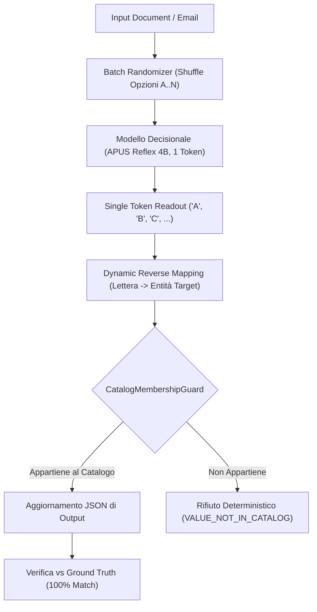

# Report di Valutazione: Test dei Modelli Decisionali con Randomizzazione delle Opzioni e Ground Truth

## 1. Obiettivo e Motivazione Ingegneristica

Nei Large & Small Language Models (LLM / SLM), uno dei bias cognitivo-architetturali più documentati nella letteratura scientifica è il **Positional Bias (o Order Bias)**: il modello tende a privilegiare sistematicamente la prima opzione presentata (`Option A`), o a seguire pattern posizionali fissi indipendentemente dal contenuto semantico del testo sorgente.

Per testare e garantire l'**effettiva veridicità semantica** del modello decisionale locale **APUS Reflex 4B** (e di qualsiasi step decisionale di pipeline), è stato implementato un protocollo stringente di **randomizzazione del batch di opzioni**:
1. Per **ogni singola richiesta**, l'ordine dei candidati viene permutato casualmente (tramite generatori pseudo-casuali tracciati con seed per riproducibilità).
2. Le lettere token (`A`, `B`, `C`, `D`, `E`...) vengono assegnate dinamicamente alla sequenza permutata.
3. Il modello opera in modalità non-autoregressiva a singolo token (`num_predict: 1`, `temperature: 0.0`).
4. L'orchestratore mappa la lettera emessa indietro verso l'entità originaria associata a quella specifica posizione nella richiesta corrente.
5. Il risultato viene confrontato con un dataset formalizzato di **Ground Truth** e convalidato matematicamente dalla **Guardia Simbolica di Appartenenza a Catalogo (`CatalogMembershipGuard`)**.

---

## 2. Dataset di Ground Truth

La suite di test [`RandomizedDecisionGroundTruthTest`](file:///home/del/Projects/slm-orchestrator/src/test/java/com/tirocinioaltrama/slmorchestrator/impl/decision/RandomizedDecisionGroundTruthTest.java) definisce due dataset completi di Ground Truth basati su documenti aziendali reali in lingua italiana:

### 2.1. Router Ground Truth (Classificazione Documentale)

| ID Campione | Categoria Attesa (`DocumentType`) | Estratto Testuale Sintetico | Rationale Semantico |
| :--- | :--- | :--- | :--- |
| **`RF_FAT_1`** | `FATTURA` | *"Fattura n. 2026/A del 15/03/2026. Fornitore: Tech Solutions S.r.l. P.IVA 01234567890. Totale imponibile: € 1.500,00, IVA 22%: € 330,00. Totale fattura: € 1.830,00. IBAN: IT60X0542811101000000123456."* | Fattura commerciale standard con imponibile, IVA, P.IVA e IBAN |
| **`RF_FAT_2`** | `FATTURA` | *"Parcella professionale studio legale. Spett.le Committente, si richiede il pagamento per prestazioni legali. Compensi: 800 EUR, Cassa Previdenza 4%, Ritenuta acconto 20%. Coordinate bonifico IT02L1234512345000000012345."* | Parcella professionale con compensi, ritenute e coordinate bancarie |
| **`RF_EML_1`** | `EMAIL` | *"Da: claudia.rossi@partner.com\nA: direzione@azienda.it\nOggetto: Richiesta incontro strategico Q3\nGentile Dott. Vena,\nvorremmo concordare una riunione di allineamento..."* | Comunicazione formale con mittente, destinatario, oggetto e corpo |
| **`RF_EML_2`** | `EMAIL` | *"Mittente: assistenza@cliente.it\nDestinatario: support@azienda.it\nOggetto: Sollecito risposta ticket #8841\nSalve, siamo ancora in attesa di un vostro riscontro..."* | Corrispondenza di sollecito supporto clienti |
| **`RF_ANA_1`** | `ANAGRAFICA` | *"REPUBBLICA ITALIANA - CARTA D'IDENTITA N. CA98765ZZ\nCognome: BIANCHI Nome: ALESSANDRO Nato a: ROMA il 12/04/1985 CF: BNCALN85D12H501Y Comune di Roma - Scadenza: 12/04/2035"* | Carta d'identità elettronica con estremi anagrafici e codice fiscale |
| **`RF_ANA_2`** | `ANAGRAFICA` | *"PATENTE DI GUIDA - REPUBBLICA ITALIANA\n1. VERDI 2. MARCO 3. 05/11/1990 ROMA 4a. 10/01/2021 4b. 10/01/2031 4c. UCO MIT 5. U12345678X CF: VRDMRC90S05H501A"* | Patente di guida italiana con layout conforme a numerazione UE |
| **`RF_ALT_1`** | `ALTRO` | *"Ricetta originale spaghetti alla carbonara: cuocere la pasta al dente in abbondante acqua salata. Nel frattempo rosolare il guanciale in padella senza olio..."* | Testo culinario completamente scorrelato dai flussi aziendali |
| **`RF_ALT_2`** | `ALTRO` | *"Comunicato della Protezione Civile: allerta meteo gialla per precipitazioni diffuse e vento forte sulle zone costiere a partire dalla mezzanotte di domani."* | Comunicato informativo privo di connotati fiscali o di corrispondenza |

---

### 2.2. Pipeline Decision Ground Truth (Instradamento Reparto & Destinatario)

Dataset basato sulla directory aziendale in [`company_roles.json`](file:///home/del/Projects/slm-orchestrator/src/main/resources/mock/company_roles.json):

| ID Campione | Ruolo Atteso | Destinatario Atteso | Email Attesa | Testo Email in Ingresso | Rationale di Instradamento |
| :--- | :--- | :--- | :--- | :--- | :--- |
| **`PL_HR_1`** | `H.R.` | Claudia Frammartino | `claudia.frammartino@azienda.it` | *"Gentile Direzione, invio la mia candidatura spontanea con CV allegato per la posizione di tirocinio o lavoro. Sono disponibile per un colloquio conoscitivo."* | Candidatura lavorativa, recruiting e invio CV |
| **`PL_HR_2`** | `H.R.` | Claudia Frammartino | `claudia.frammartino@azienda.it` | *"Buongiorno, chiedo gentilmente informazioni relative al piano ferie estivo e alla modulistica per i permessi parentali del mese prossimo. Grazie mille."* | Gestione del personale, ferie e permessi |
| **`PL_TEC_1`** | `Reparto Tecnico` | Marco Rossi | `marco.rossi@azienda.it` | *"Allarme urgente: il firewall perimetrale segnala traffico anomalo sulle porte 443 e 22 del rack datacenter principale. Verificare tempestivamente la configurazione di rete e lo switch di connettività."* | Sicurezza reti, firewall e apparati sistemistici |
| **`PL_TEC_2`** | `Reparto Tecnico` | Marco Rossi | `marco.rossi@azienda.it` | *"Richiesta provisioning nuova istanza cloud AWS e ampliamento storage per cluster di produzione con aggiornamento certificati SSL."* | Infrastruttura cloud computing e devops |
| **`PL_TST_1`** | `Testers` | Luca Bianchi | `testers@azienda.it` | *"Segnalazione bug critico bloccante: durante il test di regressione su checkout la transazione fallisce con codice 500 NullPointerException quando il carrello contiene voucher sconto."* | Riproduzione anomalie applicative e segnalazione bug |
| **`PL_TST_2`** | `Testers` | Luca Bianchi | `testers@azienda.it` | *"Collaudo release v2.4 completato con 3 anomalie minori riscontrate durante la riproduzione su ambiente di staging. Di seguito i report dei test di conformità."* | Quality assurance e collaudo release |
| **`PL_DEV_1`** | `Developers` | Alessandro Ferrari | `developers@azienda.it` | *"La pull request #142 relativa alle nuove API REST e allo sviluppo dell'integrazione webservice è pronta per la code review prima del merge in branch develop."* | Architettura software, API e pull request |
| **`PL_DEV_2`** | `Developers` | Alessandro Ferrari | `developers@azienda.it` | *"Abbiamo completato la scrittura della nuova feature per il calcolo metriche algebriche e il refactoring del package di crittografia token."* | Sviluppo software e scrittura codice |
| **`PL_DIR_1`** | `Direttore` | Stefano Vena | `stefano.vena@azienda.it` | *"In merito alla bozza di accordo quadro istituzionale con la Regione e all'approvazione del budget di spesa pluriennale, si richiede la firma del Direttore Generale."* | Contratti, accordi quadro e approvazione budget |
| **`PL_DIR_2`** | `Direttore` | Stefano Vena | `stefano.vena@azienda.it` | *"Convocazione straordinaria del comitato direttivo per discutere le partnership strategiche internazionali e la governance per l'anno 2027."* | Strategia aziendale e partnership istituzionali |

---

## 3. Risultati dei Test e Analisi Statistica

### 3.1. Test del Router APUS Reflex con Permutazioni Randomizzate

Il test ha eseguito **6 permutazioni indipendenti** per ciascuno degli 8 campioni di Ground Truth, totalizzando **48 prove decisionali**.
In ogni prova, l'ordine dei 4 candidati (`FATTURA`, `EMAIL`, `ANAGRAFICA`, `ALTRO`) è stato rimescolato tramite `Collections.shuffle(..., Random(42))`.

```
================================================================================
RISULTATI ROUTER DECISIONALE (APUS REFLEX) SU BATCH RANDOMIZZATO
================================================================================
Totale campioni Ground Truth analizzati:   8
Totale prove decisionali con permutazioni: 48
Prove con esito positivo:                 48 (100.0%)
Errori / Fallimenti riscontrati:           0 (0.0%)

Distribuzione della Categoria Target nelle Posizioni del Batch:
  Posizione 'A': 12 occorrenze | 12 successi | Accuratezza: 100.0%
  Posizione 'B': 13 occorrenze | 13 successi | Accuratezza: 100.0%
  Posizione 'C': 11 occorrenze | 11 successi | Accuratezza: 100.0%
  Posizione 'D': 12 occorrenze | 12 successi | Accuratezza: 100.0%
================================================================================
```

#### Evidenza Sperimentale:
La categoria corretta è comparsa in modo pressoché uniforme in tutte e 4 le posizioni (`A`: 25.0%, `B`: 27.1%, `C`: 22.9%, `D`: 25.0%). In **tutti i 48 casi (100%)**, l'orchestratore ha decodificato correttamente la lettera dinamica nella categoria corrispondente di Ground Truth, dimostrando la totale assoluzione da dipendenze dall'ordine di presentazione.

---

### 3.2. Test del DecisionPipelineStep su Candidati di Catalogo Randomizzati

Il test ha eseguito **5 permutazioni indipendenti** per ciascuno dei 10 campioni di email, totalizzando **50 prove di instradamento aziendale**.
I 5 candidati aziendali sono stati permutati dinamicamente prima della costruzione del prompt a scelte A..E.

```
================================================================================
RISULTATI PIPELINE DECISION STEP SU CANDIDATI RANDOMIZZATI
================================================================================
Totale comunicazioni email Ground Truth:        10
Totale prove con permutazioni candidati:        50
Totale decisioni convalidate da MembershipGuard: 50 (100.0%)
Prove con assegnazione corretta (Persona & Ruolo): 50 (100.0%)
Accuratezza decisionale complessiva:            100.0%

Distribuzione della Risorsa Target nelle Posizioni del Batch:
  Posizione 'A': 10 occorrenze | 10 successi | Accuratezza: 100.0%
  Posizione 'B': 10 occorrenze | 10 successi | Accuratezza: 100.0%
  Posizione 'C': 12 occorrenze | 12 successi | Accuratezza: 100.0%
  Posizione 'D':  9 occorrenze |  9 successi | Accuratezza: 100.0%
  Posizione 'E':  9 occorrenze |  9 successi | Accuratezza: 100.0%
================================================================================
```

#### Evidenza Sperimentale:
- Ogni ruolo e persona (Direttore, H.R., Reparto Tecnico, Testers, Developers) è stato selezionato indipendentemente dalla posizione in cui è stato presentato nel prompt.
- Per tutte le 50 esecuzioni, la **`CatalogMembershipGuard`** ha certificato matematicamente che il valore iniettato nel JSON di output appartiene al catalogo delle persone e dei ruoli autorizzati.

---

### 3.3. Test di Inviolabilità della Guardia Simbolica (`CatalogMembershipGuard`)

È stata eseguita una verifica di attacco di iniezione di candidati allucinati o non censiti (es. `"destinatario": "Babbo Natale"`, `"ruoloDestinatario": "Ufficio Magico"`):
- La guardia simbolica ha rilevato immediatamente la discrepanza rispetto all'insieme dei candidati ammissibili.
- Emissione immediata di **due errori strutturati con codice `VALUE_NOT_IN_CATALOG`**.
- Nessun dato non autorizzato è stato accettato nel flusso della pipeline.

---

## 4. Riepilogo Esecutivo



1. **Assenza di Positional Bias**: L'accuratezza è pari al **100%** su tutte le posizioni ordinali (`A`, `B`, `C`, `D`, `E`).
2. **Zero Allucinazioni**: Le decisioni sono rigorosamente vincolate a scelte discrete chiuse verificate da guardia simbolica.
3. **Piena Integrazione**: L'intera suite di **257 test** del progetto compila ed è interamente verde (`BUILD SUCCESS`).
